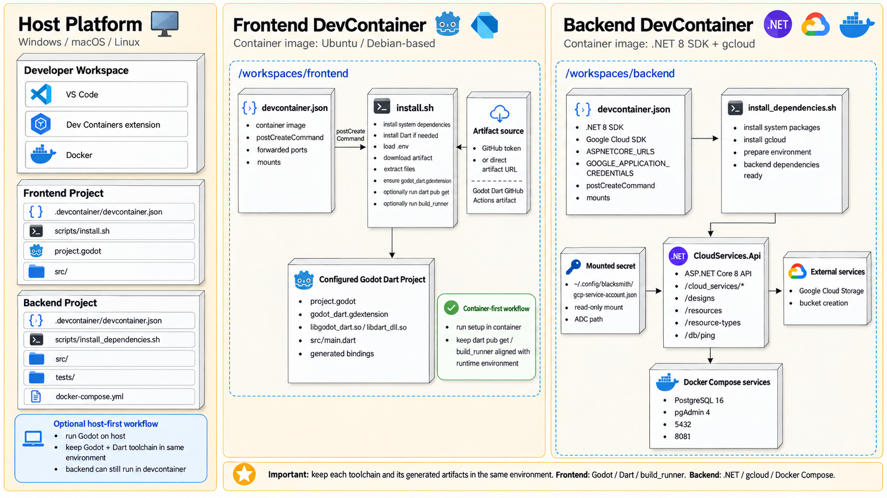

# Blacksmith

**Blacksmith** is a proof of concept for an interactive isometric cloud architecture editor built with [Godot 4](https://godotengine.org/) and [godot_dart](https://github.com/fuzzybinary/godot_dart), backed by an **ASP.NET Core 8 API** and **PostgreSQL**.

Development is **Google Cloud–first**: Google Cloud Storage bucket creation is implemented and has been manually tested against a real GCP project. The architecture is designed to remain extensible, but AWS and Azure are **not implemented**.

Project documentation:

- [Backend architecture and API contracts](docs/backend/current-architecture.md).
- [Whole-project architecture and ASCII diagrams](project_architecture.md).
- [Google Cloud Storage smoke test results and verification limits](gcs_smoke_test_report.md).

---

## 🎯 Project Context & Objectives

The main goals of this project are:

- Build an **interactive isometric grid** where resources can be placed dynamically.
- Expose a **modular cloud backend API** with separated domain, application, and infrastructure responsibilities.
- Model **designs**, **resources**, and **generic resource types** in PostgreSQL.
- Execute **real cloud operations** (currently: Google Cloud Storage bucket creation).
- Validate a **portable development workflow using devcontainers**.
- Preserve the option to support other cloud providers in the future without prematurely implementing them.

---

## 🎥 Preview (sample)

https://github.com/user-attachments/assets/6a8570f7-8b87-4de8-8a9c-fb4c8ad4aaca

---

## 🧱 Global Architecture Overview


*Conceptual overview: the illustration includes future components as well as current ones. In the current code, the cloud contract belongs to `CloudServices.Core` and its implementation to `Providers.GoogleCloud`, outside `Blacksmith.Application`. The resource type catalog is read-only; provider/metadata fields and the combined provisioning workflow shown in the image are future concepts. See the [source-based ASCII diagrams](project_architecture.md) for the implemented structure.*

### Current implementation

| Component | Implementation |
| --- | --- |
| Frontend | Godot 4 + Dart (`godot_dart`), default `Isometric3DGrid`, shared `IsomapGridBloc`; legacy 2D `AppRoot`/`IsoMapGrid`/`MenuOverlay` |
| HTTP API | ASP.NET Core 8 (`CloudServices.Api`) |
| Application | `Blacksmith.Application` services, DTOs, and repository interfaces |
| Domain | `Blacksmith.Domain`: `DesignEntity`, `ResourceEntity`, `ResourceTypeEntity` |
| Infrastructure | `Blacksmith.Infrastructure`: EF Core, Npgsql, repositories, migrations |
| Cloud integration | `CloudServices.Core` interface + `Providers.GoogleCloud` adapter |
| Database | PostgreSQL 16; pgAdmin 4 for development |
| Cloud provider | Google Cloud Storage (GCP only at present) |

The backend uses a **layered architecture with ports-and-adapters principles**. The persistence use cases go through application services and repository ports; the original Cloud Storage endpoint uses its existing `ICloudStorageService` contract and Google Cloud adapter. This is **not yet a fully unified hexagonal cloud-provisioning workflow**.

### Key API endpoints

| Endpoint | Purpose |
| --- | --- |
| `POST /designs`, `GET /designs` | Create and list designs |
| `GET /designs/{id}`, `PUT /designs/{id}`, `DELETE /designs/{id}` | Manage a design; deletion is restricted if it contains resources |
| `GET /designs/{id}/resources` | List resources belonging to one design |
| `POST /resources`, `GET /resources` | Persist resources and list all resources |
| `GET /resources/{id}`, `PUT /resources/{id}`, `DELETE /resources/{id}` | Read, update, or delete a stored resource |
| `GET /resource-types`, `GET /resource-types/{id}` | Read the generic resource type catalog |
| `GET /cloud_services/ping` | Check the cloud controller endpoint |
| `POST /cloud_services/create-bucket` | Retired (410); use authorized Save & Deploy |
| `GET /db/ping` | Database health endpoint |

### Domain and persistence

Existing Cloud Storage Resources also support a dedicated **Save-only configuration API**:
`GET` / `PUT /resources/{resourceId}/configuration`. It validates and stores a v1
JSON document without changing metadata CRUD contracts or provisioning GCP resources.
See the [configuration API contract](docs/backend/resource-configuration-api.md) for
fields, canonical defaults, limits and migration prerequisites. The 3D editor now
provides a Cloud Storage JSON configuration dialog and restores saved configurations.

Explicit local **Save & Deploy** is available for one Cloud Storage resource after target review,
consent and backend authorization. Ordinary Save and Open never provision Google resources.
See the [deployment API and recovery contract](docs/backend/storage-deployment.md) for
default-off configuration, migration prerequisites, ownership checks and retry limitations.

The backend also provides [atomic configured Resource persistence](docs/backend/resource-persistence-api.md):
client UUIDs, conditional writes, per-resource revisions, unique Design/tile occupancy,
and opt-in complete configuration read-back. The frontend uses these aggregate reads
to restore multiple Cloud Storage placements, including saved configurations.

- A **Design** contains zero or more **Resources**.
- Every persisted **Resource** belongs to exactly one **Design**.
- A **Design** with resources cannot be deleted (**restrictive deletion**).
- Each resource may reference a **ResourceType**. This reference is currently optional to preserve unknown historical resource types.
- The initial generic resource catalog contains `virtual-machine`, `storage`, `database`, `network`, `gateway`, and `load-balancer`.
- Existing resource type strings remain supported for backward compatibility.
- EF Core database migrations are applied deliberately; the API does **not** automatically apply them at startup.

**Integration boundary:** With an active Design, select an empty tile and choose
Cloud Storage from either palette to open its JSON configuration dialog.
**Save configuration** atomically persists metadata and configuration through the
Resource API/PostgreSQL; its cube appears only after canonical read-back succeeds.
Selecting a Cloud Storage tile and choosing Cloud Storage again edits that same
Resource ID/revision. **Open** restores multiple placements and their configurations
after a complete application restart. These operations do not provision GCP resources.
The other three GCP representations keep their local placement behavior. Replacing
a persisted kind or deleting it through Save remains unsupported.

---

## Local 3D editor

See [local startup and the five-cycle non-cloud smoke test](docs/local-smoke-test.md)
for host/container terminal contexts, port 5100 diagnostics, safe dependency refresh,
deployment-state semantics and isolated regression commands.

On the Ubuntu host, open the Godot editor without a deployment token:

```bash
cd frontend
bash scripts/run_local.sh
# Optional Godot arguments are forwarded unchanged.
bash scripts/run_local.sh --verbose
```

Run this on the host, outside the backend Dev Container. The launcher requires no `backend/.env` file or deployment token. It sets the project
directory and preserves existing `LD_LIBRARY_PATH` entries. The same script can be
invoked by its path from any working directory. It performs no build or deployment; prepare
the existing Dart bindings and native libraries separately as described below.

Normal Godot project startup opens `scenes/isometric_3d.tscn`. The existing 3D
scene supports selecting a tile and placing or replacing Cloud Storage,
Compute Engine, Cloud VPN and Cloud Load Balancing cubes through a native palette.
The dark workspace starts with a compact Design header and navigation rail,
leaving both optional docks closed. Open **Library** on the left rail to access
the four labelled resource placement tools. The 3D viewport fills the available
body height. **Inspect** opens selected tile/resource details and the existing Cloud
Storage configuration entry point. Selected coordinates and resource/deployment
details live in the Inspector; the existing header and dialogs keep save/deployment
feedback accessible with it closed. Both docks reserve layout space beside the
real `SubViewportContainer`; neither floats over the map. Drag their inner edge
to resize, or use their close controls without deselecting. At narrow widths,
the last requested dock takes priority; widening restores both requested docks.
The catalog retains full service labels and tooltips. The workspace and New Design
dialog share one dark UI theme. Ordinary selection does not open a dock or change
the camera framing. Configuration/deployment dialogs retain their existing modal behavior.
Other resource kinds stay in `IsomapGridBloc` memory and require no backend.
Cloud Storage configuration requires an active Design, the API and PostgreSQL;
GCP credentials are not needed. Cancel and rejected saves preserve the original
grid and JSON draft. New templates use clearly labelled example identifiers;
legacy unconfigured resources open with missing required identifiers left blank.

The **New Design** action creates a persistent Design through the existing
`POST /designs` API and displays its backend ID/name for the current session.
This action requires the API and PostgreSQL. Set `BLACKSMITH_BACKEND_URL` before
launching Godot to override `http://localhost:5100`; no GCP credentials are needed.
Unsaved placements require explicit consent before they are cleared on successful
creation. Cancellation and failures preserve them. The header Save skips confirmed
configured resources and retains transitional metadata Save for older unconfigured
local snapshots. A lost configured-write response exposes **Check Save**, which
reconciles the original Resource UUID without another write. Closing the form keeps
this session guard; no durable journal is provided for a crash during an unknown write.
Use **Copy ID**, completely quit, relaunch, then **Open** and paste that ID to restore
the saved cubes. Unsaved local changes require confirmation before Open replaces them.
See [the Dart workflow](frontend/src/README.md) for the isolated persistence test.

Prepare the Dart sources and generated bindings once, with the existing compatible
Godot/Dart native libraries installed in `frontend/`. These commands explicitly
use this VM's Dart SDK at `/usr/lib/dart/bin/dart`:

```bash
cd frontend/src
/usr/lib/dart/bin/dart pub get
/usr/lib/dart/bin/dart run build_runner build --delete-conflicting-outputs
cd ../..

# First command-line run after checkout: import native Godot resources once.
# Opening the project in the Godot editor also performs this import.
godot --path frontend --editor --import

# Normal application: actual project settings and production Dart bootstrap.
godot --path frontend

# Legacy 2D fallback, explicitly launched in its own application process.
godot --path frontend res://main.tscn

# Production-bootstrap checks, clean-launch captures and optional Linux tracing.
python3 frontend/scripts/test-godot.py --application --trace-network --timeout 600 --output /tmp/blacksmith-startup

# Existing detailed 3D and explicit legacy 2D regression fixtures.
python3 frontend/scripts/run-isometric-3d.py --check --timeout 600 --output /tmp/blacksmith-placement
python3 frontend/scripts/test-godot.py --timeout 600
```

Use Godot's **Run Project (F5)** for the default 3D editor. `main.tscn` and its
two-choice legacy palette remain available; no production 2D/3D switch is added.
The regression tools use temporary projects; normal application startup needs
neither a fixture nor test environment variables. `--trace-network` requires the
optional Linux `strace` tool. See [the Dart workflow](frontend/src/README.md) for
source-generation prerequisites.

The 3D window follows actual window dimensions, with a minimum size of
960 × 640, with at least 480 × 320 reserved for the map. Library width defaults to
216 pixels (200–304); Inspector defaults to 240 (216–304). Native containers reserve
the header, rail, visible docks and quick strip; camera framing uses the actual central render viewport and
includes the maximum cube height even on an empty board, so placement does not
change the zoom. Full application restart clears in-memory placements
and active Design selection; use Open to load a previously saved Design. See
[the Issue #44 report](issue_44_report.md) for contracts, safeguards and the real
PostgreSQL / close-and-reopen validation.

---

## 🐳 Devcontainers

Blacksmith provides frontend and backend **VS Code Dev Container** configurations. The graphical Godot editor/player may run on the host; using a frontend devcontainer does not by itself mean the GUI runs inside Docker.



*Development workflow overview: the existing frontend installer prepares Dart and the extension for Godot on the host. Running the graphical editor inside a container is not established by the current setup. The backend image supplies .NET; Google Cloud CLI is installed afterward by the setup script.*

### Frontend Devcontainer

- Dart SDK and Godot/Dart integration tooling.
- Project setup through `.devcontainer/devcontainer.json` and `scripts/install.sh`.
- Godot Dart extension artifact setup and optional `dart pub get` / `build_runner` workflow.
- Portable development approach for Linux / Windows / WSL / VM, subject to host and GUI requirements.

**Tip:** Keep `dart pub get`, code generation (`build_runner`), and the Godot/Dart runtime artifacts aligned with the environment used to build and run the frontend.

### Backend Devcontainer

- **.NET 8 SDK**.
- **Google Cloud CLI**.
- Environment configuration through `ASPNETCORE_URLS`, `GOOGLE_APPLICATION_CREDENTIALS`, and `ConnectionStrings__BlacksmithDb`.
- Dependency installation through `postCreateCommand` and `scripts/install_dependencies.sh`.
- Bind-mounted repository and access to the Compose network `backend_default`.
- GCP service-account credentials mounted **read-only from outside the Git repository**; no private key belongs in the repository.

The current backend configuration declares this bind mount unconditionally. Before creating or rebuilding the container, place a valid credential file at `~/.config/blacksmith/gcp-service-account.json` on the host. Protect the directory with mode `0700` and the file with mode `0600`. Inside the container, `GOOGLE_APPLICATION_CREDENTIALS` points to `/run/secrets/blacksmith/gcp-service-account.json`. A missing host file can prevent the configured container from starting.

After setup, check `dotnet --version` and `gcloud --version`; the initial rebuild did not automatically finish the CLI installation during the smoke test. The existing dependency script may require interactive package-installation confirmation.

### Docker Compose services

The backend's `docker-compose.yml` provides:

| Service | Image | Host port |
| --- | --- | --- |
| PostgreSQL | `postgres:16` | `5432` |
| pgAdmin | `dpage/pgadmin4:8` | `8081` |

From `backend/` on the development host:

```bash
docker compose config --services
docker compose up -d
docker compose ps
```

To validate the backend from its devcontainer terminal:

```bash
cd /workspaces/backend
dotnet build BlacksmithBackend.sln --configuration Release
dotnet test BlacksmithBackend.sln --configuration Release --no-build
```

**Testing note:** Some PostgreSQL-specific integration tests are skipped unless their isolated PostgreSQL test environment is configured. The project also includes `backend/scripts/test-postgresql.sh` for those tests. Do not run destructive migration tests against the development database.

### Running the API locally

Inside the backend devcontainer:

```bash
cd /workspaces/backend
dotnet run --project src/CloudServices.Api --urls http://0.0.0.0:5100
```

From another terminal in that container:

```bash
curl -i http://localhost:5100/cloud_services/ping
```

**Port alignment:** The retained explicit cloud client defaults to `http://localhost:5100`, matching the documented manual devcontainer smoke test. Set the API bind address and client URL consistently before explicit frontend-to-backend tests. Local editor placement does not require the backend; the previous bucket smoke test did not validate Godot connectivity.

---

## ☁️ Google Cloud Storage smoke test

The historical bucket-creation API has been manually verified using the current backend and a real GCP service account.

```http
POST /cloud_services/create-bucket?projectId=<PROJECT_ID>&bucketName=<BUCKET_NAME>
```

The user obtained a successful HTTP `200` response for a real bucket creation request through the existing **HTTP → controller → Google Cloud SDK → Cloud Storage** path. Independent checks also confirmed a successful backend build, API startup, authentication, and the required project permissions.

The user deleted the temporary bucket before independent bucket-metadata verification. The later GCS metadata request returned `404`, consistent with that deletion, so the bucket's historical location and project ownership were not independently confirmed from its metadata. See the [smoke test report](gcs_smoke_test_report.md) for the evidence and its limits.

It does **not** verify deploying a whole architecture design or automatically synchronizing PostgreSQL resources with cloud resources.

**Caution:** Bucket creation changes real cloud resources and may incur charges. The current API omits location and storage class; Google Cloud's defaults are `US` and `STANDARD`. Those are expected defaults, not verified metadata for the deleted test bucket. Confirm the target project, name, location and potential cost before creation, and clean up temporary resources deliberately after verification.

---

## 🧭 Roadmap and current limitations

- Add a separately approved, explicit **Save & Deploy** workflow with tracked cloud outcomes.
- Extend persistence beyond Cloud Storage and support deliberate resource removal/replacement.
- Keep any future deployment action explicit and separate from local architecture editing.
- Add explicit provisioning state, error handling, and recovery before combining cloud operations with database persistence.
- Introduce **ResourceConnection** later; its GitHub issue exists, but implementation is deferred.
- Continue with **GCP only**; retain modular boundaries for future providers rather than implementing placeholder AWS/Azure adapters.

For more detail, consult [the backend architecture documentation](docs/backend/current-architecture.md) and the [whole-project ASCII diagrams](project_architecture.md).
