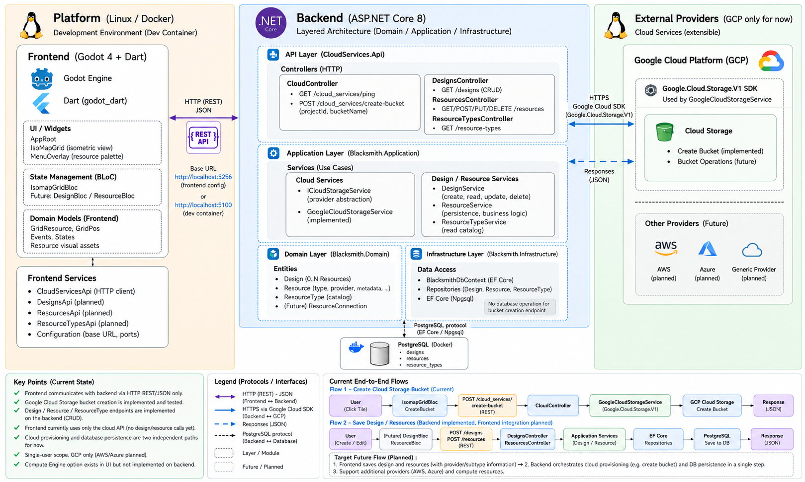

# Blacksmith

**Blacksmith** is a proof of concept for an interactive isometric cloud architecture editor built with [Godot 4](https://godotengine.org/) and [godot_dart](https://github.com/fuzzybinary/godot_dart), backed by an **ASP.NET Core 8 API** and **PostgreSQL**.

Development is **Google Cloud–first**: Google Cloud Storage bucket creation is implemented and has been manually tested against a real GCP project. The architecture is designed to remain extensible, but AWS and Azure are **not implemented**.

Project documentation:

- [Backend architecture and API contracts](docs/backend/current-architecture.md).
- [Whole-project architecture and ASCII diagrams](project_architecture.md).
- [Google Cloud Storage smoke test results and verification limits](gcs_smoke_test_report.md).

---

## 🎯 Project Context & Objectives

The main goals of this project are:

- Build an **interactive isometric grid** where resources can be placed dynamically.
- Expose a **modular cloud backend API** with separated domain, application, and infrastructure responsibilities.
- Model **designs**, **resources**, and **generic resource types** in PostgreSQL.
- Execute **real cloud operations** (currently: Google Cloud Storage bucket creation).
- Validate a **portable development workflow using devcontainers**.
- Preserve the option to support other cloud providers in the future without prematurely implementing them.

---

## 🎥 Preview (sample)

https://github.com/user-attachments/assets/6a8570f7-8b87-4de8-8a9c-fb4c8ad4aaca

---

## 🧱 Global Architecture Overview



*Conceptual overview: the illustration includes future components as well as current ones. In the current code, the cloud contract belongs to `CloudServices.Core` and its implementation to `Providers.GoogleCloud`, outside `Blacksmith.Application`. The resource type catalog is read-only; provider/metadata fields and the combined provisioning workflow shown in the image are future concepts. See the [source-based ASCII diagrams](project_architecture.md) for the implemented structure.*

### Current implementation

| Component | Implementation |
| --- | --- |
| Frontend | Godot 4 + Dart (`godot_dart`), `AppRoot`, `IsoMapGrid`, `MenuOverlay`, `IsomapGridBloc` |
| HTTP API | ASP.NET Core 8 (`CloudServices.Api`) |
| Application | `Blacksmith.Application` services, DTOs, and repository interfaces |
| Domain | `Blacksmith.Domain`: `DesignEntity`, `ResourceEntity`, `ResourceTypeEntity` |
| Infrastructure | `Blacksmith.Infrastructure`: EF Core, Npgsql, repositories, migrations |
| Cloud integration | `CloudServices.Core` interface + `Providers.GoogleCloud` adapter |
| Database | PostgreSQL 16; pgAdmin 4 for development |
| Cloud provider | Google Cloud Storage (GCP only at present) |

The backend uses a **layered architecture with ports-and-adapters principles**. The persistence use cases go through application services and repository ports; the original Cloud Storage endpoint uses its existing `ICloudStorageService` contract and Google Cloud adapter. This is **not yet a fully unified hexagonal cloud-provisioning workflow**.

### Key API endpoints

| Endpoint | Purpose |
| --- | --- |
| `POST /designs`, `GET /designs` | Create and list designs |
| `GET /designs/{id}`, `PUT /designs/{id}`, `DELETE /designs/{id}` | Manage a design; deletion is restricted if it contains resources |
| `GET /designs/{id}/resources` | List resources belonging to one design |
| `POST /resources`, `GET /resources` | Persist resources and list all resources |
| `GET /resources/{id}`, `PUT /resources/{id}`, `DELETE /resources/{id}` | Read, update, or delete a stored resource |
| `GET /resource-types`, `GET /resource-types/{id}` | Read the generic resource type catalog |
| `GET /cloud_services/ping` | Check the cloud controller endpoint |
| `POST /cloud_services/create-bucket` | Create a real Google Cloud Storage bucket |
| `GET /db/ping` | Database health endpoint |

### Domain and persistence

- A **Design** contains zero or more **Resources**.
- Every persisted **Resource** belongs to exactly one **Design**.
- A **Design** with resources cannot be deleted (**restrictive deletion**).
- Each resource may reference a **ResourceType**. This reference is currently optional to preserve unknown historical resource types.
- The initial generic resource catalog contains `virtual-machine`, `storage`, `database`, `network`, `gateway`, and `load-balancer`.
- Existing resource type strings remain supported for backward compatibility.
- EF Core database migrations are applied deliberately; the API does **not** automatically apply them at startup.

**Important integration boundary:** The current Godot frontend calls the cloud endpoint; it does **not yet** use the design/resource/catalog CRUD endpoints. Placing the Cloud Storage icon may trigger a real bucket creation, but it does not persist a `ResourceEntity` to PostgreSQL. Those are still **separate workflows**. A visual icon may remain displayed if the cloud call fails.

---

## 🐳 Devcontainers

Blacksmith provides frontend and backend **VS Code Dev Container** configurations. The graphical Godot editor/player may run on the host; using a frontend devcontainer does not by itself mean the GUI runs inside Docker.


*Development workflow overview: the existing frontend installer prepares Dart and the extension for Godot on the host. Running the graphical editor inside a container is not established by the current setup. The backend image supplies .NET; Google Cloud CLI is installed afterward by the setup script.*

### Frontend Devcontainer

- Dart SDK and Godot/Dart integration tooling.
- Project setup through `.devcontainer/devcontainer.json` and `scripts/install.sh`.
- Godot Dart extension artifact setup and optional `dart pub get` / `build_runner` workflow.
- Portable development approach for Linux / Windows / WSL / VM, subject to host and GUI requirements.

**Tip:** Keep `dart pub get`, code generation (`build_runner`), and the Godot/Dart runtime artifacts aligned with the environment used to build and run the frontend.

### Backend Devcontainer

- **.NET 8 SDK**.
- **Google Cloud CLI**.
- Environment configuration through `ASPNETCORE_URLS`, `GOOGLE_APPLICATION_CREDENTIALS`, and `ConnectionStrings__BlacksmithDb`.
- Dependency installation through `postCreateCommand` and `scripts/install_dependencies.sh`.
- Bind-mounted repository and access to the Compose network `backend_default`.
- GCP service-account credentials mounted **read-only from outside the Git repository**; no private key belongs in the repository.

The current backend configuration declares this bind mount unconditionally. Before creating or rebuilding the container, place a valid credential file at `~/.config/blacksmith/gcp-service-account.json` on the host. Protect the directory with mode `0700` and the file with mode `0600`. Inside the container, `GOOGLE_APPLICATION_CREDENTIALS` points to `/run/secrets/blacksmith/gcp-service-account.json`. A missing host file can prevent the configured container from starting.

After setup, check `dotnet --version` and `gcloud --version`; the initial rebuild did not automatically finish the CLI installation during the smoke test. The existing dependency script may require interactive package-installation confirmation.

### Docker Compose services

The backend's `docker-compose.yml` provides:

| Service | Image | Host port |
| --- | --- | --- |
| PostgreSQL | `postgres:16` | `5432` |
| pgAdmin | `dpage/pgadmin4:8` | `8081` |

From `backend/` on the development host:

```bash
docker compose config --services
docker compose up -d
docker compose ps
```

To validate the backend from its devcontainer terminal:

```bash
cd /workspaces/backend
dotnet build BlacksmithBackend.sln --configuration Release
dotnet test BlacksmithBackend.sln --configuration Release --no-build
```

**Testing note:** Some PostgreSQL-specific integration tests are skipped unless their isolated PostgreSQL test environment is configured. The project also includes `backend/scripts/test-postgresql.sh` for those tests. Do not run destructive migration tests against the development database.

### Running the API locally

Inside the backend devcontainer:

```bash
cd /workspaces/backend
dotnet run --project src/CloudServices.Api --urls http://0.0.0.0:5100
```

From another terminal in that container:

```bash
curl -i http://localhost:5100/cloud_services/ping
```

**Port alignment:** The existing Godot HTTP client is configured for `http://localhost:5256`, while the documented manual devcontainer smoke test used port `5100`. Set the API bind address and client URL consistently before testing frontend-to-backend connectivity. The previous bucket smoke test did not validate Godot connectivity.

---

## ☁️ Google Cloud Storage smoke test

The historical bucket-creation API has been manually verified using the current backend and a real GCP service account.

```http
POST /cloud_services/create-bucket?projectId=<PROJECT_ID>&bucketName=<BUCKET_NAME>
```

The user obtained a successful HTTP `200` response for a real bucket creation request through the existing **HTTP → controller → Google Cloud SDK → Cloud Storage** path. Independent checks also confirmed a successful backend build, API startup, authentication, and the required project permissions.

The user deleted the temporary bucket before independent bucket-metadata verification. The later GCS metadata request returned `404`, consistent with that deletion, so the bucket's historical location and project ownership were not independently confirmed from its metadata. See the [smoke test report](gcs_smoke_test_report.md) for the evidence and its limits.

It does **not** verify deploying a whole architecture design or automatically synchronizing PostgreSQL resources with cloud resources.

**Caution:** Bucket creation changes real cloud resources and may incur charges. The current API omits location and storage class; Google Cloud's defaults are `US` and `STANDARD`. Those are expected defaults, not verified metadata for the deleted test bucket. Confirm the target project, name, location and potential cost before creation, and clean up temporary resources deliberately after verification.

---

## 🧭 Roadmap and current limitations

- Integrate the existing **Design / Resource / ResourceType** backend API with the Godot/Dart UI.
- Persist grid placements and load the resources belonging to a selected design.
- Separate **editing a design** from **deploying cloud infrastructure**.
- Add explicit provisioning state, error handling, and recovery before combining cloud operations with database persistence.
- Introduce **ResourceConnection** later; its GitHub issue exists, but implementation is deferred.
- Continue with **GCP only**; retain modular boundaries for future providers rather than implementing placeholder AWS/Azure adapters.

For more detail, consult [the backend architecture documentation](docs/backend/current-architecture.md) and the [whole-project ASCII diagrams](project_architecture.md).
