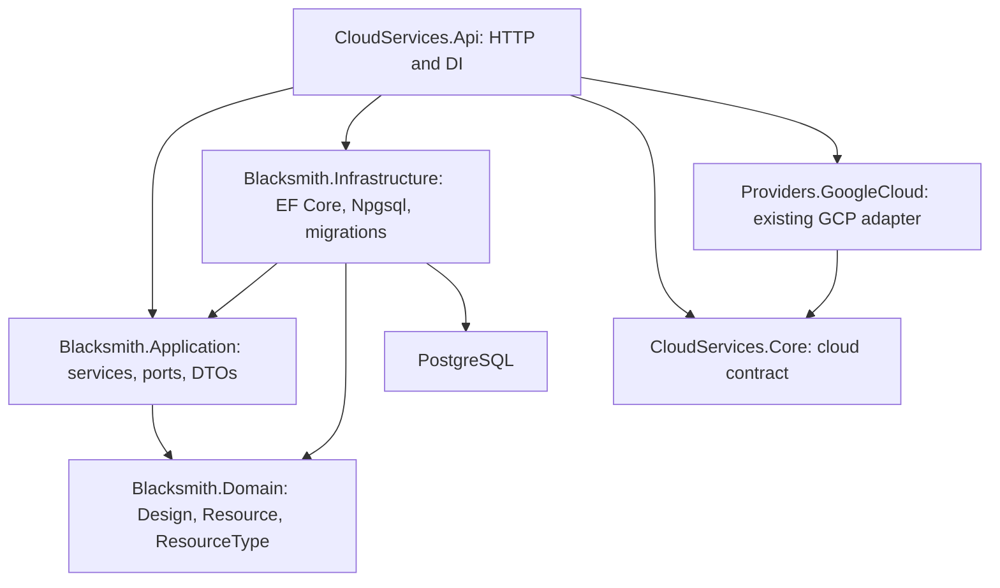
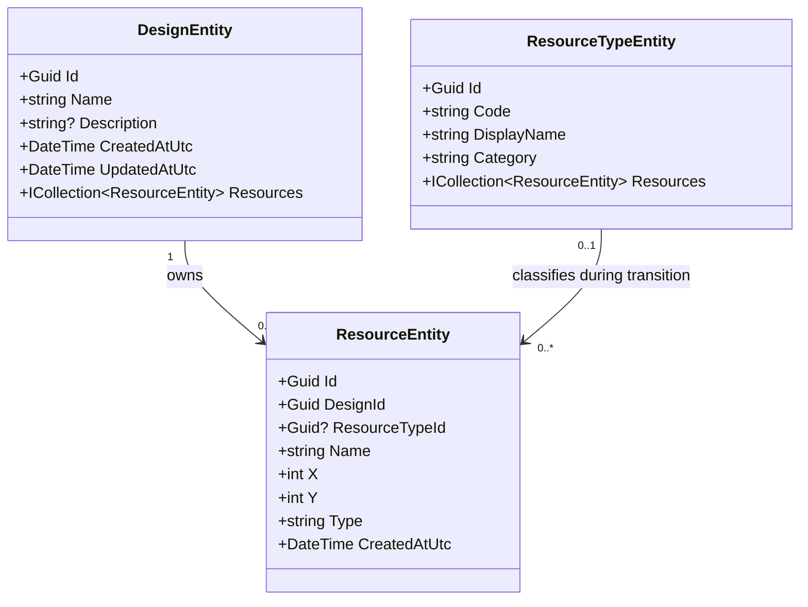
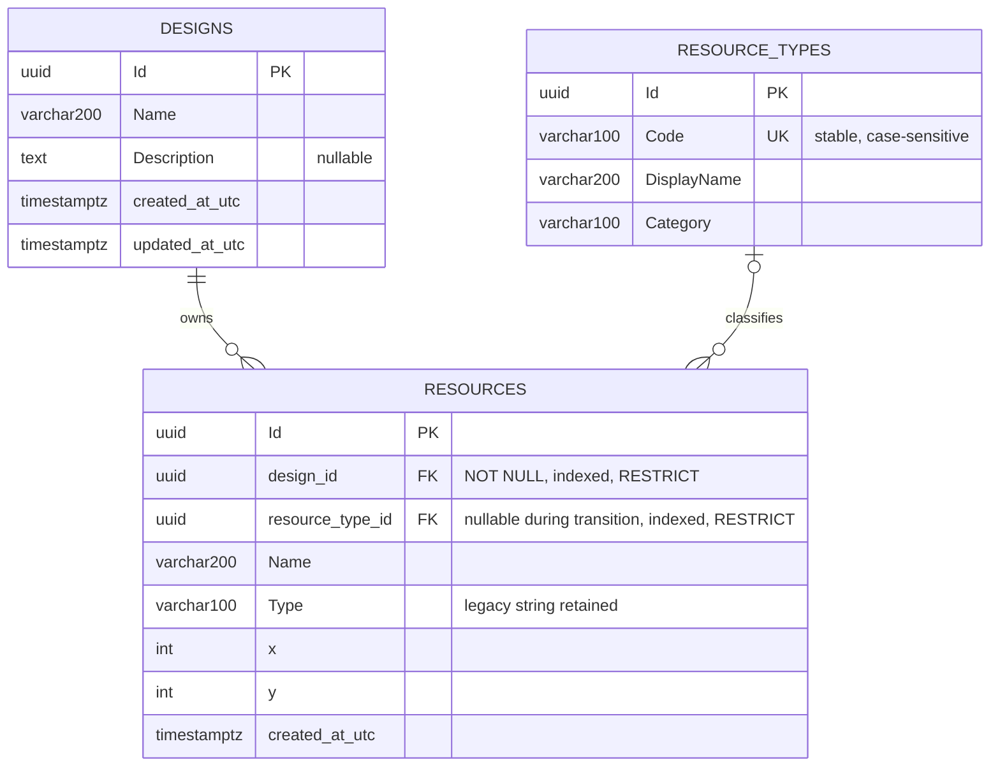

# Backend architecture — Issue #9

This document describes the backend after [Issue #9](https://github.com/dexterBEN/blacksmith/issues/9), building on the layered architecture from Issue #5 and design ownership from Issue #7. Only GCP is currently integrated; the generic catalog classifies architectural resources independently of cloud provisioning.

## Layers and dependencies



Domain has no EF, ASP.NET or cloud SDK dependencies. Application references only Domain. Controllers call services; services use repository ports; Infrastructure implements persistence and translates specific FK failures into Application exceptions. Repository ports expose neither `IQueryable` nor database exceptions.

`DesignService`, `ResourceService`, `ResourceTypeService`, their repositories and `BlacksmithDbContext` are scoped. Queries filter/sort in SQL, use `AsNoTracking` for lists/catalog reads, and propagate cancellation. Google Cloud Storage and `/db/ping` remain separate paths with their existing contracts.

## Implemented UML



Each persisted resource requires an existing design. A design may be empty. During the compatibility transition, classification is optional: every non-null `ResourceTypeId` must reference an existing catalog entry, while an unknown legacy `Type` may remain unclassified. Making every resource type reference required is a future migration, after unknown strings have been resolved explicitly.

Nullable CLR navigation properties can also indicate that a relationship was not loaded. `DesignId` itself is always required. No resource catalog class depends on a provider SDK.

Design names are trimmed, required and limited to 200 characters; duplicate names are allowed. Empty descriptions become null. Design creation sets equal UTC creation/update timestamps; updating its metadata refreshes only `UpdatedAtUtc`. Resource writes do not update that timestamp. No revision, ETag or grid-coordinate uniqueness rule is introduced.

## PostgreSQL ERD



SQL column names and existing data remain unchanged. `Code` has an actual unique constraint, `AK_resource_types_Code`. Ownership uses `FK_resources_designs_design_id` and `IX_resources_design_id`; classification uses `FK_resources_resource_types_resource_type_id` and `IX_resources_resource_type_id`. Both relations use `DeleteBehavior.Restrict` / `ON DELETE RESTRICT`. The resource type FK has no database default.

## Initial generic catalog

| UUID | Code | Display name | Category |
| --- | --- | --- | --- |
| `10000000-0000-0000-0000-000000000001` | `virtual-machine` | Virtual Machine | Compute |
| `10000000-0000-0000-0000-000000000002` | `storage` | Storage | Storage |
| `10000000-0000-0000-0000-000000000003` | `database` | Database | Data |
| `10000000-0000-0000-0000-000000000004` | `network` | Network | Networking |
| `10000000-0000-0000-0000-000000000005` | `gateway` | Gateway | Networking |
| `10000000-0000-0000-0000-000000000006` | `load-balancer` | Load Balancer | Networking |

Codes and UUIDs are stable identifiers. Display names/categories are descriptive metadata. The catalog is seeded through EF migration data and available through read-only API routes; there is no catalog mutation API.

These are generic classifications. `storage` does not identify a Google Cloud Storage bucket, and `virtual-machine` does not select a particular GCP service. No mapping, SDK call, deployment capability or provider selection is inferred from a catalog entry. Existing GCP bucket creation remains an explicit, separate HTTP operation. No AWS/Azure project, provider framework or Terraform integration is added.

## HTTP contracts

| Route | Contract |
| --- | --- |
| `GET /resource-types` | `200`, six initial entries sorted by code |
| `GET /resource-types/{id:guid}` | `200` and a catalog DTO, or `404` |
| `POST/PUT/DELETE /resource-types...` | Not supported (`405` for matching read-only routes) |
| `POST /designs` | Required name, optional description; `201`, `Location`, DTO; invalid name `400` |
| `GET /designs` | `200`, list newest first |
| `GET /designs/{id:guid}` | `200` or `404` |
| `PUT /designs/{id:guid}` | Replace metadata; `200`, `400` or `404` |
| `DELETE /designs/{id:guid}` | `204` if empty, `404` if absent, `409` if resources remain |
| `GET /designs/{id:guid}/resources` | `200`, resources belonging to the design, or `404` |
| `POST /resources` | Existing required `name`/`type` and coordinates; optional `designId` and `resourceTypeId`; `201` and existing `Location`; `400` for invalid input or conflicting known codes, `404` for a missing explicit reference |
| `GET /resources` | Existing global list, all designs, newest first |
| `GET /resources/{id:guid}` | Existing resource response or `404` |
| `PUT /resources/{id:guid}` | Existing update plus optional references; `200`, `400`, `404`; preserves identity/creation time |
| `DELETE /resources/{id:guid}` | `204` or `404`, database deletion only |

`ResourceTypeResponse` contains exactly `id`, `code`, `displayName`, `category`. `DesignResponse` contains `id`, `name`, `description`, `createdAtUtc`, `updatedAtUtc`.

Legacy resource responses retain exactly `id`, `name`, `x`, `y`, `type`, `createdAtUtc`. Resources listed by design retain these fields plus `designId`. Neither response adds `resourceTypeId` during this transition. This avoids changing the response shapes already covered by contract tests; exposing classification in a future resource DTO is a separate contract decision.

### Legacy `Type` and optional classification

`Type` remains a required free-form string. Existing validation order (`Name`, then `Type`), trimming and coordinates are preserved. The new optional UUID does not make `Type` optional.

- With an explicit `resourceTypeId`, the service verifies that the entry exists (`404` with `{"error":"Resource type not found."}` otherwise). An unknown/provider-specific legacy string can be explicitly classified by the caller without changing that string.
- If `Type` itself matches a known generic code, an explicit ID pointing to a different entry is rejected with `400` and `{"error":"Type and resourceTypeId refer to different catalog entries"}`. No partial resource mutation occurs.
- Without an explicit ID, creation resolves the trimmed legacy text only when it exactly matches a catalog code. `storage` resolves; `Storage`, `vm`, `generic` and `gcp.storage.bucket` do not.
- An update that omits the ID and leaves `Type` unchanged preserves an existing explicit classification. Changing `Type` resolves the new text again; an unknown replacement clears the old classification rather than silently keeping an unrelated one.
- `resourceTypeId: null` means omission, not an explicit request to clear classification. Invalid UUID syntax is rejected by HTTP binding; an explicitly supplied empty UUID has no corresponding catalog entry and returns `404`.

For example, `{ "name": "Bucket", "type": "gcp.storage.bucket" }` remains valid with no classification. Adding `"resourceTypeId": "10000000-0000-0000-0000-000000000002"` explicitly selects the generic Storage classification without creating a bucket or introducing an automatic provider mapping.

### Design ownership compatibility and deletion

The legacy design remains `00000000-0000-0000-0000-000000000001`, initially `Legacy design`. POSTs omitting `designId` use it; an atomic `INSERT ... ON CONFLICT DO NOTHING` recreates it if it was deleted while empty, preserving any existing edited metadata. PUTs omitting `designId` preserve the current owner. Invalid requests do not create a compatibility design as a side effect.

`DELETE /designs/{id}` deletes an existing Design together with its resources and saved configurations in one database transaction, returning `204`. Missing Designs return `404`. Any deployment history (including failed, pending and unknown outcomes) blocks the entire operation with `409` and `{"error":"Cannot delete this design: deployment history exists or its resources changed concurrently."}`. No cloud calls are made. Resource configuration rows use their existing cascade; the Design/resource and deployment/resource foreign keys remain restrictive. Concurrent resource inserts or deployment history prevent deletion and roll back all changes; revision conflicts also return `409`. If deletion wins a race against resource creation, the ownership FK prevents an orphan and becomes `404` with `{"error":"Design not found."}`. No migration is needed. Archiving and cloud destruction remain outside this endpoint.

Referenced resource types cannot be deleted in SQL either. If an unreferenced type is removed after the resource service validates it but before insertion, the classification FK prevents an orphan and becomes `404` with `{"error":"Resource type not found."}`. Only the specific ownership/classification FK violations are translated; unrelated database errors propagate normally. No delete cascades or cloud destruction occur.

## Additive migrations and rollback

The first three migrations remain unchanged. `AddResourceTypeCatalog` creates `resource_types`, seeds the six fixed entries, adds nullable `resources.resource_type_id`, backfills exact matching codes, and adds the index and restrictive FK. It preserves `Type`, all resource identities and metadata, and existing design ownership. It does not recreate the resources table.

Historical strings are matched as stored, without trimming, lowercasing or guessing aliases. For example, historical `storage` resolves, while ` storage ` and `Storage` remain unclassified with their original text untouched. Normal new HTTP writes still perform the existing trimming before resolution. Unknown strings are not assigned a fallback category or new invented catalog entries.

The API does not apply migrations at startup. Generate/review the SQL, back up the database and coordinate writes before application. Backfill, index creation and FK validation may acquire locks; no large-dataset performance claim is made.

From `backend`, with .NET 8 and `dotnet-ef` 8.0.11 installed:

```bash
dotnet ef migrations list --no-connect \
  --project src/Blacksmith.Infrastructure --startup-project src/CloudServices.Api

dotnet ef migrations script 20261019050301_AddDesignOwnership \
  --idempotent --project src/Blacksmith.Infrastructure --startup-project src/CloudServices.Api

dotnet ef migrations has-pending-model-changes \
  --project src/Blacksmith.Infrastructure --startup-project src/CloudServices.Api

# Apply only after SQL review, backup and deliberate selection of the target connection:
dotnet ef database update \
  --project src/Blacksmith.Infrastructure --startup-project src/CloudServices.Api
```

The configured connection is still `ConnectionStrings:BlacksmithDb`, overridable with `ConnectionStrings__BlacksmithDb`. No credential value is documented here.

Downgrading only the catalog migration removes classification metadata and the catalog but preserves all original resource fields and design ownership. Explicit assignments of unknown/provider-specific strings cannot be reconstructed by reapplying the migration; only exact generic-code matches are restored. Downgrading further through Issue #7 additionally loses designs and design ownership. Restore a backup if those relationships must be recovered. No user database has been migrated or downgraded by the tests.

## Frontend observations

The inspected Godot code calls `/cloud_services/ping` and `/cloud_services/create-bucket`. Its `ResourceType` enum is not serialized into persisted `Resource.Type` values, and no current `/resources` HTTP CRUD client was found. This corrects the earlier documentation's assumption that Godot already loaded the global resource list. The catalog and classification work require no frontend change.

Any future client using the global resource list must select `/designs/{id}/resources` when it needs design isolation. Classification does not itself isolate designs or add multi-user authorization.

## Tests and reproduction

```bash
dotnet restore backend/BlacksmithBackend.sln
dotnet build backend/BlacksmithBackend.sln --configuration Release --no-restore
PG_BINDIR=/usr/lib/postgresql/16/bin bash backend/scripts/test-postgresql.sh --no-build --no-restore
```

Run these commands in the backend devcontainer when available. Application tests use in-memory repository ports; HTTP tests use the real API/service/repository pipeline with SQLite and test doubles for cloud/health checks. Npgsql model checks verify the snapshot without connecting to a database.

The existing script creates a private PostgreSQL cluster under `/tmp/blacksmith-pg-tests.*`, accessible only through its local socket, runs all suites and stops only its own temporary server. It retains files/logs and does not use the application's database connection or Docker volumes. `PG_BINDIR` selects server binaries; `DOTNET_COMMAND` can select .NET.

PostgreSQL tests use `BLACKSMITH_TEST_POSTGRES` and create/drop only unique temporary databases. The supplied administrative database is never migrated or cleared. Use only an isolated test server. Without this variable, PostgreSQL cases are explicitly skipped; SQLite alone is not a complete migration/constraint validation.

See [issue_9_report.md](../../issue_9_report.md) for the implementation record, validation results and remaining limitations.
