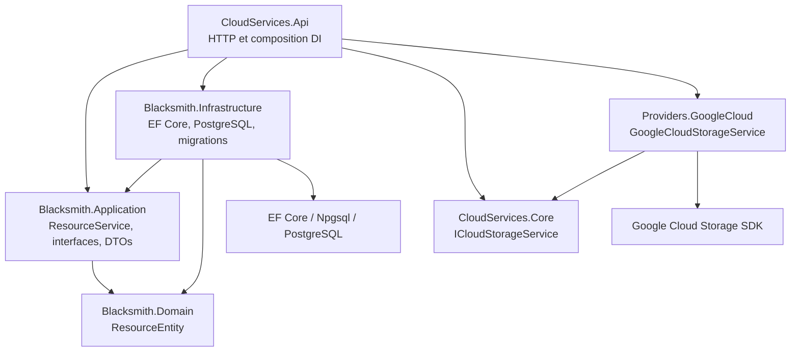

# Architecture backend — après l’issue #5

Cette page décrit le backend après la séparation des couches de l’[issue #5](https://github.com/dexterBEN/blacksmith/issues/5). Le point de départ est la branche `issue_5`, au commit `6c0a1c1`. Son code sous `backend/src` est identique à celui du commit `127edfa` analysé précédemment. Les documents d’audit précédents ne sont pas présents sur cette branche.

## Responsabilités et dépendances



Les flèches représentent les dépendances de compilation. La référence de l’API à Infrastructure sert à composer les services ; les contrôleurs utilisent les interfaces Application. À l’exécution, `ResourceService` utilise `IResourceRepository`, implémenté par `EfResourceRepository`.

| Projet | Contenu | Dépendances internes |
| --- | --- | --- |
| `CloudServices.Api` | Contrôleurs, configuration HTTP, injection des dépendances, route `/db/ping` | Application, Infrastructure, Core, provider GCP |
| `Blacksmith.Application` | Service CRUD, validation, contrats du repository et du diagnostic DB, DTOs | Domain |
| `Blacksmith.Domain` | Entité `ResourceEntity`, sans dépendance ASP.NET, EF Core ou SDK cloud | Aucune |
| `Blacksmith.Infrastructure` | DbContext, repository EF, diagnostic PostgreSQL, migrations et configuration DI | Application, Domain |
| `CloudServices.Core` | Contrat cloud existant | Aucune |
| `Providers.GoogleCloud` | Adaptateur Google Cloud Storage existant | Core |

Les projets existants conservent leurs noms. Aucun médiateur, bus de commandes, repository générique ou nouveau workflow de déploiement n’est introduit. Les concepts `Design`, `ResourceType`, `ResourceConnection` et `Deployment` restent hors périmètre.

## Gestion des ressources

`ResourcesController` traduit uniquement les résultats en réponses HTTP. Le service Application valide `Name` puis `Type`, supprime leurs espaces de début/fin, attribue l’identifiant et la date UTC à la création, et coordonne la persistance. Une `ResourceValidationException` devient une réponse HTTP `400` avec le message existant ; les exceptions de persistance ne sont pas reclassées en erreurs de validation.

`IResourceRepository` exprime une unité de travail limitée aux ressources : lecture, ajout/suppression et sauvegarde. L’implémentation EF garde les entités chargées individuellement dans le contexte de la requête pour que les modifications du service soient persistées lors de `SaveChangesAsync`. La liste utilise `AsNoTracking` et un tri SQL décroissant sur `CreatedAtUtc`. Chaque écriture réussie effectue une sauvegarde, sans transaction supplémentaire ni changement du modèle de concurrence.

Les réponses utilisent `ResourceResponse`, indépendant d’EF Core. Son JSON conserve les six propriétés existantes : `id`, `name`, `x`, `y`, `type`, `createdAtUtc`. Les classes de requête conservent leurs propriétés, types, valeurs par défaut et nullabilité. Les validations automatiques d’`[ApiController]` restent actives.

| Route | Contrat conservé |
| --- | --- |
| `POST /resources` | `201`, ressource JSON et `Location` vers `GET /resources/{id}` ; validation `400` |
| `GET /resources` | `200`, tableau trié du plus récent au plus ancien, tableau vide si nécessaire |
| `GET /resources/{id:guid}` | `200` et ressource, ou `404` |
| `PUT /resources/{id:guid}` | `200` et ressource ; identifiant/date de création conservés ; validation `400` avant recherche ; `404` si absent |
| `DELETE /resources/{id:guid}` | `204` sans contenu, ou `404` |
| `GET /cloud_services/ping` | Message existant inchangé |
| `POST /cloud_services/create-bucket` | Paramètres query `projectId` et `bucketName`, messages et intégration GCP existants |
| `GET /db/ping` | `{ "status": "ok", "dbTime": ... }`, via un diagnostic Infrastructure |

Le CRUD enregistre uniquement les ressources en base. La création d’un bucket reste un appel HTTP séparé. Le service CRUD n’a aucune dépendance vers le contrat cloud ou le provider.

## Composition DI et configuration

L’API enregistre `IResourceService` → `ResourceService` en portée `Scoped`. `AddBlacksmithInfrastructure` enregistre `BlacksmithDbContext`, `IResourceRepository` → `EfResourceRepository` et `IDatabaseHealthCheck` → `PostgreSqlDatabaseHealthCheck`, également en portée `Scoped`. L’enregistrement cloud existant reste `ICloudStorageService` → `GoogleCloudStorageService`, en portée `Scoped`.

`ConnectionStrings:BlacksmithDb` reste la source de configuration PostgreSQL ; sa variable d’environnement correspondante est `ConnectionStrings__BlacksmithDb`. Les identifiants cloud continuent à utiliser le mécanisme ADC existant du provider. Aucune valeur de credential n’est documentée ici.

`/db/ping` conserve sa requête `select now()` et sa réponse. Le diagnostic relit la chaîne de connexion depuis `IConfiguration` à chaque appel, comme auparavant. Le code Npgsql se trouve dans Infrastructure ; l’API dépend du contrat `IDatabaseHealthCheck`. Les annulations HTTP sont propagées aux opérations du repository et du diagnostic DB. Le contrat cloud reste inchangé.

## Migrations et schéma

Le DbContext et les cinq fichiers de migrations/snapshot se trouvent désormais dans `Blacksmith.Infrastructure`. Les identifiants sont inchangés :

- `20251229003351_InitialCreate` ;
- `20251229011642_AddResourcesTable`.

Les adaptations de ces fichiers se limitent aux espaces de noms CLR du contexte, des migrations et de l’entité. Les opérations `Up`/`Down` et les métadonnées SQL restent inchangées. Le nom CLR du snapshot est adapté au déplacement de l’entité, ce qui évite un faux écart de modèle.

La table reste `resources`, avec la même clé UUID, les mêmes propriétés obligatoires, les limites `Name` à 200 et `Type` à 100, les colonnes `x`, `y`, `created_at_utc` et le défaut `NOW()`. Aucune migration supplémentaire n’est créée ou appliquée.

Les paquets EF Core/Npgsql d’exécution sont portés par Infrastructure. `Microsoft.EntityFrameworkCore.Design` reste une dépendance privée de l’API, utilisée comme projet de démarrage par les outils EF. Ce paquet de conception ne sert pas à accéder à la base dans les contrôleurs.

Pour une vérification avec `dotnet-ef` 8.x installé, depuis `backend` :

```bash
dotnet ef migrations has-pending-model-changes \
  --project src/Blacksmith.Infrastructure \
  --startup-project src/CloudServices.Api
```

Le test PostgreSQL de modèle vérifie aussi cette absence d’écart sans se connecter à une base.

## Vérification

Depuis `backend`, avec le SDK .NET 8 :

```bash
dotnet restore BlacksmithBackend.sln
dotnet build BlacksmithBackend.sln --configuration Release --no-restore
dotnet test BlacksmithBackend.sln --configuration Release --no-build --no-restore
```

`Blacksmith.Application.Tests` utilise un repository en mémoire pour tester les règles et la coordination du service sans framework web, EF ou cloud. `Blacksmith.IntegrationTests` utilise le pipeline HTTP réel, le service et le repository EF avec SQLite en mémoire ; le cloud et le diagnostic DB sont remplacés. Les tests du modèle utilisent le provider Npgsql sans connexion pour contrôler les migrations et le schéma.

Cette stratégie ne valide pas une connexion PostgreSQL réelle ni les permissions/opérations GCP. Les détails des résultats, limites et observations figurent dans [issue_5_report.md](../../issue_5_report.md).
