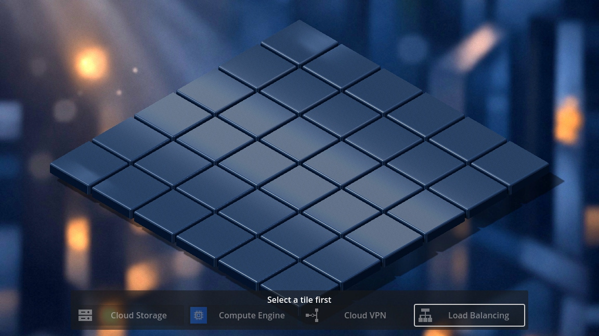
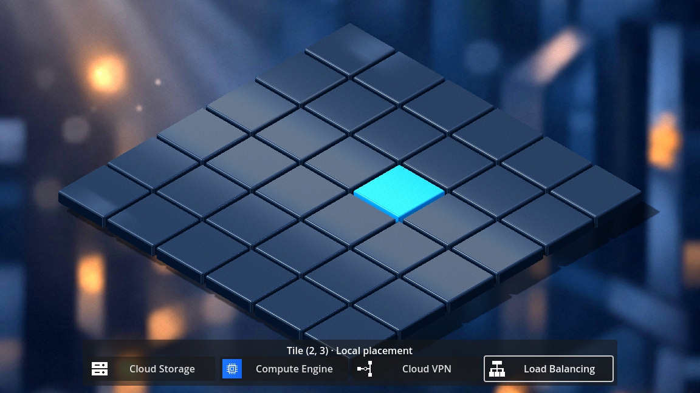
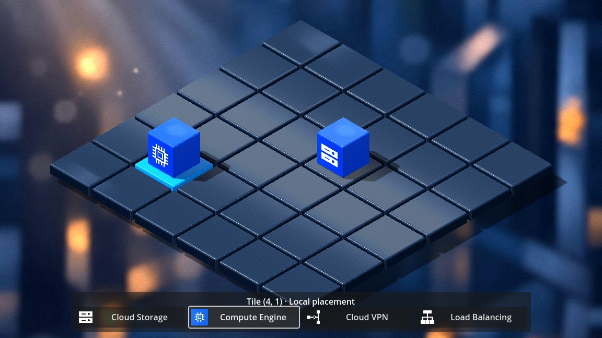
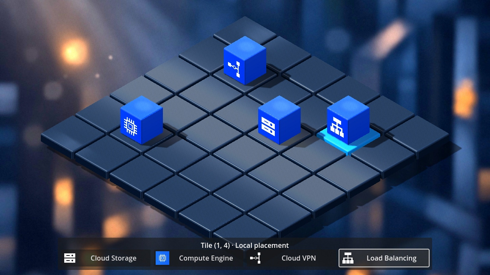
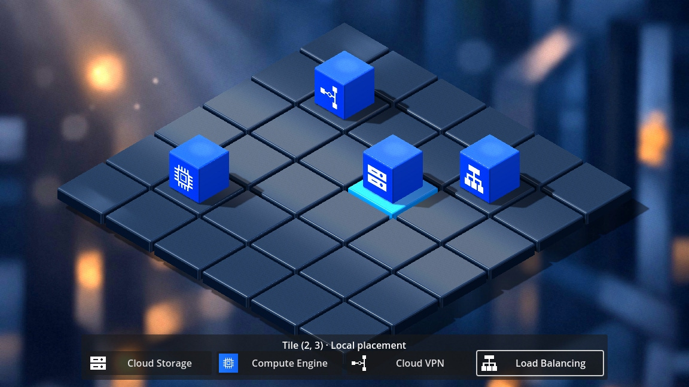
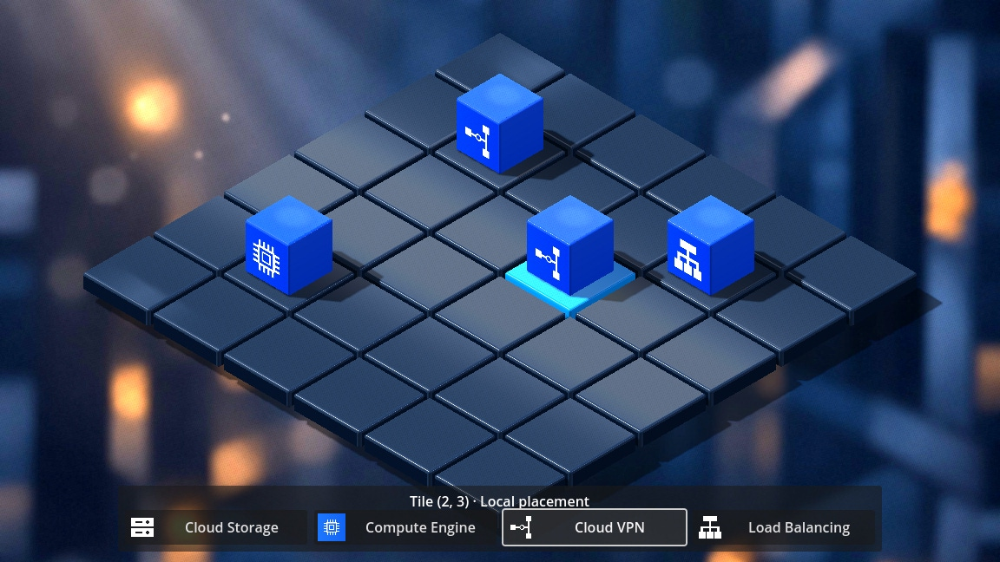

# Issue #33 — Local 3D resource placement and minimal palette

[Issue #33](https://github.com/dexterBEN/blacksmith/issues/33) · branch `issue_33`.
Based on `7fad84ae0c2b6ba7edd42f3d557560ea198f8cd9`, after switching to
`master` and running `git pull --rebase origin master`.

## Result

The existing standalone 3D scene now supports **select tile → choose resource →
place or replace a cube**. Its native bottom palette starts disabled and displays
“Select a tile first”. After selection, four illustrated choices update only the
existing `IsomapGridBloc` state. Previously occupied tiles remain unchanged.

The production `main.tscn` stays 2D. No backend, credentials, database or GCP
resources are involved. No deployment or persistence behavior was added.

## Event, state and visual mapping

```text
3D tile click → existing plane picking → GridPos(row, col) → TileClicked
                                                            │
Native palette → PlaceResource(ResourceKind) → IsomapGridBloc │
                                             state.selected / state.tiles
                                                            │
                  Isometric3DGrid ← initial state + stream ←─┘
                    ├─ selection material + palette availability
                    └─ ResourceRoot: one existing cube scene per occupied tile
```

| Native palette choice | Local `ResourceKind` | Existing asset under `assets/models/resource_cubes/` |
| --- | --- | --- |
| Cloud Storage | `cloudStorage` | `cloud_storage.tscn` |
| Compute Engine | `computeEngine` | `compute_engine.tscn` |
| Cloud VPN | `cloudVpn` | `cloud_vpn.tscn` |
| Load Balancing | `cloudLoadBalancing` | `load_balancer.tscn` |

VPN and Load Balancing needed two explicit enum entries. These identify local
GCP visuals; they are **not** backend `ResourceType` catalog values or persisted
resource mappings. The BLoC's existing generic placement handler already supports
them, so its events, state and implementation remain unchanged.

The small `resource_visuals_3d.dart` mapping belongs to the UI. Godot scene paths,
meshes, controls and HTTP/JSON handling stay outside the BLoC.

## Rendering, input and ownership

- The scene observes the complete state stream, replacing its old selection-only
  subscription. It reconstructs initial `state.tiles` before any new click.
- A render cache associates tile positions with scene nodes and kinds. It is
  derived from BLoC state, never a second placement authority. Unchanged cubes
  retain their instance IDs; changed/removed cubes are detached and queued for
  deletion. Empty tiles have no cube. Nothing is rebuilt per frame.
- Cube scenes and the existing mesh/materials are reused. Uniform scale is
  `0.68`; base height is `0.12`, exactly the tile top. Column follows +X and row
  follows +Z through the existing `GridLayout3D`. Asset rotation stays unchanged.
- A native `CanvasLayer` contains the compact palette. Its panel/buttons consume
  mouse input; the surrounding full-screen control ignores it. Four columns at
  1152 × 648 become two at 480 × 640. Availability and instruction derive from
  valid BLoC selection. Existing white SVGs and the Compute atlas supply icons;
  no duplicate icon assets are introduced.
- Native signal connections belong to the scene node. Scene exit cancels its
  subscription, drops render references, and frees native child controls/cubes.
  A shared DI BLoC survives; only a scene-created local fallback is closed.
- The launcher starts with an empty interactive scene. Its old hardcoded Dart
  cube insertion and `resource_cubes_demo.gd` are removed. The separate native
  asset-only preview remains available, with the interactive palette hidden.
  `--resource-cubes` remains a harmless compatibility alias.

Camera position/projection/fit calculation, lighting, tile geometry/materials,
background, cube art, renderer and Godot registration are unchanged.

## Changed files

| Files | Purpose |
| --- | --- |
| `frontend/scenes/isometric_3d.tscn` | Native palette, icon references and empty `ResourceRoot` |
| `frontend/src/lib/domain/models/resource_kind.dart` | Explicit local VPN and Load Balancing identities |
| `frontend/src/lib/prototypes/isometric_3d/isometric_3d_grid.dart` | Full-state observation and incremental cube rendering |
| `frontend/src/lib/prototypes/isometric_3d/resource_palette_3d.dart` | Native palette presentation, input and responsive sizing |
| `frontend/src/lib/prototypes/isometric_3d/resource_visuals_3d.dart` | Four kind-to-scene/button mappings |
| `frontend/src/test/isomap_grid_bloc_test.dart`, `resource_visuals_3d_test.dart` | Four-kind local placement/replacement and identity assertions |
| `frontend/src/test_support/isometric_3d_main.dart`, `isometric_3d_selection_checks.dart`, `isometric_3d_placement_checks.dart` | Native input, visual identity, lifecycle, fail-closed cloud checks and captures |
| `frontend/scripts/run-isometric-3d.py` | Copy existing cube dependencies by default; require placement success marker |
| `frontend/tools/resource_cubes_demo.gd` | Obsolete static Dart-demo helper removed |
| `README.md`, asset `README.md`, this report, `docs/frontend/issue_33/*.jpg` | Run instructions and seven native screenshots |

## Executed validation

| Check | Result |
| --- | --- |
| `dart analyze` | Passed, no issues |
| `dart test --reporter expanded` | 58 tests passed |
| Committed asset dependency graph | Passed: 20 files, all present in Git index |
| Windowed native Godot 3D | Passed: original structure/36-center picking, gaps, GUI interception, resize, shared reload and owned fallback cleanup |
| Native placement checks | Passed: all four actual palette buttons, correct scene identities, repeated placement, replacement, unaffected neighbors, all four corners and an edge, selection highlight, portrait palette, state removal and initial replay |
| Native lifecycle | Passed: obsolete instance IDs invalid after replacement/unload, zero listeners after exit, exactly one after reopening, shared BLoC remains open |
| Cloud safety | Passed: fail-closed repository/client report `repository_calls=0 http_requests=0` across selection, placement, state replay and reload |
| Native 2D main/diagnostic regression | Passed: both positive markers and zero repository/HTTP calls |
| Isolated static asset preview | Passed: import and `BLACKSMITH_RESOURCE_CUBES_PASSED rendered=true`, four models without interactive palette |
| Git-export checks | 58 tests and static analysis passed; 57 tracked runtime inputs match the tested 3D fixture byte-for-byte |

Positive markers include `BLACKSMITH_ISSUE33_PLACEMENT_PASSED` and the existing
`BLACKSMITH_ISSUE17_SELECTION_PASSED` / `BLACKSMITH_ISSUE17_RENDER_PASSED`.
The 3D runtime log contains no engine/script/shader error or ObjectDB leak warning.
Existing script-UID warnings fall back to text paths; the deliberate GetIt failure
in the fallback-ownership test is expected.

The existing 2D headless editor import emits Godot 4.4
`editor/progress_dialog.cpp` diagnostics despite a successful initialization
marker and exit status. Both 2D runtime logs are free of engine/script/shader
errors and ObjectDB leak warnings. An initial 2D attempt was interrupted by
SIGTERM before completion; the complete rerun passed. The 3D windowed import
and runtime checks passed without those editor progress diagnostics.

The verified frontend Git subtree is
`0cb926b4faf3c76235109be14b46a59b76cc1faa`. The export uses the existing ignored
generated bindings and package configuration as development prerequisites;
application, test and asset sources come from the candidate Git tree.

Runtime sanity sample: Dart **3.12.2**, Godot **4.4.stable.official.4c311cbee**, Compatibility,
Mesa 25.2.8 / **llvmpipe LLVM 20.1.2**, viewport 1152 × 648. With eight cubes after
the test sequence: 68 frames in 6.046 s, approximately **11.25 FPS / 88.9 ms**.
This is a short software-rendered VM sample, not a GPU benchmark or final visual
performance target. No renderer/driver changes were made.

## Reproduce

Use the existing Linux Godot/Dart native libraries, Dart packages from
`frontend/src/pubspec.lock`, local generated bindings and an X11 display.
No package/native-library upgrade is part of this change. Launchers create
temporary projects and confine Godot caches there; they do not alter the
production entry point.

```bash
# From repository root: interactive, initially empty local editor.
python3 frontend/scripts/run-isometric-3d.py

# Actual native input checks, seven JPEGs and runtime sample.
python3 frontend/scripts/run-isometric-3d.py --check --timeout 600 --output /tmp/blacksmith-placement

# Structural/input checks without screenshot evidence.
python3 frontend/scripts/run-isometric-3d.py --headless --timeout 600

# Existing 2D and isolated asset regressions.
python3 frontend/scripts/test-godot.py --timeout 600
python3 frontend/scripts/preview-resource-cubes.py --check --timeout 600 --output /tmp/blacksmith-cubes
python3 frontend/scripts/check_resource_cubes.py --require-tracked

cd frontend/src
/usr/lib/dart/bin/dart analyze
/usr/lib/dart/bin/dart test --reporter expanded
```

The headless command above is an available mode, not a claim of an additional
headless 3D run for this issue. The asset preview still requires X11 for import.
Screenshots are direct Godot JPEGs at quality 0.95, without retouching or generated
art. Logs, extra PNGs, runtime JSON, native libraries and caches stay outside Git.

## Visual evidence

Empty, no selection and disabled palette:



Selected tile, enabled palette:



Storage and Compute on different tiles:



All four service types:



The same occupied tile before and after Storage → VPN replacement:





Selected occupied corner, after corner/edge checks:


## Observations and limits

- The preserved camera fits the board, not the extra height of cubes at its rear
  corner: the highest part can clip at the viewport boundary. The bottom palette
  also overlaps part of the front corner's base/highlight. All 36 tile centers
  remain clickable in the tested landscape viewport. The occupied-corner capture
  records these limits honestly; future primary-editor layout work should reserve
  explicit camera/UI margins rather than silently changing this issue's camera.
- The 2D palette/rendering remains limited to Storage and Compute. No 2D/3D switch
  is introduced. Passing new VPN/Load Balancing state into the current 2D renderer
  is not supported; a future unified editor must explicitly extend its mapping
  or constrain that transition.
- Shared in-memory placements survive scene reload, not process restart. Local
  fallback state ends with its scene. There is no deletion UI; state-removal
  coverage uses a fixture-only state restoration method.
- Existing white-icon assets and their documented usage/provenance caveats remain
  unchanged; this issue makes no new branding or licensing claim.
- Backend `ResourceType` compatibility, Design/Resource save/load, cloud deployment,
  connections and making 3D the primary editor remain separate work.

No backend, database, Dev Container, production 2D scene/code, credential, existing
cloud resource or deferred lighting stash was changed.
