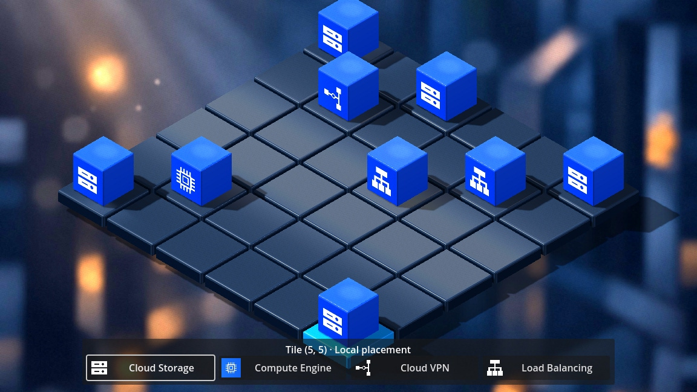
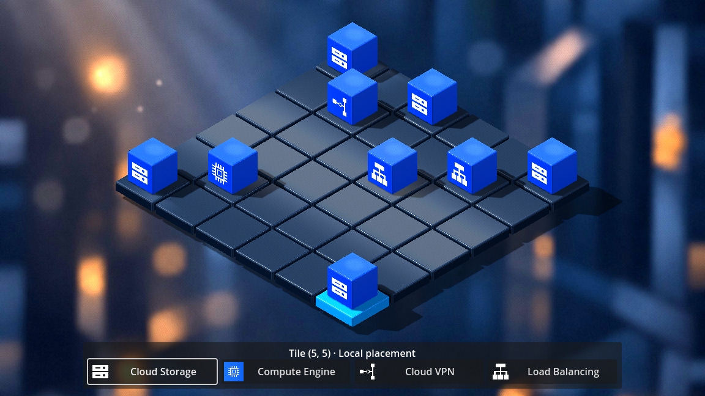
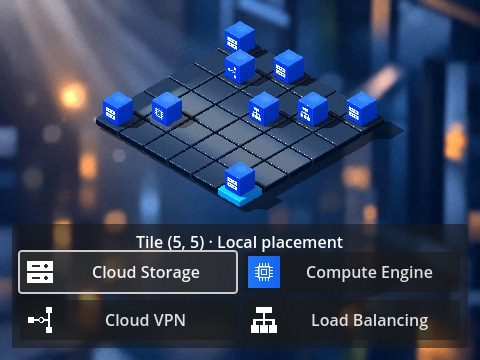
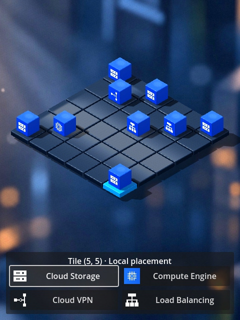
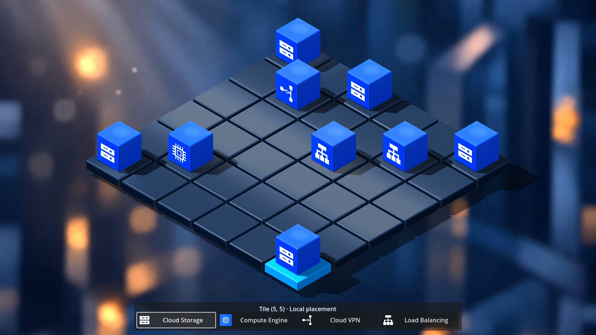

# Issue #35 — Camera framing and resource palette layout

[Issue #35](https://github.com/dexterBEN/blacksmith/issues/35) · branch `issue_35`.
Base: `885d80b8c13ec2f9e0396845717fd2a8db65c03b`, after switching to `master`
and running `git pull --rebase origin master`.

## Problem and resulting behavior

The standalone 3D camera previously fitted the board footprint to the entire
viewport. It did not reserve the palette's area or the additional height of cubes,
so the rear cube could be clipped and the foreground tile/cube could overlap the
palette. The interactive launcher also scaled a fixed internal viewport instead
of adapting its layout to the actual window.

The camera now fits the board **and maximum cube height** inside the space above
the palette. All four corners remain visible, including occupied rear and front
corners. The isometric angle, original camera transform, orthographic projection,
tile/cube geometry, materials, icons, colors and four-choice interaction remain
unchanged. The board is smaller where necessary to accommodate the safe area.

## Focused implementation

- `ResourcePalette3D.resize` returns the usable rectangle after laying out its
  existing native controls. It reserves 12 pixels around the viewport and another
  12-pixel gap above the panel. The existing four-/two-column responsive layout
  and native keyboard focus behavior remain intact.
- Button minimum sizes are updated **before** sizing their `GridContainer`.
  Returning from portrait to landscape previously retained the old wider minimum
  and pushed the last button outside its panel. Native bounds assertions exposed
  this related resize defect; the updated ordering fixes it.
- `Isometric3DGrid._fitCamera` uses a conservative envelope from board bottom
  `Y=-0.12` through cube top `Y=0.80`, including cubes on perimeter tiles. It fits
  the projected envelope to the available width/height with a 4% safety factor.
  The same envelope is used on an empty board, so placement, replacement and
  selection never trigger camera zoom/pan.
- Only orthographic size and vertical viewport offset change. The original
  `(10,10,10)` transform and fixed isometric angle remain unchanged. Native camera
  projection/ray methods handle the offset, with no manual mouse-coordinate
  correction. See the [Godot 4.4 Camera3D API](https://docs.godotengine.org/en/4.4/classes/class_camera3d.html#class-camera3d-method-get-camera-transform).
- Interactive launch now follows the actual window dimensions, with minimum
  size **480 × 360**. Fixed internal dimensions remain available for deterministic
  automated captures. Resizing drives the existing viewport signal; nothing is
  polled per frame.

There is no new BLoC, placement state, repository, input mode or UI framework.
`TileClicked`, `PlaceResource`, selection highlighting, local replacement,
incremental cube rendering and shared-state lifecycle remain unchanged.
The white button outline still indicates native keyboard focus, not an active
resource tool saved in the BLoC.

## Files changed

| File | Change |
| --- | --- |
| `frontend/src/lib/prototypes/isometric_3d/isometric_3d_grid.dart` | Fit the full height envelope above the palette; stable orthographic size/offset |
| `frontend/src/lib/prototypes/isometric_3d/resource_palette_3d.dart` | Return usable area and fix minimum-size update ordering |
| `frontend/src/test_support/isometric_3d_framing_checks.dart` | Actual native bounds, six-size picking and physical window-resize assertions |
| `frontend/src/test_support/isometric_3d_main.dart` | Responsive interactive launch; replace whole-viewport centering assertion with safe-area checks |
| `frontend/src/test_support/isometric_3d_placement_checks.dart` | Exercise framing/resizing on the existing populated scene |
| `frontend/scripts/run-isometric-3d.py` | Require positive framing and window-resize success markers |
| `README.md`, this report, `docs/frontend/issue_35/*.jpg` | Usage, results and native before/after evidence |

No scene file, production 2D code, model, material, texture, shader, BLoC, backend,
database, credential, Dev Container or renderer configuration is modified.

## Validation

| Check | Result |
| --- | --- |
| Dart analysis | Passed with no issues, including the final Git export |
| Existing Dart unit tests | 58 passed, including the final Git export; no new pure-Dart business behavior |
| Native 3D framing and interaction | Passed: 216 tile clicks over six viewport sizes, full tile/cube bounds, palette bounds, stable camera while editing |
| Physical window resize | Passed at 800 × 600 and 640 × 480, with the viewport following the native window |
| Placement and lifecycle regressions | Passed: four kinds, replacement, unaffected neighbors, replay, resource removal, shared subscription cleanup and owned fallback disposal |
| Cloud safety | Passed: `repository_calls=0 http_requests=0` |
| Native 2D regressions | Passed: main scene and diagnostic ownership markers, zero repository/HTTP calls, no runtime engine/script/shader errors or ObjectDB leak warnings |
| Asset dependency validation | Passed: 20 dependencies present in the Git index |

The new native tests project actual mesh AABB corners through the actual camera,
then compare their screen coordinates with the actual panel bounds. They also
check room for a hypothetical cube on **all 36 tiles even when empty**; they do
not merely repeat the production fitting formula.

The populated scene includes rear `(0,0)`, front `(5,5)`, left/right `(5,0)` and
`(0,5)` corners and an edge. At each size below, tests click all 36 centers and
exercise foreground placement without palette input passing through to the grid.
They verify highlighted selection, stable size/offset during editing, and all
buttons staying inside the panel.

| Internal viewport | Palette columns | Purpose |
| --- | --- | --- |
| 1152 × 648 | 4 | Existing default |
| 640 × 360 | 2 | Small landscape |
| 480 × 360 | 2 | Minimum supported launcher size |
| 800 × 600 | 2 | Intermediate landscape |
| 480 × 640 | 2 | Portrait |
| 1600 × 900 | 4 | Larger landscape |

Two additional physical window resizes, **800 × 600** and **640 × 480**, verify
that an unscaled interactive viewport actually follows the native window.
Existing selection, placement/replacement, initial state replay, resource removal
and shared/owned BLoC lifecycle checks continue to run. Fail-closed cloud doubles
reject accidental provisioning/HTTP operations.

Positive markers include `BLACKSMITH_ISSUE35_FRAMING_PASSED`,
`BLACKSMITH_ISSUE35_WINDOW_RESIZE_PASSED`, and the existing selection/placement/
render success markers. The windowed 3D import and runtime passed without engine,
script or shader errors or ObjectDB leak warnings. Existing UID fallback warnings
and the deliberately induced GetIt fallback-ownership warning remain expected.

Environment: Dart **3.12.2**, Godot **4.4.stable.official.4c311cbee**, Compatibility,
Mesa 25.2.8 and **llvmpipe LLVM 20.1.2** on the VirtualBox VM. The short final
runtime sample with eight cubes recorded 50 frames in 6.161 seconds, approximately
**8.12 FPS / 123.2 ms**. This software-rendered sanity sample is not a controlled
performance comparison with PR #34; no driver/renderer change or performance
improvement is claimed.

The final Git export passed the 58 Dart tests and static analysis. Its **58 tracked
native runtime inputs** match the tested temporary project byte-for-byte. The
2D fixture's **30 tracked runtime inputs** also match the export; existing
ignored generated bindings and package configuration are development prerequisites.
Verified frontend subtree: `fe6c72f81d02e967939ae1f14791c2ae5a54bae4`.

The unchanged 2D fixture's headless editor import still emits the known Godot 4.4
`editor/progress_dialog.cpp` diagnostics despite its successful initialization
marker and exit status. This is not an error-free headless-import claim and was
not addressed by changing engine settings or unrelated tooling.

## Run and reproduce

Use the existing Godot 4.4/Dart native libraries, generated bindings, locked Dart
packages and an X11 display. No backend, Docker service or credentials are needed.
The existing launcher creates a temporary project and keeps caches/logs outside
the repository.

```bash
# Responsive interactive window; select a tile, then choose a resource.
python3 frontend/scripts/run-isometric-3d.py

# Native interaction, bounds, window-resize checks and actual screenshots.
python3 frontend/scripts/run-isometric-3d.py --check --timeout 600 --output /tmp/blacksmith-framing

# Existing 2D regression fixture.
python3 frontend/scripts/test-godot.py --timeout 600
python3 frontend/scripts/check_resource_cubes.py --require-tracked

cd frontend/src
/usr/lib/dart/bin/dart analyze
/usr/lib/dart/bin/dart test --reporter expanded
```

## Before/after evidence

The baseline image is the actual PR #34-era Godot capture from commit `46ae307`,
preserved byte-for-byte.
Its frontend tree is identical to this issue's base `master` tree
(`0cb926b4faf3c76235109be14b46a59b76cc1faa`). No removed Issue #33 report or image
directory is restored. Before and after use the same 1152 × 648 viewport, cube
placements, selected front corner and original isometric angle.

Before: rear cube clipped and front selection obscured by the palette.



After: complete rear cube and visible foreground selection above the palette.



Minimum supported window, 480 × 360:



Portrait, 480 × 640:



Larger landscape, 1600 × 900:



These are actual native Godot captures, visually inspected after the automated
interaction checks. JPEGs are saved directly at quality 0.95, without retouching
or generated artwork. Extra captures, logs, runtime JSON, native libraries and
caches remain outside Git.

## Limits and observations

- The launcher supports a practical minimum of 480 × 360. Smaller embedded
  viewports are not promised readable controls or a usable grid. No camera
  navigation, dragging, scrolling or palette redesign is introduced.
- The height envelope assumes the four existing one-unit cubes at uniform scale
  `0.68`. Future taller models must update the envelope; native actual-mesh bounds
  checks will expose inadequate framing.
- Existing tile-plane picking is preserved. The checks exercise tile centers and
  palette clicks; separate cube mesh hit-testing is not introduced.
- The static asset-only preview keeps its own fixture camera and hidden palette;
  this issue fixes the interactive Dart scene. The production entry point remains
  the existing 2D editor.
- Local state still disappears on process restart. No persistence, deployment,
  backend request, GCP operation or resource configuration is added.
- The existing deferred-lighting stashes and unrelated branch tips are preserved.
