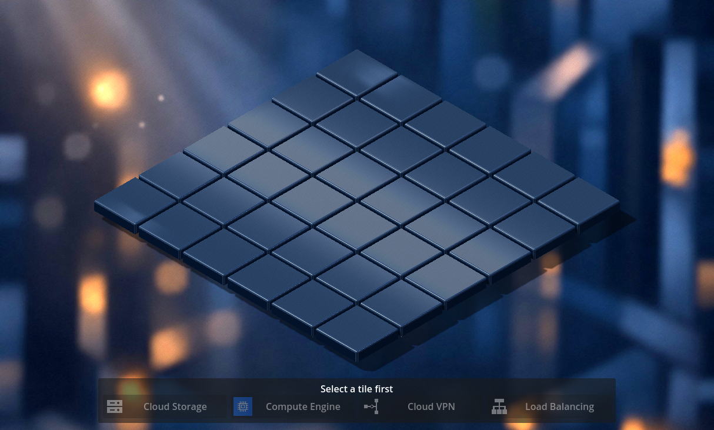
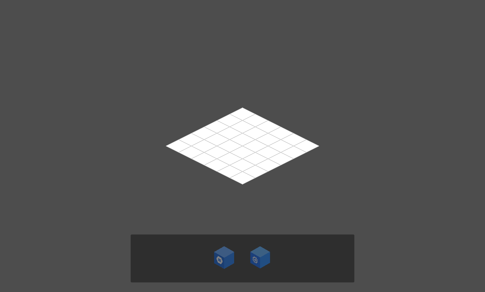

# Issue #37 — Make the existing 3D editor the application default

[Issue #37](https://github.com/dexterBEN/blacksmith/issues/37) · branch `issue_37`.
Base: `79318f94d83d611b205fa4deae17ac9afaf5df4b`, after switching to `master`
and running `git pull --rebase origin master`.

## Result and inspected startup path

Normal project startup now opens the existing interactive
`res://scenes/isometric_3d.tscn`. The former default, `res://main.tscn`, remains
available as an explicitly launched legacy 2D editor. No scene is duplicated or
renamed, and no production mode switch is introduced.

Previously, `project.godot` pointed to `uid://dgpvq7pmfx6gw`, the UID of
`main.tscn`. The standalone 3D tool copied the project, replaced its Dart entry
point with `test_support/isometric_3d_main.dart`, supplied fake selection
dependencies and overrode the main-scene setting. Its success alone therefore
did not prove normal application startup.

The existing production `src/main.dart` already initialized GetIt and registered
all four Godot script types, including `Isometric3DGrid`. The integration gap was
runtime ownership: only `AppRoot` installed the root-window hook that disposed
shared services. Making 3D the default without moving that hook would bypass it.

## Focused changes

```text
Godot project startup
  → project.godot: res://scenes/isometric_3d.tscn
  → src/main.dart: attach the existing resolver
                 initialize shared GetIt services during runtime only
  → Isometric3DGrid: resolve the shared IsomapGridBloc
                    observe selection and state.tiles
                    render the existing board, palette and cube scenes
  → scene exit: cancel that scene's subscription and free its nodes
  → root-window exit: dispose shared services once

Explicit fallback: godot --path frontend res://main.tscn
  → same production bootstrap → legacy AppRoot / IsoMapGrid / MenuOverlay
```

- `project.godot` uses the existing 3D scene's explicit resource path and retains
  Godot's normal 1152 × 648 initial defaults. Redundant explicit default dimensions
  are omitted because the editor removes them on import. The Compatibility
  renderer is unchanged.
- `src/main.dart` always attaches the existing resolver, then skips DI setup in
  editor-hint mode. Runtime still uses the unchanged lazy GetIt registrations.
  No test import, fixture flag, cloud operation or special launcher is needed.
- `core/runtime_shutdown.dart` contains the previous root-owned shutdown hook.
  Both editor roots install that same hook; its guard prevents duplicate hooks
  across scene reloads. It captures no scene instance or BLoC reference. A scene
  closes only its own fallback BLoC, retaining a shared runtime BLoC on reload.
- The 3D scene applies its existing 480 × 360 minimum window policy itself, so
  the normal entry point preserves the standalone launcher's usable layout.
- The standalone launcher no longer appends a second display-settings section;
  it reuses the project's initial dimensions. The existing 2D regression tool
  explicitly launches `res://main.tscn` now that the default has changed.
- The Dart README replaces its obsolete command-line sample text with the actual
  bootstrap and source-generation workflow. The root README documents normal
  startup, explicit fallback and verification commands.

No BLoC event/state contract, repository API, resource mapping, scene geometry,
cube model, material, icon, background, light or camera-fit calculation changes.
All four cubes retain scale `0.68`, base height `0.12`, and the tile-first editing
flow. Empty selection disables placement. Replacement retains one resource per
tile; resources remain derived from `state.tiles`.

## Repeatable verification and evidence boundaries

The existing `test-godot.py` gains an `--application` mode with three distinct
checks; the report does not conflate their startup paths:

1. **Production-bootstrap interactions.** A temporary wrapper calls the unchanged
   production `main()` function. Only cloud API/repository dependencies are
   replaced by fail-closed doubles; the real production DI creates the BLoC.
   Native clicks verify disabled placement, Storage → Compute replacement,
   repeated placement, all four services, corners, resizing, replay after reload,
   one BLoC instance, and freed obsolete nodes. The installed root-exit hook is
   emitted while the VM is still running, making asynchronous disposal observable.
   Shared BLoC/client disposal must occur once, with zero repository/HTTP calls.
2. **Clean normal application launch after those placements.** The wrapper is
   removed and production `main.dart` restored byte-for-byte. The original project
   settings are unchanged; Godot runs without an explicit scene argument, fake
   dependencies, autoload observer or test environment variables. It must reach
   the shared-BLoC 3D editor with `resources=0`, demonstrating a fresh restart.
3. **Clean explicit 2D fallback.** A fresh Godot process uses the same production
   files and `res://main.tscn` as its standard scene argument. It must reach
   `AppRoot` without a 3D editor or local diagnostic fallback.

The two clean launches use Godot's native PNG movie writer for a short frame
sequence. The final native frames become the screenshots below; no generated art,
retouching, viewport crop or test-only screenshot node is involved. See the
[Godot 4.4 movie-writer documentation](https://docs.godotengine.org/en/4.4/tutorials/animation/creating_movies.html#png).

With the optional Linux `--trace-network`, `strace` records `connect()` calls for
each application runtime. An outgoing IPv4/IPv6 connection fails the check. This
complements the logical fail-closed repository/HTTP counters; it concerns the
application processes, not unrelated Git or development-tool network activity.

The same import, normal 3D and explicit 2D commands were also executed directly
against `/home/dexter/Documents/isometric_map_test/blacksmith/frontend`, not a
temporary project. Both production source files and project settings stayed
byte-identical. Three pre-existing tracked editor-cache files changed during
import and were restored to their exact prior contents afterward. The screenshots
below come from these direct workspace launches.

| Check | Actual result |
| --- | --- |
| Fresh source generation | Passed: four previously absent generated parts and the resolver regenerated from Git sources |
| `dart analyze` | Passed, no issues, from the regenerated Git export |
| `dart test --reporter expanded` | 58 tests passed from that export |
| Production-bootstrap interactions and shutdown | Passed: one real DI BLoC, four services, replacement/replay, node cleanup, one observed BLoC/client disposal, zero repository/HTTP calls |
| Clean default 3D launch / fresh restart | Passed: intact production entry/config, shared BLoC, no saved resources, native PNG capture |
| Clean explicit legacy 2D launch | Passed: intact production entry/config and explicit scene argument, native PNG capture |
| Linux runtime network tracing | Passed: zero outgoing IPv4/IPv6 connect calls in instrumented, normal 3D and explicit 2D runtime processes |
| Existing full 3D picking/placement/framing checks | Passed headless: original 36-center/gap/input tests, all four placements/replacements, six viewport sizes and 216 additional center clicks, replay/removal, shared/owned cleanup, zero repository/HTTP calls |
| Existing 2D main/diagnostic regression checks | Passed: both explicit legacy-scene modes, shared-state reload and scene-owned reset, zero repository/HTTP calls |
| Direct launches from the actual workspace | Passed: import, default 3D and explicit 2D, untouched production entry/settings, zero outgoing IP connect calls |

All final verification jobs returned exit code 0. The normal/windowed imports
and runtime logs have no engine/script/shader errors or ObjectDB leak warnings.
The existing **headless editor imports** emit the known Godot 4.4
`editor/progress_dialog.cpp` diagnostics despite successful exit/initialization
markers. Their runtime logs are clean. Existing script-UID fallback warnings and
the deliberately induced diagnostic DI warning remain expected.

Environment: Dart **3.12.2**, Godot **4.4.stable.official.4c311cbee**, locked
`godot_dart` **0.11.0** / generator **0.9.0**, Compatibility renderer,
Mesa **25.2.8** / **llvmpipe LLVM 20.1.2**. Native processes run sequentially to
limit VM load. The final suite completed after an earlier orchestration process
received SIGTERM; no interrupted attempt is counted as a successful test.

## Generated bindings and reproducibility

The export initially contained **none** of the four ignored `.g.dart` part files.
`/usr/lib/dart/bin/dart run build_runner build --delete-conflicting-outputs` recreated all of them
using the existing locked dependencies. The resulting four parts and tracked
`godot_dart_scripts.g.dart` match the previously used bindings byte-for-byte.
No generated Dart source was recovered from another working tree for the final
export, and no generated binary/cache is committed.

The locked generator warns that its analyzer predates Dart 3.12; generation still
succeeds with the installed versions. No dependency upgrade was attempted merely
to suppress that warning. Native Godot/Dart libraries and the installed package
cache remain explicit development prerequisites.

Verified candidate frontend subtree:
`289bafc398c4e522ce8b6de46382b7f86d3562b2`.

## Launch and validation commands

From the repository root, with the existing compatible Godot/Dart native artifacts:

```bash
cd frontend/src
/usr/lib/dart/bin/dart pub get
/usr/lib/dart/bin/dart run build_runner build --delete-conflicting-outputs
/usr/lib/dart/bin/dart analyze
/usr/lib/dart/bin/dart test --reporter expanded
cd ../..

# Import Godot resources after a fresh checkout (also automatic in the editor).
godot --path frontend --editor --import

# Normal entry point; Godot Run Project (F5) is equivalent.
godot --path frontend

# Legacy fallback in its own application process.
godot --path frontend res://main.tscn

# Production bootstrap, native interactions, clean captures and optional tracing.
python3 frontend/scripts/test-godot.py --application --trace-network --timeout 600 --output /tmp/blacksmith-startup

# Existing detailed 3D and legacy 2D regression checks.
python3 frontend/scripts/run-isometric-3d.py --check --timeout 600 --output /tmp/blacksmith-3d
python3 frontend/scripts/test-godot.py --timeout 600
```

The detailed 3D regression was executed with `--headless` for this issue; the
windowed production application checks above provide actual rendering, physical
resize checks and screenshots. `--check` remains the documented windowed option.

No backend, Docker service, database or GCP credentials are required for these
editor flows. The test tools use temporary projects to keep import caches and
logs out of the working tree. `--trace-network` requires an installed `strace`;
the other checks remain usable without it. The manual application commands use
the real project, not a temporary launcher.

## Screenshots

Default 3D application, started from the actual workspace with production
`main.dart` and no scene override:



Legacy fallback, started from the same workspace using `res://main.tscn`:



Both images are original native Godot frames, visually inspected and copied
without conversion or editing. X11's window manager provided an actual
**1214 × 731** viewport despite the requested initial 1152 × 648; the normal
application adapts to that size rather than enforcing a test-only internal
resolution. Extra frame sequences, WAV files, logs and network traces stay
outside Git. Functional input coverage comes from the native interaction checks;
these static launch captures do not replace it.

## Limits and observations

- Unsaved placements survive shared-state scene reload, not process restart.
  No Design creation, persistence, resource configuration, Save/Load or Deploy
  behavior is added.
- Legacy 2D retains its two supported choices. It is launched independently;
  there is no transition that passes a populated four-kind 3D state into its
  two-kind renderer.
- Existing tile-plane picking and camera-fit behavior remain in place. New camera
  controls, mesh hit-testing and art changes are outside this issue.
- Compatibility rendering still uses VirtualBox/llvmpipe on this VM. PNG movie
  output cadence is not an interactive FPS measurement. No GPU/driver change or
  performance improvement is claimed.
- Backend, PostgreSQL, migrations, GCP resources/credentials, Dev Containers,
  deferred illumination stashes and unrelated work remain unchanged.
