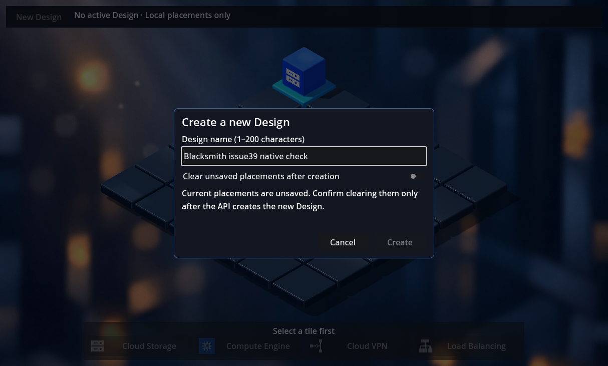
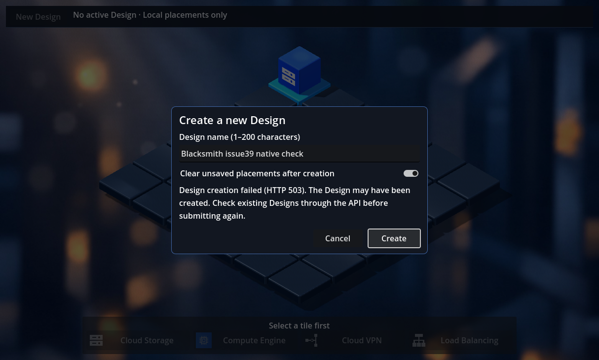

# Issue #39 — Create New Design in the 3D editor

The 3D editor now exposes **New Design**, creates a persistent Design through the
existing backend API, and displays its confirmed name. Its backend-generated ID
is retained in application state and available in the header tooltip. Local cube
placement still works without the backend and never provisions GCP resources.

## Contract inspection and architecture

Inspected `DesignsController`, `CreateDesignRequest`, `DesignResponse`,
`DesignService`, `EfDesignRepository`, and `BlacksmithDbContext` before implementation.
The existing backend is compatible and is unchanged.

| Operation | Existing contract |
| --- | --- |
| Create | `POST /designs`, JSON `{"name":"My design"}`; optional `description` is omitted by this UI |
| Success | HTTP **201**, `Location` header, JSON `id`, `name`, `description`, `createdAtUtc`, `updatedAtUtc` |
| Validation | Name required, trimmed, at most 200 UTF-16 code units; duplicate names are currently allowed |
| Read-back | `GET /designs/{id}` returns HTTP **200** and the persisted Design, or **404** |
| Errors | Service validation: **400** `{"error":"..."}`; malformed body can use ASP.NET ProblemDetails; unexpected errors can be **500** |

```text
3D scene / DesignEditor3D (native Godot controls)
    -> DesignCubit (draft, validation, pending/failure, active Design)
        -> DesignRepository (HTTP, JSON, timeout, sanitized failures)
            -> existing POST /designs
                -> DesignService -> EF repository -> PostgreSQL

API-confirmed creation + explicit discard consent
    -> ResetGridForNewDesign -> existing IsomapGridBloc -> tile/cube rendering
```

`IsomapGridBloc` keeps selection and placement responsibilities. A small separate
Cubit is appropriate because persistence, creation errors, and active Design
selection have a different lifecycle. The Cubit coordinates the one grid reset;
Godot nodes do not contain that policy. No generic repositories, DTO hierarchy,
new provider, or additional HTTP abstraction were introduced.

The repository maps only ID/name into the frontend model and validates the
successful response. It sends each POST once, has a 15-second timeout, and does
not display raw responses, exceptions, or credentials. HTTP 400, unsuccessful
statuses, unreachable backend, timeout, malformed JSON, and invalid/mismatched
success responses are handled. An uncertain outcome explicitly asks the user to
check the existing Design API before manually submitting again.

`BLACKSMITH_BACKEND_URL` configures the production bootstrap; the existing default
is `http://localhost:5100`. Design creation does not need GCP credentials.

## Editor behavior and safeguards

- A small header contains **New Design** and the current Design name. The camera
  reserves header space as well as the existing bottom palette, keeping its
  isometric angle, resource height allowance, materials, and lighting.
- A native dark dialog contains a name field, Create/Cancel, and feedback.
  Empty/whitespace/overlong names never produce a request. Enter submits a valid
  form; pending submissions disable Create, Cancel, and the name/consent controls.
- Cancellation **before submission** closes the dialog without a request. Once a
  POST is sent, cancelling it cannot reliably undo server persistence, so the
  dialog waits for success, failure, or timeout. Rendering continues throughout.
- When unsaved placements exist, creation requires explicit confirmation:
  **“Clear unsaved placements after creation.”** Only a confirmed API success
  clears placements and selection. Failure or cancellation preserves the grid
  and any previously active Design. Existing Designs are never deleted.
- While the dialog is open, a full viewport overlay consumes pointer input,
  selection ignores clicks, and palette buttons are disabled, including keyboard
  activation. Cancellation/failure dismissal restores editing.
- The shared Cubit and grid survive scene reloads. Each scene cancels its own
  subscription; runtime shutdown closes the Cubit before its repository/grid.
  A late response after disposal cannot change the active Design or clear the grid.
- Isolated 3D previews without Design DI show an unavailable New Design action;
  the normal application registers it. The legacy 2D scene remains unchanged.

## Validation results

Validation used the existing VM installation: Godot **4.4**, Dart **3.12.2**,
Compatibility rendering on Mesa/llvmpipe, .NET SDK **8.0.426** in backend Dev
Container `d26cb899e251`, and the existing PostgreSQL **16** development server.

| Check | Result |
| --- | --- |
| Fresh source generation | Passed; generated all four ignored Dart parts and the resolver, byte-identical to the existing compatible bindings |
| Dart static analysis | Passed, no issues |
| Dart unit suite | **93 passed**, including the existing regressions and Design/DI/error/timeout/disposal cases |
| Backend API and test-host builds | Passed, **0 warnings / 0 errors**; cached dependencies, no upgrades |
| Native New Design workflow | Passed with the real production bootstrap, dialog controls, cancellation, validation, pending/duplicate guard, visible failure, consent, active state, scene reload, and teardown |
| Real frontend → API → PostgreSQL | **POST 201**, backend GUID returned; **GET 200** read-back matches; independent SQL verification passed |
| Controlled native UI test | Passed; `strace` detected **zero outbound IP connections** |
| Detailed 3D regression | Passed; selection, four resource kinds, replacement/removal/replay, GUI consumption, lifecycle, six viewport sizes and **216** additional tile-center clicks |
| Legacy 2D regression | Passed in shared and scene-owned diagnostic modes; palette/selection/placement remain functional, with zero repository/HTTP calls |
| Existing asset dependency graph | Passed, **20 required tracked files** |

The reproducibility check exported staged frontend sources to
`/tmp/blacksmith-issue39-export`, copied only the existing native SDK artifacts
and package configuration, and generated bindings without copying ignored Dart
parts from the working tree. The existing generator warns about its older analyzer
versus Dart 3.12, but generation succeeds; dependencies were not upgraded.

Fresh headless editor imports still emit the previously observed Godot 4.4
`progress_dialog.cpp` diagnostics and UID-to-path fallback warnings. Import
completion markers and exit status are checked. Windowed Design imports pass;
the 3D/Design runtime checks report no script/shader errors or ObjectDB leaks.

One initial native run failed when reopening the dialog after cube placement.
The synthetic mouse helper moved and pressed without waiting for Godot's next GUI
hover update. The corrected test waits for an actual rendered frame and then the
expected state; both the live and offline workflows pass. No production-interface
change was required for this test synchronization problem. Unexpected HTTP 200/202
responses are also tested as unconfirmed creation, with no automatic retry.

### Actual persistence evidence

```text
Test API: http://172.18.0.4:5139
Database: blacksmith_front_smoke_bac623cea3454182be89582f3beb7daf
POST /designs
Payload: {"name":"Blacksmith issue39 smoke 1792805849967"}
Response: HTTP 201
Confirmed ID: 3fe28908-484a-467e-926c-970581713a6e
GET /designs/3fe28908-484a-467e-926c-970581713a6e: HTTP 200
API and SQL name: Blacksmith issue39 smoke 1792805849967
SQL resources for this Design: 0
Real creation POSTs: 1; real read-back GETs: 1
Cloud repository calls: 0; cloud HTTP calls: 0
```

SQL verification succeeded before cleanup. The test API was then stopped and
the helper confirmed deletion of **only that generated database**, including its
test Design. The normal development database, PostgreSQL/pgAdmin containers,
Docker volumes, and GCP resources were not modified by the test. The backend Dev
Container was initially stopped and was started for validation; it remains running.

### Native application captures

These are unmodified **1214 × 731** Godot viewport captures, not generated
mockups. The window manager determines the actual viewport size. The error uses
a controlled **503** response; the success image follows the **real persisted**
creation and successful API read-back above.

New Design with explicit consent required for existing local placements:



Sanitized error; the existing cube remains, with the dialog still usable:



Confirmed active Design; the local grid is empty:


## Reproduce the integration test

Prerequisites: existing Godot 4.4 / compatible native Dart extension, locked Dart
packages and generated bindings, an X11 display for native captures, Docker, and
the existing .NET 8 backend Dev Container with cached dependencies and its normal
PostgreSQL configuration. Do not supply cloud credentials for these tests.

```bash
cd frontend/src
/usr/lib/dart/bin/dart run build_runner build --delete-conflicting-outputs
/usr/lib/dart/bin/dart analyze
/usr/lib/dart/bin/dart test --reporter expanded
cd ../..

# Controlled UI cases and actual Godot screenshots; no IP connections permitted.
python3 frontend/scripts/test-godot.py --design --trace-network --timeout 600 --output /tmp/blacksmith-design-ui

# In another terminal: run the unchanged API with a uniquely named test DB.
python3 frontend/scripts/start-design-test-backend.py CONTAINER_ID --port 5139
# Note RUN_PATH and the Dev Container's reachable IP; keep this terminal running.

# One real creation POST and independent API GET from the frontend repository.
python3 frontend/scripts/test-godot.py --design --design-live http://CONTAINER_IP:5139 --timeout 600 --output /tmp/blacksmith-design-live
# Use the exact id/name from design_result.json for an independent SQL query.
python3 frontend/scripts/start-design-test-backend.py CONTAINER_ID --verify RUN_PATH DESIGN_ID 'DESIGN_NAME'

# Stop only this test API and drop only its generated test DB.
python3 frontend/scripts/start-design-test-backend.py CONTAINER_ID --stop RUN_PATH

# Existing native regressions, including explicit legacy 2D.
python3 frontend/scripts/run-isometric-3d.py --headless --timeout 600 --output /tmp/blacksmith-3d
python3 frontend/scripts/test-godot.py --timeout 600 --output /tmp/blacksmith-2d
```

The test backend helper copies only backend `.cs`/`.csproj` sources to a temporary
directory, builds the unchanged API, creates a randomly named PostgreSQL database,
and applies **existing** migrations exclusively there. The API is a real Kestrel
process. An intentionally nonexistent GCP credential path prevents use of the
mounted key. The helper prints no connection strings and removes only its own
test database on stop. It never removes containers or volumes. Temporary build
and log files remain outside the repository for inspection.

The native test invokes the unchanged production bootstrap with test-only HTTP
instrumentation. The deliberate HTTP 503 is controlled locally; live success
forwards to the real API. The BLoC/Cubit, repository, Godot scene, HTTP encoding,
API controller, EF persistence, and API/SQL read-backs use their actual implementations.

## Manual validation with the normal development services

1. Start the existing PostgreSQL service (`docker compose -f backend/docker-compose.yml up -d db`)
   and open/start the existing backend Dev Container. Use the existing migrated
   development database; this change introduces no migration.
2. Inside the Dev Container, run
   `dotnet run --project /workspaces/backend/src/CloudServices.Api --no-launch-profile --urls http://0.0.0.0:5100`.
3. From the VM, use the forwarded local port or the container's current reachable
   IP. Set `BLACKSMITH_BACKEND_URL=http://CONTAINER_IP:5100` and run
   `godot --path frontend`. An environment value must be set **before** Godot starts.
4. Open **New Design**, enter a dedicated test name, and click **Create**. Confirm
   its name in the header and obtain the ID from the tooltip.
5. Request `GET /designs/ID` against the same base URL. Confirm HTTP 200 and the
   same `id`/`name`. In PostgreSQL, query only that ID:
   `SELECT "Id", "Name" FROM designs WHERE "Id" = 'ID'::uuid;`.
6. Place a cube, reopen the dialog, and cancel. The cube must remain. Reopen,
   enter another name, and confirm the discard checkbox before successful creation.
7. To test transport failure, restart Godot with an unused local backend port.
   Attempt creation; the error must be visible and the existing grid preserved.
   Cancel to resume editing. Do not automatically repeat an ambiguous real POST.
8. For manual test-data cleanup, identify the **exact dedicated test ID** and
   verify `GET /designs/ID/resources` is empty before explicitly deleting that
   record with the existing API. There is no Design deletion UI in this change.

## Limitations and review notes

- Active Design selection is session-only. Restarting the application forgets
  it and local cubes; persistent Design records remain in PostgreSQL.
- No resources are saved or loaded, even while a Design is active. The header
  says **“Placements not saved”** to make this visible. No Design browser,
  reopening workflow, deployment, authentication change, or GCP operation is added.
- The backend permits duplicate names and has no POST idempotency key. A lost
  response can leave a persisted Design without a confirmed active selection.
  The frontend performs no automatic retry and explains that uncertainty.
- Development-container IPs can change. Configure the reachable URL instead of
  assuming the VM's localhost reaches the container directly.
- Native integration checks require the existing compatible SDK artifacts and
  display; unit tests alone cannot establish PostgreSQL persistence or rendering.
- This VM uses Compatibility rendering with VirtualBox/llvmpipe. Captures are
  functional evidence, not a hardware rendering performance benchmark.

## Affected files

- `frontend/scenes/isometric_3d.tscn` and new `isometric_3d/design_controls.tscn`:
  integrate the native header/dialog without changing scene assets or rendering.
- New `design.dart`, `design_cubit.dart`, `design_repository.dart`, and
  `design_editor_3d.dart`: model, operation state, data access, and presentation.
- `service_locator.dart`, `main.dart`, grid event/BLoC, `isometric_3d_grid.dart`,
  and `resource_palette_3d.dart`: shared lifetime/configuration, confirmed reset,
  scene subscription/input, header framing, and modal palette guard.
- New unit/native Design tests; DI/framing assertions; the existing Godot runner;
  and the isolated backend test helper (test code only).
- README/workflow documentation, this report, and the three requested native captures.

Backend production sources, database migrations, Dev Containers, resource models,
materials, shaders, Git stashes, and existing GCP resources are unchanged.

The work started from a clean tree, updated `master` with
`git pull --rebase origin master` (base `200ae3d`), and created `issue_39`.
The three pre-existing stashes and all previous work-branch tips were verified
unchanged. No shared history was rewritten and no container or volume was removed.
