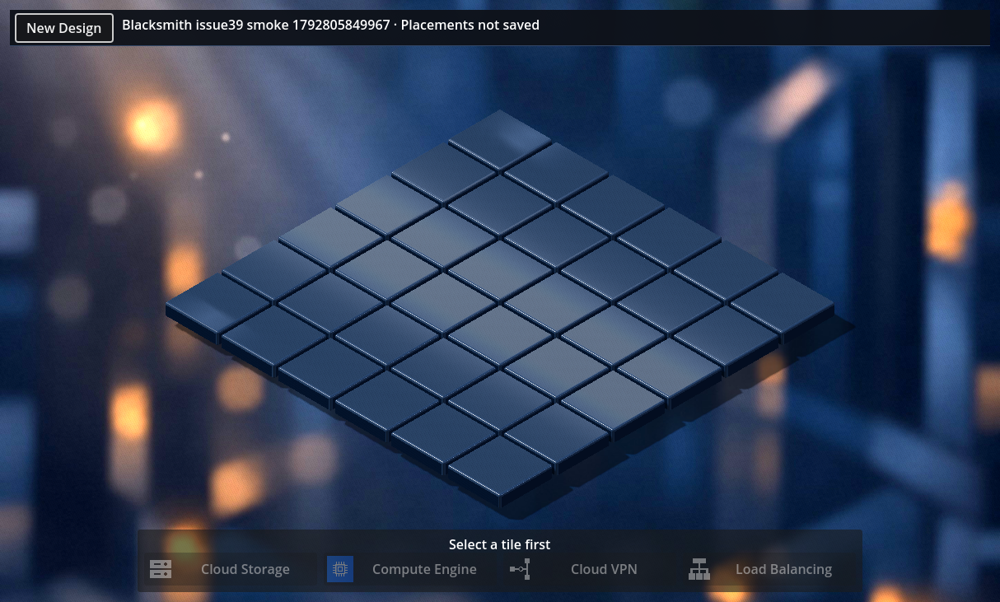
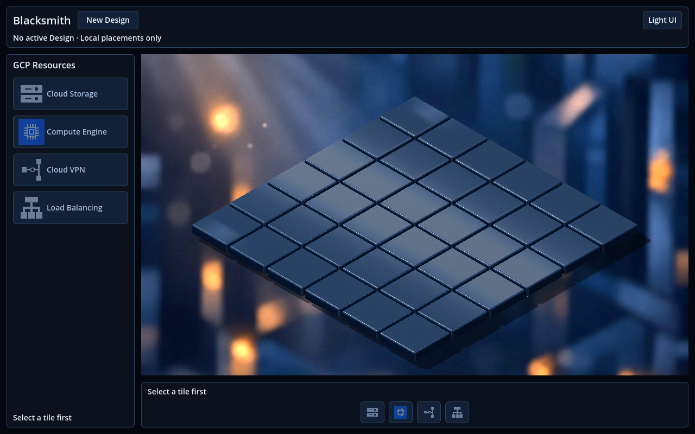
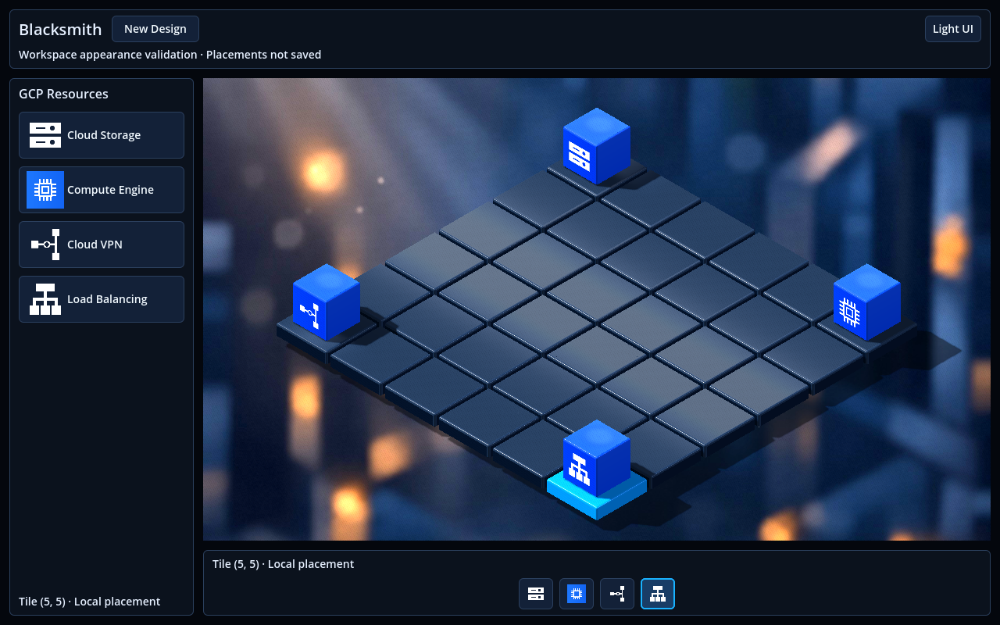
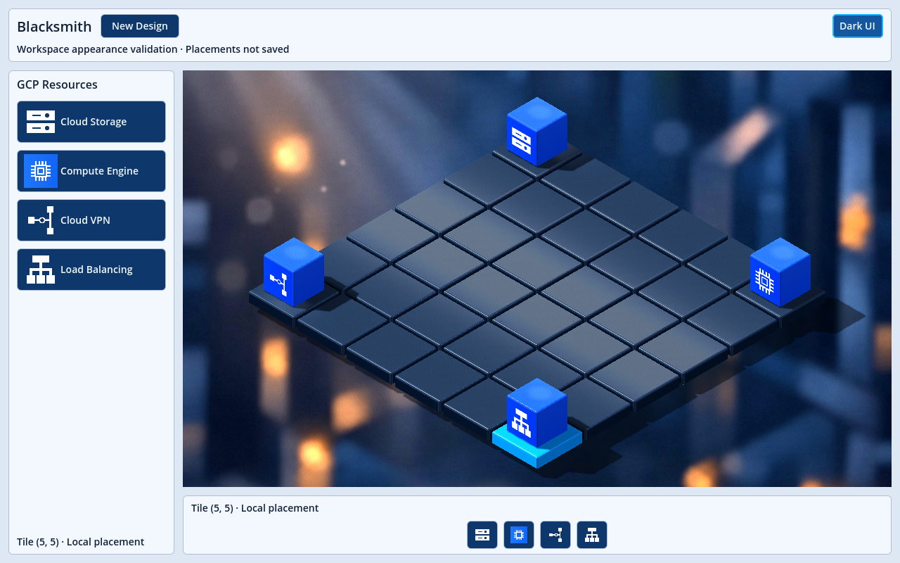
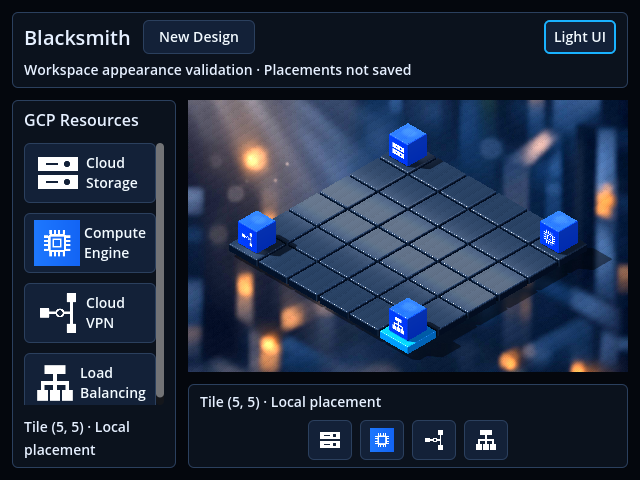

# Issue #42 — 3D workspace layout and resource sidebar

## Baseline audit and implementation decisions

The merged baseline (`c478ba7`) already has the required 6×6 grid, ray picking,
incremental cube renderer, shared `IsomapGridBloc`, and validated `DesignCubit`
creation flow. The existing palette and Design header are overlay controls; camera
fitting manually reserves their vertical offsets. There is no resource sidebar
or appearance selector. The legacy `main.tscn` remains a separate 2D regression scene.

Reuse the existing world, materials, camera transform, resource scenes/icons,
placement events, Design state, repository and API contract. Implement a native
container-based shell and a real `SubViewportContainer`/`SubViewport` canvas.
The canvas shares the existing World3D; only its camera belongs to the render
viewport. This preserves resource node lifetimes and avoids rebuilding the world.
Project clicks from the actual canvas rectangle into that viewport before ray
picking. Fit the complete tile/cube envelope against its actual dimensions.

Both resource entry points will dispatch the same existing `PlaceResource` action.
Exactly the four supported GCP services appear. Open/Save and unsupported mockup
categories are omitted. Theme switching is presentation state only; the existing
Design Cubit and grid remain authoritative.

Dark and light **UI** presets are in scope. Existing 3D materials/environment are
preserved in both, as permitted by the issue. This is not a complete pale 3D scene
theme; light tile/background presets should be a small separate follow-up.

## Result and architecture

Normal startup continues to use `scenes/isometric_3d.tscn` and the existing Dart
bootstrap. Its root and logical world nodes remain in place. The camera now
belongs to the central render viewport, which explicitly shares that original
World3D. No second grid or additional resource instances are created for the UI.

```text
Isometric3DGrid (existing scene/controller)
  GridRoot / ResourceRoot / lights / environment / backdrop (existing world)
  WorkspaceLayer
    Workspace / native containers
      Header: Blacksmith | New Design | appearance action
              active Design name / local-state guidance
      Body
        Sidebar: GCP Resources / scrollable four-service list
        Center
          SubViewportContainer -> SubViewport -> existing camera
          Quick placement: guidance + four resource shortcuts
  DesignLayer
    Existing creation dialog and modal shade

Sidebar + quick strip -> same ResourcePalette3D callback -> PlaceResource
    -> IsomapGridBloc -> existing incremental cube renderer
New Design -> existing DesignCubit -> existing repository / API
Appearance action -> Workspace3D presentation only
```

`VBoxContainer`, `HBoxContainer`, `PanelContainer`, margins and size flags reserve
actual space for each panel. The central `SubViewportContainer` stretches its
render target to its allocated rectangle. Camera fitting uses those dimensions,
with a 12-pixel inner gutter and the existing conservative cube-height envelope.
No screenshot-specific sidebar offsets enter the camera formula.

The input route rejects points outside the actual canvas, subtracts its origin
and accounts for the render-target size before using the existing camera ray and
logical tile mapping. Blank panel margins cannot select a tile behind them.
Layout and fitting react to resize signals; there is no new per-frame Dart work.

The shared-world and stretch behavior follows the native Godot 4.4
[viewport documentation](https://docs.godotengine.org/en/4.4/tutorials/rendering/viewports.html)
and [SubViewportContainer contract](https://docs.godotengine.org/en/4.4/classes/class_subviewportcontainer.html).

### Resource actions and compact layout

- Exactly four verified GCP icons and cube scenes are reused: Cloud Storage,
  Compute Engine, Cloud VPN, and Load Balancing. No model, logo, shader or 3D
  material is added or modified.
- `ResourcePalette3D` connects both lists to one existing placement callback and
  derives all eight buttons' enabled state from the same BLoC selection.
  Unavailable actions also leave the keyboard focus traversal.
- The sidebar is 236 pixels on desktop and 164 below 760 pixels of window width.
  Labels wrap in compact mode; a native vertical scroll area keeps every choice
  reachable on short windows. The four quick icons remain visible and have full
  service-name tooltips.
- The original `.68` uniform cube scale and `.12` tile-top placement are preserved.
  No pedestal, base, platform or extra node is inserted below a resource.
- Open/Save, unsupported resource categories, search, and decorative tool actions
  are omitted. This UI adds no persistence or deployment behavior.

### Appearances and Design integration

Two native Theme resources style panels, buttons, labels, text entry and tooltips.
Light mode uses pale panels with dark text and blue buttons so the existing white
service symbols stay readable. Both themes use the same layout metrics.

Switching **Light UI / Dark UI** updates the workspace and dialog theme. It does
not recreate the scene, meshes, cubes, camera, Cubit or BLoC. The UI preference is
session-only and survives scene reloads; application restart defaults to dark.
Selected tiles retain their existing cyan highlight.

The Design header was relocated into the native container layout. Its original
dialog, validation, pending state, failure feedback, discard consent and active
ID/name still come from the unchanged `DesignCubit`. Opening its modal disables
both resource entry points and appearance switching. Each scene releases its
subscriptions and presentation cache on exit; shared application services keep
their existing runtime lifetime.

**Light-scene limitation:** tiles, resource materials, lighting, reflections and
the backdrop keep the existing dark appearance. The screenshots deliberately
show this limitation. A follow-up can evaluate a pale tile/environment preset in
the same renderer, independently of layout and interaction; this issue introduces
no new material system or renderer switch.

## Validation

The validation environment is Godot **4.4**, Dart **3.12.2**, the existing Linux
`godot_dart` native libraries, and Compatibility rendering on Mesa/llvmpipe in the
Ubuntu VM. No SDK, package, renderer, or environment configuration was upgraded.

| Check | Result |
| --- | --- |
| Fresh-source bindings | Passed; no ignored parts copied, all four parts and the resolver regenerated and matched existing compatible output |
| Dart analyze | Passed, no issues |
| Existing Dart unit suite | **93 passed** |
| Existing model/texture dependency graph | Passed, **20 required tracked files** |
| Native workspace | Passed: four kinds from both entry points, replacement, tile-first guidance, active Design/selection/node preservation across both UI appearances |
| Compact/wide layout | Passed at **1280×800, 640×480, 480×360, 1920×1080**; all tile/cube bounds inside the real render region, compact choices individually scrolled into view |
| Production startup/lifetime | Passed with the real shared runtime, scene reload/teardown, then separate clean 3D and explicit legacy 2D launches |
| Existing New Design workflow | Passed with controlled 201/503 responses, validation, cancellation, duplicate prevention, discard policy, active Design display and reload |
| Detailed 3D regressions | Passed: selection, gaps/outside/GUI filtering, replacement/removal/replay, node/subscription cleanup, six viewport sizes and **216** additional tile-center clicks |
| Legacy 2D regressions | Passed in shared and scene-owned diagnostic modes; selection, palette and local placement preserved |
| Network/cloud guard | **Zero outgoing IP connect calls** across four traced runtime phases; cloud repository/HTTP tripwires remain at zero |

Validation exports only the staged frontend tree plus the already-installed
native SDK artifacts and package configuration. Godot's runtime/editor caches
are confined to temporary projects. The existing analyzer-version warning during
generation is non-blocking; dependencies remain locked.

The workspace checks capture matching dark/light views without changing camera or
resource state. The camera keeps its original orthographic transform; each cube
keeps the established scale and tile-top position. Native tests reject script,
shader and ObjectDB-leak errors and trace outgoing IP connections.

The captures are functional evidence from a software-rendered VM, not a hardware
performance benchmark. Existing fresh-project UID-to-path warnings remain; the
native runtime checks finish without errors or leaked ObjectDB instances.
Headless editor imports retain the previously observed Godot 4.4
`progress_dialog.cpp` diagnostics; exit status and explicit completion markers
are checked. The normal windowed imports pass without those diagnostics.

The unit suite is unchanged: this issue adds no business rules. Native checks
cover the new geometry, input routing, two resource entry points, appearance
invariants, compact catalog navigation and existing Design interaction instead
of adding unit tests that mirror style constants.

Reproduce with the existing compatible Godot 4.4 / native `godot_dart` artifacts,
Dart SDK and locked dependencies. Native captures require an X11 display;
`--trace-network` uses the installed `strace`. No backend or cloud account is
required for these checks.

```bash
cd frontend/src
/usr/lib/dart/bin/dart pub get
/usr/lib/dart/bin/dart run build_runner build --delete-conflicting-outputs
/usr/lib/dart/bin/dart analyze
/usr/lib/dart/bin/dart test --reporter expanded
cd ../..

# Production bootstrap + workspace interactions + clean 3D/legacy startup.
python3 frontend/scripts/test-godot.py --application --trace-network --timeout 600 --output /tmp/blacksmith-workspace

# Existing validated New Design dialog/HTTP contract, controlled responses only.
python3 frontend/scripts/test-godot.py --design --trace-network --timeout 600 --output /tmp/blacksmith-design

# Detailed grid, placement, framing and legacy regression fixtures.
python3 frontend/scripts/run-isometric-3d.py --headless --timeout 600 --output /tmp/blacksmith-3d
python3 frontend/scripts/test-godot.py --timeout 600 --output /tmp/blacksmith-2d
```

The instrumented application test uses the real production bootstrap and real
grid/Design state components. An explicitly invoked local Design repository
fixture supplies an active Design for theme-preservation assertions. It does not
write to PostgreSQL or send HTTP. Cloud dependencies reject operations and native
IP connections are traced. The separate clean launches restore the original
production entrypoint and contain no fixture wrapper.

### Manual checks

1. Import/open `frontend/project.godot` and run F5, or use `godot --path frontend`.
2. Confirm both sets of resource actions are unavailable without a selected tile.
3. Select a tile and place/replace all four kinds using the sidebar and quick strip.
4. Place cubes at the front/back edge tiles. Resize the window, including a compact
   shape; the board and all cube extremities must remain inside the central canvas.
5. Switch UI appearances. Selection, cube positions/types and the active Design
   must remain unchanged. The 3D scene intentionally remains dark.
6. Shrink the window to 480×360 and scroll the catalog to reach each service.
7. With the existing backend running and `BLACKSMITH_BACKEND_URL` configured as
   needed, use New Design. Its existing cancel/error/confirmation behavior must
   remain usable. Without a backend, local editing and appearance changes still work.
8. Launch the unchanged 2D fallback explicitly: `godot --path frontend res://main.tscn`.

## Native visual evidence

All images below are actual unmodified Godot viewport captures. The before image
is the original Issue #39 capture, byte-identical to the file published in
`24f1234` (the baseline UI is unchanged in merged `c478ba7`). Its active Design
came from that issue's real persistence test. New workspace captures use a local
fixture Design solely to verify state preservation and are not persistence evidence.

Before, 1214×731 — original overlay header and bottom palette:



Dark workspace, 1280×800, no selection:



Dark workspace with four edge resources and a selected tile:



Light UI at the same 1280×800 resolution, camera and placement state:



Compact workspace, 640×480, with native catalog scrolling:



## Scope and affected files

- Existing `isometric_3d.tscn` and `design_controls.tscn`: camera viewport and
  relocation of header controls; original world nodes remain in place.
- New `workspace_controls.tscn`, `workspace_dark.tres`, `workspace_light.tres`:
  native layout and UI theme resources.
- New `workspace_3d.dart`; existing grid/palette/Design presentation helpers and
  resource metadata: container geometry, appearance, canvas mapping and shared UI.
- Existing native integration helpers: updated camera/panel lookup and projected
  window coordinates. New `workspace_checks.dart`: workspace and state invariants.
- Existing `test-godot.py`: native evidence output and required workspace pass marker.
- README/workflow, this report and the requested native captures.

No backend, database, Dev Container, domain BLoC/Cubit, repository, API contract,
Godot renderer configuration, asset model, material or shader changes. No cloud
operation, shared-history rewrite, stash modification, container or volume removal.

The work started with a clean tree, switched to `master`, ran
`git pull --rebase origin master` and created `issue_42` from `c478ba7`.
The three existing stashes and all prior work-branch tips were checked unchanged.
All final frontend sources match the exported sources used for validation.
