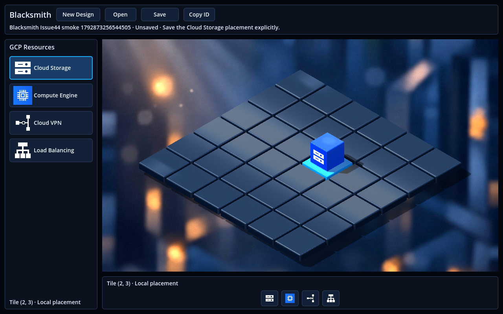
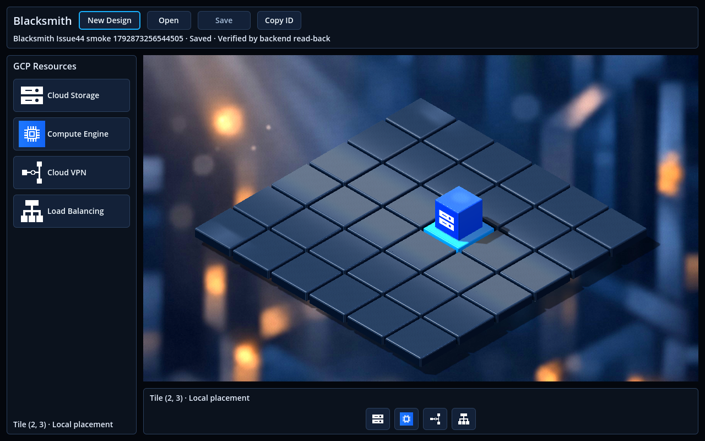

# Issue #44 — Persistent 3D Design workflow

Explicit Save and Open-by-ID now connect the 3D editor to the existing ASP.NET Core
API and PostgreSQL. The supported slice is an empty Design or **one Cloud Storage
representation**. Saving metadata never creates a GCP bucket.

## User workflow

1. Create a Design with New Design; the API supplies its ID.
2. Select row **2**, column **3**, then choose Cloud Storage from either palette.
3. Press Save. Only a successful Design/resource read-back marks the snapshot saved.
4. Use Copy ID, completely quit the application, relaunch, and Open that ID.
5. The persisted Cloud Storage cube returns on the same logical tile.

Save is disabled without an active Design, without a valid supported placement,
while busy, and when the current snapshot is already confirmed. Other GCP kinds
and multi-resource arrangements remain available locally but are not persisted.
Replacement/deletion synchronization is explicitly unsupported. Open requires
confirmation before replacing unsaved placements; read failures preserve the
previous Design and grid. A changed local snapshot during Save remains unsaved.

## Verified existing contracts and mapping

| API | Contract used / inspected |
| --- | --- |
| `POST /designs` | `{name, description?}` → 201; backend-generated GUID, name, description, UTC timestamps |
| `GET /designs`, `GET /designs/{id}` | Existing Design list/read DTOs; Open uses the ID read |
| `POST /resources` | `designId`, `resourceTypeId`, `name`, integer `x`/`y`, `type` → 201, backend-generated Resource GUID |
| `GET /resources`, `GET /resources/{id}` | Legacy response omits Design/type FK fields |
| `GET /designs/{id}/resources` | Ownership-scoped records with `id`, `designId`, `name`, `x`, `y`, `type`, `createdAtUtc` |
| `PUT /resources/{id}`, `DELETE /resources/{id}` | Existing full update/delete; production UI does not add synchronization |
| `GET /resource-types`, `GET /resource-types/{id}` | `id`, `code`, `displayName`, `category`; resolve the `storage` ID at runtime |

Catalog codes are `virtual-machine`, `storage`, `database`, `network`, `gateway`,
and `load-balancer`. Cloud Storage uses the existing provider-specific legacy
value **`gcp.storage.bucket`**, explicitly associated with generic catalog code
**`storage`**. Backend tests already exercise this provider value, and the service
accepts an explicit catalog ID for it. No new catalog entry or invented GUID is
introduced. Generic `type=storage` alone is not assumed to mean GCP Cloud Storage.

Coordinates map **`x = column = 3`, `y = row = 2`**, independently of camera or
screen coordinates. Backend coordinates are integers and historically unbounded;
frontend reads validate actual grid bounds. Missing/wrong ownership, unknown types,
malformed records and multiple records/duplicate positions are rejected before
hydration, rather than partly loading or silently discarding data.

Neither Resource read DTO exposes `resourceTypeId`; SQL independently verifies that
foreign key. Designs with Resources use Restrict-delete. Resource IDs are generated
by the backend, not assigned by the frontend.

## Responsibilities and lifecycle

```text
Godot header / dialog → DesignCubit → DesignRepository / ResourceRepository
                                         → existing API → PostgreSQL
Sidebar / quick placement → IsomapGridBloc → existing 3D renderer
DesignCubit → validated RestoreDesignResources event → IsomapGridBloc
Grid tile changes → DesignCubit feedback only (no automatic HTTP)
```

DesignCubit remains the one coordination point: it snapshots placements for Save,
tracks confirmed server state and write uncertainty, and hydrates only after all
Open reads succeed. Its one grid subscription is cancelled on shutdown. The grid
BLoC remains the sole visible tile/selection state; hydration clears selection.
Repositories own HTTP/JSON and catalog/record validation, with no Godot dependency.
GetIt owns both repositories and shared state with their existing runtime lifetime.

The dark theme, standard sidebar, all four local resource choices, native layout
containers, SubViewport canvas, camera fitting, input mapping and legacy 2D scene
are preserved. Header additions are Save, Open and Copy ID; the existing dialog
handles creation or ID entry. No renderer/model/shader/provider change.

## Duplicate prevention and agreed limit

The existing API has no idempotency token or unique `(design_id, x, y)` constraint.
The user explicitly chose **the existing API with guarded read-back recovery**.
No backend production change or migration was made.

- Save preflights the current Design and scoped Resources. An existing matching
  single record is adopted, not duplicated. Conflicting data is not overwritten.
- Pending/unchanged repeated saves issue no additional POST. A 201 alone does not
  confirm persistence: Design and scoped Resource reads must also match.
- An ambiguous write retains a per-Design attempt guard. Check Save performs reads
  only; an empty/error read does not prove that a delayed commit cannot still occur.
  Positive matching reconciliation clears uncertainty without another POST.
- The guard survives scene reload and switching dialogs/Designs within the shared
  runtime. It is not a server idempotency key or a durable cross-process journal.
  Exactly-once writes across crashes, concurrent clients or external writers are
  **not guaranteed** by this API. Restarting must not be treated as proof that an
  uncertain write failed. Backend idempotency remains a separate follow-up.

## Validation and provenance

Feature commit: `91c2ff4`. Corrected native test harness: `e6a16b4`.
Validated frontend Git tree: `605fb04ff78dd4645c17c58d607c7a7c2f1a6f53`.
Sources come from a reproducible Git export. Ignored Dart parts are generated
fresh; installed native artifacts and package configuration are supplied as
explicit environment prerequisites. The native retry reuses imported Godot assets
only after byte-comparing production code, scenes and models to the corrected
export; generated binding inputs/output remain identical.

Environment: Godot **4.4**, Dart **3.12.2**, Compatibility/Mesa llvmpipe on the VM,
.NET **8.0.426** in existing Dev Container `d26cb899e251`, and PostgreSQL **16**.
The stopped Dev Container was restarted; the graphical Godot tests run on the host.
The existing API was compiled and run against a new unique test database using
only existing migrations. The API process was given an unusable GCP credential
path. Cloud repository/HTTP tripwires and a metadata-only HTTP allowlist were active.

| Check | Actual result | Wall time (seconds) |
| --- | --- | ---: |
| Fresh Dart bindings | Passed, exit 0 | 139.6 |
| Dart analysis | Passed, exit 0 | 3.3 |
| Dart tests (122) | Passed, exit 0 | 14.5 |
| Native Save / full quit / Open | Passed, exit 0 | 799.4 |
| Independent PostgreSQL read-back | Passed, exit 0 | 1.4 |
| Production startup / workspace | Passed, exit 0 | 1064.2 |
| New Design regressions | Passed, exit 0 | 381.6 |
| Detailed 3D regressions | Passed, exit 0 | 230.5 |
| Legacy 2D regressions | Passed, exit 0 | 190.4 |

Durations include cold compilation and imports; these are not performance benchmarks.
The unit suite includes the original 93 tests plus 29 persistence tests: catalog,
coordinates/payload, invalid records, failed/ambiguous writes, empty read-back after
201, lost response after commit, duplicate clicks, failed Open, shutdown and reinit.

### Network and regression guards

Four offline runtime phases have **zero outgoing IP connections**. The two real
persistence phases connect only to the dedicated local API (`172.18.0.4:5144`),
with **zero external destinations** and cloud repository/HTTP counters **0**.
The live traces contain 6 local API connect calls total.
Detailed framing validates six desktop sizes, 216 tile-center selections, complete
cube bounds and panel separation, including the configured 960×640 minimum.
Local four-kind placement/replacement, replay/removal, node disposal and both
shared/local 2D modes pass.

### Real desktop / API / SQL evidence

- Saved Design: `e7f03eae-f51a-4a70-baf4-806bca36222b`.
- Resource: `7c0352d8-b611-4d4c-9810-3bddcc610d06`.
- API writes: one `POST /designs` → **201**, one `POST /resources` → **201**.
- Before successful Save, the harness deliberately redirected one read to a missing
  Design ID. The real backend returned **404**; the unsaved cube remained visible
  and no Resource POST was sent by the failed attempt. The next explicit Save
  recovered successfully. This is deliberate fault injection, not a production
  request rewrite.
- Save process **77031** fully exited. Open process **79625** began with
  an empty grid and no active Design, then restored the exact original cube.
- Open, local replacement/reversion and scene reload sent **0 Resource POSTs and
  0 Design POSTs**. Old cube nodes were freed; one current cube remained.
- Scoped API read-back and independent SQL before/after Open agree on this result:

```json
{
  "resource_id": "7c0352d8-b611-4d4c-9810-3bddcc610d06",
  "design_id": "e7f03eae-f51a-4a70-baf4-806bca36222b",
  "x": 3,
  "y": 2,
  "type": "gcp.storage.bucket",
  "resource_type_id": "10000000-0000-0000-0000-000000000002",
  "catalog_code": "storage",
  "count": 1
}
```

Real desktop captures at 1280×800, unmodified Godot viewport output:





### Failures and diagnostics

The first native attempt on `91c2ff4` timed out before form submission because the
harness used `LineEdit.setText()` without emitting `text_changed`. Godot intentionally
does not emit that signal for programmatic text changes. `e6a16b4` fixes the harness
using the same input signal pattern as existing tests, and guards the deferred
scene reload. Production code was unchanged by this test correction. The corrected
Save/quit/Open journey passes. All further results above reflect actual exit codes.

The binding generator's existing analyzer-version warning and Godot UID-to-path /
V-Sync warnings are recorded in the temporary logs. Runtime logs contain no `ERROR`, script/shader error or ObjectDB leak messages.
Headless 3D and legacy editor imports each print eight existing
`progress_dialog.cpp` errors while exiting 0 with required completion markers;
these editor diagnostics are distinct from the clean runtime results. The legacy
diagnostic mode intentionally exercises the missing-DI fallback and passes.

## Cleanup and reproduction

Dedicated database: `blacksmith_front_smoke_0772d0fd232e4f979f883fb052d18865`. Test data was verified by exact fixture
Design name and scoped Resource ID before deletion. Actual cleanup statuses:
parent deletion while nonempty **409**, Resource deletion **204**, empty Design
deletion **204**; both IDs then returned **404**. The test API was stopped and its
owned database was dropped (`BLACKSMITH_DESIGN_BACKEND_CLEANED` recorded).
The development database and GCP resources were not modified. No container or
volume was removed. The existing Dev Container was restarted and remains running.

With the existing SDK/caches, database configuration and Dev Container available:

```bash
python3 frontend/scripts/start-design-test-backend.py CONTAINER --port 5144
# Retain its RUN_PATH; obtain the container's numeric local IP.
python3 frontend/scripts/test-godot.py --persistence http://CONTAINER_IP:5144 --trace-network --timeout 900 --output /tmp/blacksmith-persistence
python3 frontend/scripts/start-design-test-backend.py CONTAINER --verify-resource RUN_PATH DESIGN_ID
# Delete only that owned Resource, then its Design, through the API.
python3 frontend/scripts/start-design-test-backend.py CONTAINER --stop RUN_PATH
```

Dart checks: fresh `build_runner build --delete-conflicting-outputs`, `dart analyze`,
`dart test --reporter expanded`. Existing native checks: `test-godot.py --application
--trace-network`, `test-godot.py --design --trace-network`,
`run-isometric-3d.py --headless`, and `test-godot.py` for legacy 2D.

Local evidence is under `/tmp/blacksmith-issue44-final-validation`,
`/tmp/blacksmith-issue44-final-persistence`, `/tmp/blacksmith-issue44-final-application`,
`/tmp/blacksmith-issue44-final-design`, `/tmp/blacksmith-issue44-final-3d`, and
`/tmp/blacksmith-issue44-final-2d`. The native retry driver is
`/tmp/blacksmith-issue44-native-retry.py`; the ordinary committed driver includes the
corrected harness for fresh reproduction. Temporary logs are not durable artifacts;
the selected results and two real captures are published with this report.

## Branch / scope

Started clean on `issue_42`, switched to `master`, ran `git pull --rebase origin
master` (fast-forward to `1f3f9f6`), then created `issue_44`. All three existing
stashes and unrelated branch tips are preserved. No automatic merge.

No backend production, schema/migration, GCP provisioning, new provider,
configuration forms, resource connections, account/authentication, batch saving,
move/delete synchronization or rendering refactor is included.

## Follow-up: preserve the viewport when saving in the Godot editor

An editor save exposed a scene-ownership defect: `isometric_3d.tscn` added
`WorldViewport` and its `Camera3D` below a descendant of the instanced workspace,
without marking that instance editable. They worked when the scene was loaded
directly, but Godot's scene packing could omit them when saving the parent.
The local editor-saved file had lost both declarations. The subsequent Dart
viewport lookup returned null and its non-null assertion failed during startup.

Both nodes now belong directly to `workspace_controls.tscn`, under its existing
`Canvas`. The parent scene no longer declares them. Their settings and full
runtime paths are preserved; Dart, camera fitting, input mapping, BLoC/Cubit,
backend operations and layout behavior are unchanged. Existing local editor/theme
changes are retained rather than discarded.

`test-godot.py --application` now runs `check-workspace-scene-save.gd` in its
temporary project after importing resources. It instantiates both real scenes
with `PackedScene.GEN_EDIT_STATE_MAIN`, packs/saves/reloads them twice and checks
the viewport/camera. The following graphical application checks run against those
saved files. This covers the ownership round trip missed by the original
runtime-only validation. The source checkout is never re-saved by this test.

Follow-up results on 2026-10-24, from the corrected working tree on `issue_44`:

- Dart analysis: passed, no issues.
- Dart unit tests: all 122 passed.
- Workspace/parent save and reload: passed, both nodes retained.

The first test-launcher attempt used `--editor --script`; its scene assertions
passed, but Godot reported editor progress-dialog and shutdown leaks. The launcher
now runs `--script` with the explicit editor instantiation flag, avoiding an
unneeded editor UI lifecycle. The corrected save/reload check exits cleanly.
An initial sandbox-only Dart telemetry permission failure was resolved by
re-running with SDK filesystem access. Neither failure required production Dart
changes. Bindings were not regenerated because no Dart signatures changed.

Two initial graphical interaction runs failed the expected-empty-selection
assertion. The diagnostic capture showed a manually entered Design name and a
placed Compute cube before the fixture's own creation step; physical input on
the shared desktop had changed the test state. The automated startup harness
now marks only its temporary window mouse-passthrough and non-focusable. Injected
native `pushInput` events still exercise the same UI; normal application windows
retain their usual input behavior. No HTTP connections occurred in either failed
attempt. Diagnostic logging and the failure capture remain outside the repository.

The final native interaction run passed with physical-input isolation:

- All four GCP kinds placed and replaced through both sidebar and quick placement.
- Full perimeter-cube visibility at the desktop sizes, including 960 × 640;
  the native window also clamped an attempted 640 × 480 resize to 960 × 640.
- Scene reload retained the single shared BLoC and eight local resource cubes;
  shutdown completed without native errors or object leaks.
- Separate, unwrapped production 3D and legacy 2D launches passed and each
  produced 16 real Godot movie-writer frames. This is a legacy startup check,
  not a repeat of the dedicated legacy interaction suite.
- Cloud repository/HTTP tripwires stayed at zero, and all runtime network traces
  contained zero outgoing IP connections. No backend or GCP operation was run.

The successful retry reused the imported temporary fixture and the two scenes
already saved by the passing round-trip check; its final test helpers were copied
from the working tree. All production Dart files were byte-compared with the
checkout. The earlier import and round-trip results remain applicable because
only the interaction helper's input isolation changed afterward.

Actual follow-up logs/captures are in
`/tmp/blacksmith-workspace-fix-y8slkgi7/validated`, including
`workspace-scene-save.log`, `isolated-interactions.log`,
`application-normal.log`, `application-legacy.log`, `dark_empty.png`,
`dark_resources.png`, `minimum_resources.png`, `normal_3d.png` and `legacy_2d.png`.
The minimum-size capture was visually inspected. These temporary artifacts are
local evidence, not committed assets. Reproduce the complete sequence with:

```bash
python3 frontend/scripts/test-godot.py --application --trace-network --timeout 900 --output /tmp/blacksmith-workspace-save-check
```

All pre-existing local edits and the three stash identities were verified
unchanged. This follow-up is left uncommitted; no merge or push was performed.
