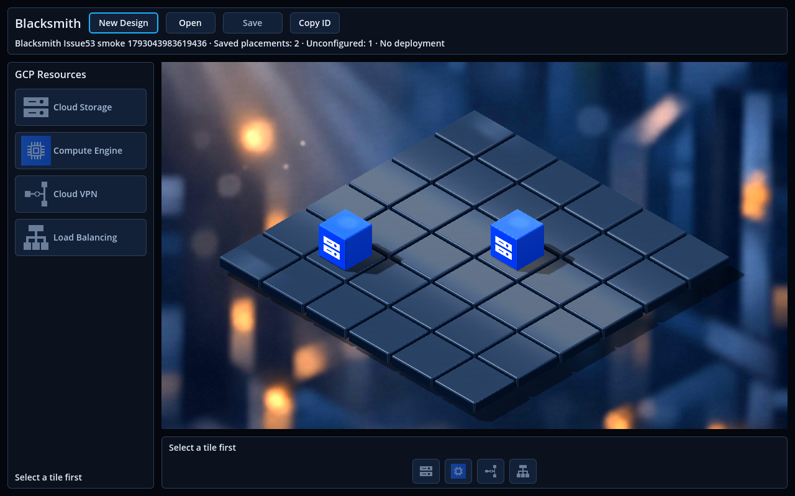

# Issue #53 — Multi-resource persistence in the 3D editor

Multiple Cloud Storage placements can now be saved to one Design and restored after a complete application restart. Each placement retains its own server identity, configuration, revision and ETag. Earlier successful writes remain confirmed when a later placement fails.

## Baseline and scope

- Base `83000ccc5742003e90954be93872580c61d218d9`, merged PR #52, verified through GitHub metadata.
- The existing clean `issue_53` branch was rebased onto updated master; no stashes were used.
- Frontend integration only: no JSON dialog, deployment, provider calls, live development migration or visual redesign.
- Both palettes continue local placement. Header Save uses legacy metadata-only POST for unconfigured placements, as explicitly permitted by the issue. The API chooses these server IDs; in-session uncertainty blocks further writes and uses strict read-back. No project/bucket/region is fabricated.
- Explicit configured intents use stable client UUIDs, scoped conditional PUT, and aggregate GET/list including configuration/revision/ETag. These are repository/test/future-dialog capabilities, not an added configuration UI.
- IsomapGridBloc owns immutable rich Resource entries; the old `tiles` kind map is a derived immutable rendering projection for the existing 3D and legacy 2D adapters.
- Persisted kind replacement is blocked; metadata-only edit/deletion synchronization remains unsupported rather than silently rewriting saved data.

## Implementation

- `IsomapGridState.resources` is the sole live grid snapshot. Immutable `PlacedResource` values distinguish local intent keys from server IDs; `ResourceConfiguration` deeply freezes documents. The old `tiles` map is a derived immutable projection for the unchanged 3D and legacy 2D renderers.
- `ResourceRepository` owns the HTTP/JSON contracts: full aggregate list/GET, metadata-only legacy create, configured conditional create/update, revision/ETag handling, sanitized errors, complete-response validation and duplicate identity/position rejection. List responses carry per-row revisions; their tags follow the documented backend ETag format. Individual GET additionally verifies the actual ETag header. No Godot dependency or automatic retry is introduced.
- `DesignCubit` captures Save snapshots and tracks per-resource confirmation and uncertainty in memory. It verifies the complete confirmed baseline, writes changed supported resources sequentially, then confirms through Design/resource reads. Check Save performs reads only, even when recovery succeeds. A newer local configuration draft survives confirmation of an earlier snapshot.
- Open validates the entire response before one acknowledged BLoC restore. Unsupported type/version/state, invalid coordinates, duplicate identity/position or incomplete data leave the previous Design/grid intact. Repeated Open completes even when the snapshot is unchanged.
- The two existing palettes still share one placement action. Replacing an unsaved cube works for all four GCP kinds; replacing a persisted kind is disabled with an explanation. Header feedback distinguishes saved placements, missing configuration and deployment.
- Tests cover the aggregate wire contract, rich immutable state, partial success/retry, lost responses, stable identities and configuration-only edits. Native persistence checks use the real API/PostgreSQL, a complete process restart, actual screenshots, SQL verification and network tripwires.

## Deliberate boundaries and observations

1. The reference image depicts a configuration dialog and Save & Deploy, which are outside this issue. No new dialog, deployment button, provider operation or visual redesign was added.
2. Palette placements still lack required configuration fields. As explicitly allowed by the issue, their Save uses the existing metadata-only POST and the backend generates the server UUID. Local intent keys remain stable; they are not falsely presented as preassigned server IDs. Explicit configured intents use their original client UUID with `If-None-Match: *`, or the saved ETag with `If-Match` for updates.
3. For a lost legacy POST response, recovery accepts only a unique, exact matching new revision-1 row absent from the preflight snapshot. This verifies the observed desired state, not causal authorship: a concurrent identical create cannot be distinguished. The guard blocks new writes until resolved, but is memory-only. Crash recovery of an unacknowledged legacy POST is not guaranteed; a durable journal is deliberately deferred.
4. Saving is per Resource, not a transaction across the entire Design. If A succeeds and B fails, A remains confirmed and a subsequent deliberate Save targets B. Confirmed IDs are never replaced to avoid conflicts. Conflicts require read-back/Open rather than silent overwrites.
5. Only Cloud Storage persists in this slice. Other GCP kinds remain available locally. Persisted deletion, moving/kind replacement and unsupported configuration editing are not implemented or silently treated as saved.
6. The development database lacks the existing configuration/occupancy migrations. They must be applied deliberately before this workflow is used there. This task applies migrations only to an isolated temporary test database; it does not change the development database.

## Committed source and environment tested

Validation date: **2026-10-26**. All final checks used a fresh export of implementation commit **`af8a0e2499709a5156fb6b72d9a923e8b155d2cd`**, not the working tree.

- Frontend tree: `16788f27a43bf8267e6eb22aa0db5fb52cad2952`.
- Backend tree: `b4388c1ef2a5f6cce7fc49541e932d1313f1cc30`, unchanged from master/PR #52.
- Export: `/tmp/blacksmith-issue53-final-x78avm6n`. The existing package-resolution file and native Godot/Dart libraries were reused as environment prerequisites. No generated part files or build cache were copied. Bindings were generated afresh. All **250 tracked frontend/backend files** in the export matched the commit afterward, including the tracked script resolver.
- Host: Dart **3.12.2**, Godot **4.4.stable.official.4c311cbee**, native X11/OpenGL Compatibility with Mesa llvmpipe. No dependency upgrades.
- API: existing Dev Container `d26cb899e251`, .NET SDK **8.0.426**, unchanged API source built in Release. API and test-host builds each completed with **0 warnings, 0 errors**.
- Database: PostgreSQL **16.15**, new disposable database `blacksmith_front_smoke_a66fac90b42949aeb26b7a3b4167da41`, API `http://172.18.0.4:5153`. All six existing migrations were verified there, including configuration storage and unique Design/tile occupancy. No production backend file or migration was added or edited.

The follow-up commit contains this final report and native screenshots only; it preserves the tested frontend/backend trees.

## Actual final results

| Check | Result and evidence |
| --- | --- |
| Fresh Dart bindings | **PASS** — clean asset graph; 57 outputs, 183 actions. Existing analyzer/SDK compatibility warning noted below. |
| Dart analysis | **PASS** — `No issues found!` |
| Dart unit/repository suite | **PASS — 154 tests**. Includes multi-resource save/restore, immutable state, configuration-only dirty state, late-draft preservation, partial success/retry, failed read-back, duplicate/unsupported data and sanitized error paths. |
| Real API/PostgreSQL configured integration | **PASS** — two configured Resources plus a legacy unconfigured row; conditional create/update, original-UUID recovery after losing a committed PUT response, duplicate-create `412`, stale-revision `412`, occupied-tile `409`, unchanged-save revision preservation and isolation from another Design. |
| Native multi-resource persistence | **PASS** — real API/DB, two Cloud Storage cubes, sidebar and quick placement, genuine API `404` before Save, lost second committed POST response, read-only recovery, repeat Save, full quit/relaunch/Open, repeat Open and scene reload. |
| Native workspace/application | **PASS** — four kinds through both palettes, selection and local replacement, node reuse/disposal, scene-save round trips (2), shared BLoC lifecycle, clean default 3D and explicit legacy 2D launches. |
| Desktop/minimum viewport | **PASS** — 1152 × 648, 960 × 640, 1024 × 768 and 1920 × 1080 logical layouts; actual native window clamped to **960 × 640** after requesting 640 × 480. Grid/cube bounds remained in the canvas; all four perimeter cubes were visible. |
| Native New Design dialog | **PASS** — validation, cancellation, controlled error, duplicate-submit guard, discard only after success, active Design and scene reload; `cloud_calls=0`. Network tracing found no outgoing IP connection. |
| Legacy 2D interactions | **PASS** — headless shared-DI and deliberate local-fallback modes: tile selection, sprite placement/replacement/reuse, scene reload and zero repository/HTTP calls. Fresh headless import emitted the Godot errors recorded below. |
| Independent SQL | **PASS** — exactly two Resources belonging to the native journey's Design, correct coordinates, one stored configuration, revisions 2 and 1. |
| Network/provisioning boundaries | **PASS** — native workspace/clean launches had no outgoing IP connections. Persistence connected only to the dedicated API address/port; all recorded routes were Design/Resource/catalog operations. Cloud tripwires reported `cloud_calls=0`, `cloud_http=0`. Whole headless-2D tracing saw one local loopback connection to the import's Dart VM service on port 6222, no external/backend/GCP connection. |
| Cleanup/development DB | **PASS** — both test APIs stopped and both owned disposable databases removed. Development DB migration list and server-side fingerprints of Designs, Resources and catalog exactly match the pre-test snapshot. |

### Native restart evidence

Native Design: `cc531a0e-3a08-4cbf-896b-d826d59bc586`.
Save process **83396** exited completely; Open ran in a separate process **84802**.

| Resource ID, identical before/after restart | API coordinates | Revision | Configuration restored |
| --- | --- | --- | --- |
| `8faee0c3-f88b-44cb-83f6-1902a560fe25` | `x=3, y=2` | 2 | schema v1, validated |
| `152eab38-0971-4add-8953-3941361f07c6` | `x=1, y=4` | 1 | absent, preserved as unconfigured |

Exactly **two** Resource POSTs reached the real API. The second committed response was deliberately drained and lost; Check Save made no third POST. A test-only explicit configuration was then attached to the first row through one conditional PUT. It used `example-project-123`, `blacksmith-native-fixture` and `europe-west9` solely as database fixture values, never as cloud operations or production defaults. Open performed **zero POSTs and zero PUTs**, including repeated Open and scene reload. Identity/configuration confirmation did not rebuild unchanged cube nodes.

These rows were independently verified before cleanup; the disposable database has since been removed.

### Native screenshots

Unedited captures from the committed implementation, retained in this branch:

- [Two local cubes before Save](images/issue_53/before_save.png).
- [The same two cubes after complete relaunch and Open](images/issue_53/after_relaunch.png).
- [960 × 640 workspace with all four perimeter cubes](images/issue_53/minimum_workspace.png).



### Errors, warnings and limits of validation

- **Fresh headless editor import was not error-free:** Godot printed eight `ERROR:` lines from `editor/progress_dialog.cpp` (`Do not use progress dialog ... while flushing the message queue`, followed by missing-task errors). It returned zero and reached the resolver-ready marker. Both following 2D runtime checks passed without native error lines; the separate graphical import and clean 2D launch also passed. This is recorded as an import anomaly, not silently counted as a clean import.
- During overlapping headless-2D and persistence checks, one Save process could not bind its optional Dart VM debug HTTP service to `127.0.0.1:5858`. Its actual application initialization and Save assertions passed. The subsequent Open process and remaining native tests ran sequentially. No debugger/provisioning behavior was added to production.
- Other observed warnings: locked generator analyzer predates Dart 3.12; llvmpipe cannot change VSync; isolated scene copies resolve old script UIDs through their text paths; the test input driver sometimes repeats a mouse-enter notification. Dependencies, render configuration and scene UIDs were not changed to suppress these messages.
- The deliberate API `404`, dropped committed responses, conditional-write conflicts, controlled dialog errors and unavailable-DI fallback are test injections, not unexpected backend failures. Early development assertions still encoded the old one-placement/legacy-response boundary; fixtures/assertions were updated while retaining failure/read-back coverage. The final 154-test suite passes.
- No configuration dialog, cross-process pending-write journal, multi-resource atomic transaction, other-provider persistence or real GCP deployment is validated or claimed here. Configured repository writes are tested with explicit fixtures; palette Save intentionally remains metadata-only.

## Reproduction and local logs

From the fresh export's `frontend/src`, with the existing locked packages resolved:

```bash
/usr/lib/dart/bin/dart run build_runner build --delete-conflicting-outputs
/usr/lib/dart/bin/dart analyze
/usr/lib/dart/bin/dart test --reporter expanded
BLACKSMITH_INTEGRATION_BASE=http://172.18.0.4:5153 /usr/lib/dart/bin/dart run test_support/resource_api_integration.dart
```

The API URL is the one actually tested. To reproduce, first start a **new owned test database/API** with `frontend/scripts/start-design-test-backend.py`; the recorded instance is now stopped. Run the following native commands from the export root, sequentially, with `--native-dir` pointing to the installed native libraries:

```bash
python3 frontend/scripts/test-godot.py --application --native-dir /home/dexter/Documents/isometric_map_test/blacksmith/frontend --trace-network --timeout 600 --output /tmp/blacksmith-issue53-final-workspace
python3 frontend/scripts/test-godot.py --persistence http://172.18.0.4:5153 --native-dir /home/dexter/Documents/isometric_map_test/blacksmith/frontend --trace-network --timeout 600 --output /tmp/blacksmith-issue53-final-persistence
python3 frontend/scripts/test-godot.py --design --native-dir /home/dexter/Documents/isometric_map_test/blacksmith/frontend --trace-network --timeout 600 --output /tmp/blacksmith-issue53-final-design
strace -f -qq -e trace=connect -o /tmp/blacksmith-issue53-final-legacy.network.log python3 frontend/scripts/test-godot.py --native-dir /home/dexter/Documents/isometric_map_test/blacksmith/frontend --timeout 600 --output /tmp/blacksmith-issue53-final-legacy
```

Independent verification used `--verify-resource /tmp/blacksmith-design-backend-5uj9qb8c cc531a0e-3a08-4cbf-896b-d826d59bc586` before stopping the owned test API. Its `RUN_PATH` is historical; obtain a new one on rerun.

Local evidence is retained under `/tmp/blacksmith-issue53-final-*`: bindings/analyze/Dart/API/backend logs; native workspace/persistence/design/legacy directories; SQL result, migration list, source check and DB invariant JSON. These temporary logs may be cleared by the OS. The essential results and three native screenshots are retained in this report/branch.

## Rollout prerequisite and preserved work

The untouched `blacksmith_db` still has its original four migrations. Before testing Save/Open against that database, deliberately apply the existing **`20261025205111_AddResourceConfigurations`** and **`20261026040000_EnforceResourceIdentityAndOccupancy`** migrations through the normal backend workflow. No development migration was applied by this task.

No backend production code, Godot scene, mesh, material, camera, viewport layout, theme, native library, dependency version or Dev Container changed. No real GCP resource was created or altered. Existing stashes were neither applied nor deleted; unrelated work was preserved. No merge was performed.
