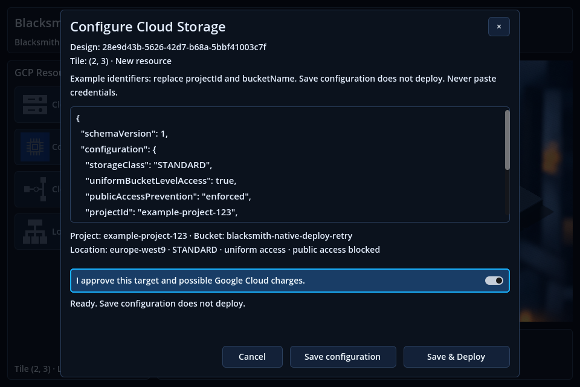
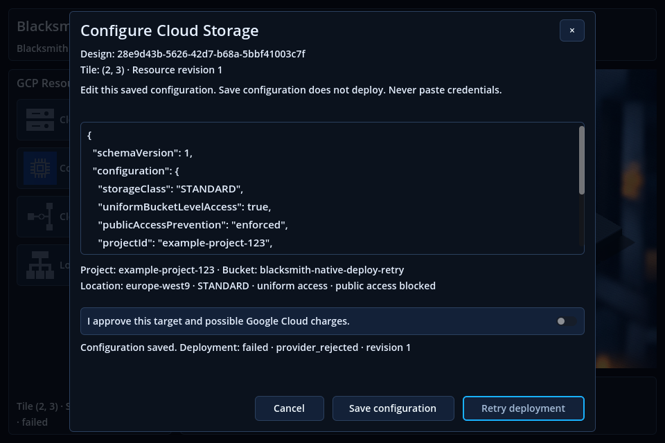

# Issue #58 — Explicit Cloud Storage Save & Deploy

Blacksmith now exposes a deliberate, authorized **Save & Deploy** command for one Cloud Storage Resource. It first commits the Resource, configuration and deployment intent to PostgreSQL, then creates/verifies the exact bucket through the existing Google SDK adapter. Saved configuration and cloud outcome are separate facts. A provider failure or an ambiguous response never discards a confirmed configuration.

**Validated implementation commit:** `95bb244676545620f3ee2ca3eea11d3d04a6a934` on `issue_58` (base `311ab18`, the already updated master). Tests ran from a clean `git archive` export, with freshly generated Dart bindings. The subsequent report/screenshots commit changes no backend or frontend source. No merge was performed.

**Live GCP validation: NOT RUN.** The owner's latest instruction explicitly prohibits real cloud operations. Actual ADC authentication, live IAM permissions, bucket creation and live GCP read-back are therefore unverified. The real-GCP acceptance criterion remains pending separate authorization; fake-provider success is not evidence of a real bucket.

## What changed

- Reused the existing Google Cloud integration with lazy ADC. The adapter applies configured location, STANDARD, uniform bucket-level access and enforced public-access prevention. It resolves the configured project ID to its project number, sets a server-generated ownership label plus Resource-ID label, and verifies all settings/ownership through bucket read-back. A matching global bucket name is insufficient. SDK creation retries are disabled with [RetryOptions.Never](https://docs.cloud.google.com/dotnet/docs/reference/Google.Cloud.Storage.V1/latest/Google.Cloud.Storage.V1.RetryOptions); a conflict must pass ownership verification.
- Added a bounded deployment operation and consumed-attempt IDs. Resource/configuration/initial intent share one database transaction. Claims commit before Google calls; no database transaction spans GCP. Stable IDs, revision preconditions, advisory/row locks and consumed request IDs prevent automatic duplicate dispatch. There is no scheduler or automatic compensation.
- Restricted cloud mutations to explicitly enabled local Development, a private runtime token, approved project allowlist and target/cost consent. The unauthenticated legacy create-bucket endpoint is retired with HTTP 410. Ping and Save-only metadata operations do not resolve ADC.
- Extended the existing dark JSON dialog with target review, consent, Save & Deploy, explicit retry and read-only Check deployment. Editing the document resets consent. Save configuration remains available. **Check Save is database-only**, including after a lost deployment response; provider inspection requires Check deployment.
- Restored durable per-resource outcomes with Design reads. Confirmed configurations retain their cube when deployment fails. Status/details include the requested revision and explicitly identify older configurations. `IsomapGridBloc`, rendering/camera/assets, four resource entries and the legacy 2D scene are unchanged. Status micro-icons remain a separate visual task.
- Added one migration and test-only API composition with an injected fake provider. Production has no configuration switch to select that fake. Existing stashes and unrelated work were preserved.

See [the deployment contract](docs/backend/storage-deployment.md) for the complete payload, environment configuration, IAM prerequisites, recovery and migration procedure.

## API and persisted state

```text
PUT  /designs/{designId}/resources/{resourceId}/deployments/{operationId}
GET  /designs/{designId}/resources/{resourceId}/deployments/{operationId}
POST /designs/{designId}/resources/{resourceId}/deployments/{operationId}/reconcile
POST /designs/{designId}/resources/{resourceId}/deployments/{operationId}/retry/{requestId}
```

Initial PUT uses the existing configured Resource body, `If-None-Match: *` for create or the original strong `If-Match` ETag for edit, a private deployment-token header and explicit consent header. It returns `{resource, deployment}` with HTTP 200 for a durable terminal outcome or 202 while pending. HTTP 200 alone does not mean cloud success. Replaying the same operation never repeats Save; changing its intent returns 409. A retry requires the exact current/original revision and fresh consent. Ordinary Resource reads include an optional latest `deployment`; absence means not requested.

`storage_deployments` records operation/Resource/Design IDs, requested revision, canonical target/configuration hashes, server ownership marker, claim/lease, outcome and verified remote identity. `storage_deployment_attempts` records consumed execution/retry IDs. No token, ADC material or service-account JSON is stored or exposed in these records. Resources with deployment history cannot be silently deleted or reassigned through CRUD.

| Persistence truth | Deployment state | Meaning and recovery |
| --- | --- | --- |
| Configuration saved, no operation | not_requested | Save-only; no provider call |
| Intent/claim committed | pending | Queued or executing; repeated reads do not create |
| Configuration retained | succeeded | Project, ownership and supported settings verified at the recorded observation time |
| Configuration retained | failed | Known rejection/conflict; explicit consented retry of the same target is possible |
| Configuration retained | unknown | Lost response, timeout or expired claim; read/reconcile the original operation, never invent a new bucket name |

An expired claim is durably recognizable from its saved lease and exposed as unknown. A read-only inspection cannot recreate a bucket. Unknown + missing bucket stays unknown conservatively. Retargeting a Resource with deployment history is deliberately unsupported; Save-only editing still works, with older deployment revision clearly identified. Local deployment authorization is a single-operator development boundary, not multi-user authentication.

## Actual validation results

Environment: .NET SDK 8.0.426 in Dev Container `d26cb899e251`; Dart 3.12.2; Godot 4.4 stable `4c311cbee`, X11/OpenGL Compatibility on VirtualBox/Mesa llvmpipe. Packages and native dependencies remain pinned.

| Check at commit `95bb244` | Result |
| --- | --- |
| Release API/fixture builds | PASS — zero errors/warnings |
| Application tests | PASS — 96 |
| HTTP/SQLite contract tests | PASS — 90 |
| PostgreSQL tests, random disposable databases | PASS — 42, none skipped |
| Fresh Dart bindings | PASS — 57 outputs |
| Dart analysis | PASS — no issues |
| Dart unit/repository/coordinator tests | PASS — 201 |
| Native Save/Deploy/retry/unknown/reconcile/full restart | PASS — failure, explicit retry, unknown, DB-only recovery, reconciliation and distinct processes |
| Native New Design regressions | PASS — cancel, validation, duplicate guard, confirmation, reload; zero cloud calls |
| Production startup/dark workspace/native 2D launch, no outbound HTTP | PASS — default 3D + explicit 2D; all four types, perimeter cubes at 960 × 640, zero HTTP |
| Detailed native 3D selection/placement/framing checks | PASS — 4 kinds/replacement, all corners, 6 sizes/216 tile centers, no HTTP |
| Legacy 2D regression fixture | PASS — scene + diagnostic fallback, zero HTTP |
| Real ADC / real GCP creation | NOT RUN — explicitly prohibited |

Executed from the committed export (not an uncommitted workspace):

```bash
# Inside the existing Dev Container. BLACKSMITH_TEST_POSTGRES was supplied
# privately from its existing configuration; its value was never printed.
dotnet test BlacksmithBackend.sln -c Release \
  -p:RestoreSources=/root/.nuget/packages -p:NuGetAudit=false --logger trx

# frontend/src in the committed export
dart pub get --offline
dart run build_runner build --delete-conflicting-outputs
dart analyze
dart test --reporter expanded

# Repository root in the committed export
python3 frontend/scripts/start-design-test-backend.py d26cb899e251 --deployment --port 5148
python3 frontend/scripts/test-godot.py --deployment http://172.18.0.4:5148 --trace-network --timeout 600 --output /tmp/blacksmith-issue58-validation-95bb2446/deployment
python3 frontend/scripts/test-godot.py --design --trace-network --timeout 600 --output /tmp/blacksmith-issue58-validation-95bb2446/new-design
python3 frontend/scripts/test-godot.py --application --trace-network --timeout 600 --output /tmp/blacksmith-issue58-validation-95bb2446/application
python3 frontend/scripts/run-isometric-3d.py --check --timeout 600 --output /tmp/blacksmith-issue58-validation-95bb2446/grid-3d
python3 frontend/scripts/test-godot.py --timeout 600 --output /tmp/blacksmith-issue58-validation-95bb2446/legacy-2d
```

Backend coverage includes target/token/consent denial before Save; disabled and non-Development deployments; stale revisions; idempotent replay; a retained failed configuration; unknown-to-success reconciliation; unrelated-bucket rejection; consumed retry-ID deduplication; concurrent duplicate requests; crash/expired claims; atomic rollback if operation insertion fails; and sanitization of provider exceptions. Static provider mapping/read-back tests check location, security settings and ownership/project mismatch. Normal tests use fakes; no provider network request is needed.

## Native end-to-end evidence

The native test drove the actual production entrypoint and native controls, Dart repositories, ASP.NET controllers, EF and PostgreSQL. Only the external provider port was replaced in test composition:

1. Saved a second Cloud Storage Resource through quick placement; no deployment record or provider call.
2. Opened the first Resource from the sidebar at **960 × 640**, reviewed the exact project/bucket/location and checked that document edits revoke consent.
3. Explicit Save & Deploy returned **HTTP 200 + failed/provider_rejected**. The saved cube/configuration remained visible; retry stayed disabled until renewed consent.
4. An explicitly approved retry reused the same operation/target. The fake created one bucket but returned unknown; the harness then discarded the HTTP response. No automatic retry followed.
5. **Check Save** issued a database-only operation GET. Provider inspection count stayed **0** and the saved unknown outcome/cube was recovered.
6. **Check deployment** performed one read-only provider inspection, confirmed ownership/settings and recorded succeeded. No additional creation occurred.
7. Fully quit Godot PID **308510**, started PID **309924**, opened Design `28e9d43b-5626-42d7-b68a-5bbf41003c7f` and restored Resource `26d6de14-47ab-4825-b47a-b95be0fc5f71`, revision **1**, operation `eb255922-f539-4094-9cfb-3aa624282780`, configuration and succeeded outcome. Open issued **GET requests only**, with unchanged provider counters.

Independent `psql` read-back of the dedicated database confirmed **2 Resources, 2 configurations, 1 operation, 3 consumed attempts, 1 succeeded outcome at revision 1, ownership_verified=true**. The fake provider contained **1 bucket**, with **2 explicitly requested Ensure calls** (initial known refusal + approved retry) and **1 inspection**. The sibling remained not requested. All initial/retry/reconcile responses were HTTP 200 with their explicit status; no cloud success was inferred from HTTP status alone.

Network traces for both Godot phases contained only connections to the dedicated local API. Logs, request-path/status traces, journey IDs and restart evidence are retained under `/tmp/blacksmith-issue58-validation-95bb2446/deployment`; backend TRX files are under `/tmp/blacksmith-issue58-results-95bb2446`. One orchestration PUT performs Save + deployment intent + provider dispatch; the frontend also performs metadata preflight/read-back requests for confirmation.

Actual, unmodified native Godot screenshots (test fixture data; **no real GCP bucket**):






## Findings resolved during validation

- Resumed and preserved the existing `issue_58` working tree; no implementation restart, reset, stash application or history rewrite was used. The implementation was frozen in `297f588`, then corrected narrowly in `95bb244`.
- The two previously reported HTTP failures were obsolete model-contract counts: 6 → 7 migrations and 4 → 6 entities. Existing migration identities and schema mappings remain tested; no assertion was disabled.
- Initial PostgreSQL fixture failures came from reinserting the Legacy Design already seeded by migrations and an old migration-count assertion. Fixtures/counts were corrected; all 42 tests then passed on new databases.
- The first test-only TCP host failed because WebApplicationFactory inferred the wrong content root in the exported layout. Its test composition now specifies the API source root; no production workaround was introduced.
- Final inspection found that ambiguous modal Check Save reused provider inspection. Commit `95bb244` makes it strictly database-only and adds unit/native checks. Explicit Check deployment remains the only inspection action.
- Fresh binding generation emits the existing pinned-analyzer/SDK compatibility warning, but completes successfully; `dart analyze` reports no issues. No dependency upgrades were introduced. Native isolated imports may report an existing script-UID fallback warning. The legacy headless editor import emitted **8 progress-dialog ERROR lines** in Godot 4.4 while exiting 0; scene and diagnostic runs passed. No ERROR/SCRIPT ERROR/SHADER ERROR lines were found in the other native test logs. This editor-import limitation is not hidden or presented as a clean log. The software-rendered 3D sample measured about 9.6 FPS with eight cubes; it is not a hardware performance benchmark.

## Preservation, deployment prerequisites and limitations

Read-only logical dump fingerprints of `blacksmith_db` matched before/after validation (schema and data unchanged). All **3 stashes** retained the same IDs and order. The four dedicated native fixture databases, including the initial failed setup, were confirmed absent after cleanup; PostgreSQL tests dropped only their own random databases. No containers/volumes were removed. The committed export retained byte-identical tracked files after generation/tests; the final documentation/screenshots commit changes no implementation.

The migration `20261027011918_AddStorageDeployments` was generated and tested only in disposable databases. It was **not** applied to the development database. Running this API version against a persistent database requires a separately authorized schema update. Deployment stays disabled until an operator supplies valid ADC, a private token and the exact approved project allowlist. Provider IAM requirements include `resourcemanager.projects.get`, `storage.buckets.get` and `storage.buckets.create`; no IAM grants were changed.

A successful record is the last verified observation, not a continuous cloud health check. Database/cloud partial failures are retained honestly; a crash or unobservable bucket may require operator investigation. There is no automatic bucket deletion, ownership-history cleanup, retargeting, whole-Design deployment or generic deployment engine. Ownership labels assume trusted project IAM and are not protection against an actor able to modify that bucket's metadata. Preserve deployment records while a real/unknown bucket may exist.

No real GCP creation, GCP deletion, IAM/credential change, development-DB mutation, Docker container/volume removal, Git stash change or Git history rewrite was performed. The live milestone remains explicitly unexecuted; the implementation is prepared for review without claiming live-cloud acceptance.
