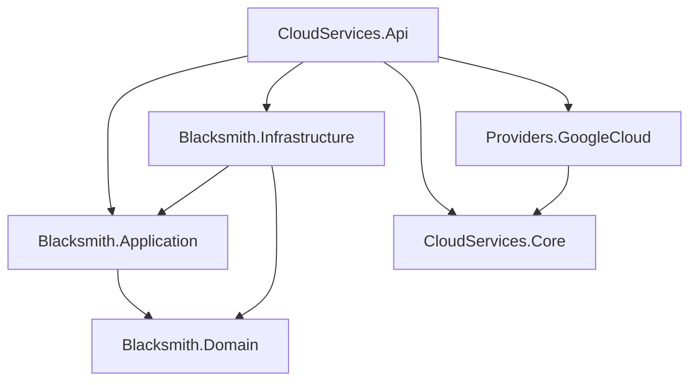

# Issue #5 — analyse et refactoring de l’architecture backend

Date : **18 octobre 2026**, America/Toronto. Référence : [issue #5](https://github.com/dexterBEN/blacksmith/issues/5).

## Périmètre et point de départ

Le travail est effectué sur la branche existante `issue_5`, initialement propre au commit `6c0a1c1`. Les sources sous `backend/src` sont identiques à celles du commit `127edfa` audité précédemment. Les documents des issues #3/#4 ne sont pas présents sur cette branche ; aucune fusion ni réintroduction du travail de sécurité n’est réalisée dans cette issue.

L’objectif est une séparation progressive des responsabilités en conservant les comportements observables du backend ASP.NET Core 8, EF Core, PostgreSQL et GCP. Aucun modèle UML futur, changement de schéma, nouveau fournisseur cloud, modification du frontend ou nettoyage de credentials n’entre dans ce changement.

## Analyse du code existant

Avant refactoring, `ResourcesController` regroupait le protocole HTTP, la validation, le nettoyage des chaînes, la création des identifiants/dates et l’accès direct à EF Core. Le projet API portait aussi l’entité, le DbContext et les migrations.

Un second accès PostgreSQL se trouvait dans `Program.cs` pour `/db/ping`. Déplacer uniquement le CRUD aurait donc laissé du code de persistance dans l’API. Cet endpoint est conservé et passe désormais par une interface de diagnostic.

Le contrat à préserver comprend plusieurs détails :

- validation de `Name` avant `Type`, et validation avant recherche de l’identifiant lors d’un `PUT` ;
- messages exacts `Name is required` et `Type is required`, dans `{ "error": ... }` ;
- espaces de début/fin supprimés pour le nom et le type, sans nouvelle restriction sur les coordonnées ;
- `201` et en-tête `Location` à la création ; `404` si absent ; `204` sans corps après suppression ;
- JSON avec exactement `id`, `name`, `x`, `y`, `type`, `createdAtUtc` ;
- date de création et identifiant conservés lors d’une mise à jour ;
- liste triée par date de création décroissante ;
- validations automatiques d’ASP.NET pour les corps invalides, `null` et les champs non nullables ;
- CRUD sans provisionnement cloud ; routes et messages GCP conservés.

## Architecture et modifications

La [documentation d’architecture](docs/backend/current-architecture.md) décrit les responsabilités, les contrats HTTP, les enregistrements DI et les commandes de travail.



### Domain

`ResourceEntity` est déplacée dans `Blacksmith.Domain/Entities`. Ses propriétés et leurs types sont conservés. Le projet ne référence ni ASP.NET, ni EF Core, ni SDK cloud. Aucun dossier `ValueObjects` vide ni nouvelle abstraction métier non utilisée n’est ajouté.

### Application

`ResourceService` reprend la validation et la coordination du CRUD. Il dépend uniquement d’`IResourceRepository`, défini dans Application, et des entités Domain. Il ne connaît ni HTTP, ni EF, ni GCP.

Les DTOs de requête sont déplacés en conservant leurs propriétés, types, valeurs par défaut et nullabilité. `ResourceResponse` évite d’exposer directement l’objet suivi par EF tout en conservant le JSON existant. La validation applicative utilise une exception spécifique, convertie en `400` par le contrôleur ; aucune exception technique générique n’est transformée en erreur de saisie.

Le repository exprime une unité de travail limitée aux ressources : ajout/suppression, recherche, liste et sauvegarde. Les opérations d’écriture réussies appellent une seule sauvegarde. Le `CancellationToken` est transmis aux opérations asynchrones.

### Infrastructure

`BlacksmithDbContext`, la configuration EF, `EfResourceRepository`, le diagnostic PostgreSQL et les migrations sont déplacés dans Infrastructure. La liste conserve son tri SQL et `AsNoTracking`. Les entités obtenues individuellement sont suivies dans le contexte de la requête afin que les mises à jour soient sauvegardées par l’unité de travail. Les réponses restent des DTOs séparés.

`PostgreSqlDatabaseHealthCheck` conserve `select now()` pour `/db/ping`. L’API reçoit son résultat par `IDatabaseHealthCheck` et conserve le JSON `status`/`dbTime`. Le diagnostic relit la chaîne de connexion depuis `IConfiguration` à chaque appel, comme l’endpoint initial, au lieu de figer sa valeur au démarrage.

### API et injection des dépendances

`ResourcesController` conserve les attributs de routage et traduit les résultats du service en réponses HTTP. Il ne référence plus le DbContext ou EF Core. `Program.cs` compose les dépendances :

- `IResourceService` → `ResourceService` ;
- `IResourceRepository` → `EfResourceRepository` ;
- `BlacksmithDbContext`, via `AddBlacksmithInfrastructure` ;
- `IDatabaseHealthCheck` → `PostgreSqlDatabaseHealthCheck` ;
- enregistrement existant `ICloudStorageService` → `GoogleCloudStorageService`.

Les services sont `Scoped`, avec un DbContext partagé à l’intérieur d’une requête. Les projets existants conservent leurs noms. Le contrat cloud et le code du provider ne sont pas modifiés. L’unique ajout public au point d’entrée `Program` permet l’hébergement en mémoire pour les tests HTTP.

### Migrations et dépendances NuGet

Les deux identifiants de migrations existants sont préservés : `20251229003351_InitialCreate` et `20251229011642_AddResourcesTable`. Les cinq fichiers de migrations/snapshot sont déplacés ; seuls les espaces de noms CLR sont adaptés. Une comparaison réversible des contenus vérifie que les opérations SQL et métadonnées n’ont pas été changées.

Le snapshot désigne le nouveau nom CLR de l’entité. Les tests vérifient que le modèle Npgsql courant ne demande aucune migration supplémentaire. Aucune commande de migration de base n’est exécutée.

Les versions d’exécution existantes sont conservées, notamment EF Core et le provider PostgreSQL `8.0.11`. Le paquet privé `Microsoft.EntityFrameworkCore.Design` reste dans le projet API pour les outils EF avec ce projet de démarrage ; il n’implique aucun accès EF dans les contrôleurs. Les nouveaux paquets de test sont limités à xUnit, Test SDK, `Mvc.Testing` et SQLite.

## Vérifications de l’implémentation locale initiale

**Restauration, compilation Release et tests terminés avec succès.**

| Vérification | Résultat |
| --- | --- |
| Tests HTTP sur le backend initial | **16 réussis**, aucun échec, aucun ignoré |
| Restauration de la solution complète | Réussie, **8 projets** pris en compte |
| Compilation Release finale | Réussie, **0 avertissement, 0 erreur** |
| Tests `Blacksmith.Application.Tests` | **11 réussis**, aucun échec, aucun ignoré |
| Tests `Blacksmith.IntegrationTests` | **19 réussis**, aucun échec, aucun ignoré |
| Total des tests après refactoring | **30 réussis** |
| Assertions des 16 tests HTTP de référence | Inchangées, seuls deux imports de namespaces ont été adaptés |
| Modèle Npgsql contre snapshot | `HasPendingModelChanges()` vaut **false**, sans connexion DB |
| Identifiants de migrations | Les **2 identifiants existants** sont conservés |
| Comparaison des cinq fichiers de migrations/snapshot | Seuls les espaces de noms CLR ont changé |
| Graphe de projets | Domain sans référence/paquet ; Application dépend uniquement de Domain |
| Frontend, provider GCP, contrat cloud, contrôleur cloud, Compose et devcontainer | Aucune modification |

Un SDK .NET **8.0.426** est installé uniquement dans `/tmp/blacksmith-issue5-tools`, après vérification SHA-512 à partir des métadonnées officielles. Le cache NuGet et le répertoire CLI sont également temporaires ; aucune installation système ni ressource Docker n’est modifiée. Aucun blocage de compilation ou d’exécution des tests ne reste ouvert.

Deux particularités de l’environnement ont été résolues :

- Le fichier solution appartenait à `nobody` et l’outil `dotnet sln` ne pouvait pas l’écrire directement. Une copie dans le même répertoire a été modifiée avec l’outil, contrôlée puis substituée atomiquement à l’original, sans `sudo` ni modification récursive des permissions. Les projets préexistants et leurs identifiants sont conservés.
- Une première compilation dans le bac à sable a échoué sans diagnostic C#. La compilation et les tests ont ensuite été exécutés avec l’accès nécessaire hors bac à sable. La commande de compilation finale a utilisé `-m:1 -nodeReuse:false` ; les tests ont utilisé `--no-build --no-restore`.

La stratégie de test comprend :

1. Des tests HTTP sur le backend initial, avant bascule des couches, puis les mêmes assertions après refactoring.
2. Des tests unitaires du service, sans EF/HTTP/cloud, couvrant validation, nettoyage, identifiant/date, sauvegarde, absence de ressource et annulation.
3. Des tests HTTP traversant le vrai contrôleur, le service et le repository EF avec SQLite en mémoire ; le provider GCP est remplacé par un double qui enregistre les appels.
4. Un test du diagnostic HTTP et des tests de modèle/migrations Npgsql ne nécessitant aucune connexion PostgreSQL.
5. Des vérifications du graphe de projets, des chemins documentaires et de l’absence de modification du frontend, du provider, du contrat cloud et des paramètres sensibles.

Commandes reproductibles depuis `backend`, avec le SDK .NET 8 :

```bash
dotnet restore BlacksmithBackend.sln
dotnet build BlacksmithBackend.sln --configuration Release --no-restore
dotnet test BlacksmithBackend.sln --configuration Release --no-build --no-restore
```

Les tests n’utilisent aucun credential GCP et ne créent aucun bucket. SQLite ne remplace pas une vérification d’intégration sur PostgreSQL réel : les différences de dialecte, contraintes et encodage des dates restent une limite, complétée par les tests du modèle Npgsql.

## Correspondance avec les critères de l’issue

- Les trois projets de couches et les deux projets de test sont ajoutés à `BlacksmithBackend.sln`.
- Le contrôleur des ressources dépend d’`IResourceService` ; Application utilise `IResourceRepository` ; EF Core est implémenté dans Infrastructure.
- Les routes et les réponses couvertes par les tests de référence restent compatibles, sans changement du provider GCP ou du workflow frontend.
- Aucune migration nouvelle ou modification de schéma n’est nécessaire ; les tests de modèle le vérifient sans appliquer de migration.
- La compilation complète, les tests ciblés et le diagramme Mermaid sont livrés.

## Observations et limites

- **Refactoring volontairement léger.** L’entité reste un modèle de données simple. Introduire maintenant les agrégats du futur UML ou un bus de commandes dépasserait l’issue et compliquerait la preuve de compatibilité.
- **Unité de travail explicite.** Le service manipule des entités mutables que le repository persiste à la sauvegarde. Cette sémantique est documentée dans le contrat. Un autre adaptateur devra la respecter.
- **Validation inchangée.** Les longueurs maximales restent imposées par EF/PostgreSQL ; ajouter des validations HTTP supplémentaires modifierait les réponses actuelles et relève d’une tâche distincte.
- **Concurrence inchangée.** Aucun verrou optimiste, jeton de version ou stratégie de reprise n’est ajouté.
- **Cloud séparé du CRUD.** Le frontend conserve ses deux appels distincts. Il reste possible qu’une ressource soit enregistrée puis que la création du bucket échoue ; une orchestration de déploiement appartient aux prochaines issues.
- **Diagnostic cloud existant.** Le contrôleur cloud reçoit le provider dans son constructeur ; même son endpoint `ping` peut donc nécessiter ADC au moment de son activation. Ce comportement et les messages existants sont conservés.
- **Sécurité hors périmètre.** Les identifiants, mots de passe de développement, configurations CORS/ports et historiques Git ne sont pas modifiés. Aucun secret n’est reproduit dans ce rapport.
- **Vérifications externes.** Une base PostgreSQL réelle et des identifiants GCP seraient nécessaires pour un test d’intégration externe complet ; aucun appel à ces services n’est effectué ici.

Lors de l’implémentation initiale, aucun commit, push, changement d’issue distante ou déploiement n’avait été réalisé. Les vérifications ci-dessus concernaient le working tree complet, et non le commit publié ultérieurement. Le contrôle de complétude ci-dessous distingue ces deux états.

## Revue de complétude de la PR #6

La revue externe a identifié un blocage réel dans la [PR #6](https://github.com/dexterBEN/blacksmith/pull/6), au commit `55a02c080cbdab6157ba3ba74b1dfe9947f20227`. L’API utilisait les nouvelles couches alors que les fichiers permettant de les compiler n’avaient pas tous été commités. Le résultat de compilation locale initial ne prouvait donc pas la reproductibilité de cette publication.

### Comparaison des quatre états

| État au début de la correction | Constat |
| --- | --- |
| Working tree local | Solution à huit projets, références API corrigées, cinq nouveaux fichiers projet, quatre migrations déplacées et deux documents présents |
| Index Git | Identique à `HEAD`, aucun ajout en attente |
| Commit `55a02c0` | Solution limitée aux trois projets historiques, références API incomplètes, fichiers nouveaux ci-dessous absents |
| PR #6 sur GitHub | Même SHA complet que `HEAD` local, un seul commit, mêmes omissions confirmées via l’API GitHub |

Treize fichiers avaient été laissés hors du commit : deux fichiers suivis modifiés et onze fichiers non suivis. Leur origine précise ne peut pas être attribuée à une commande ou un outil particulier ; le fait vérifiable est que leur contenu n’était pas dans l’index et le commit publié.

### Contenu du commit correctif

| Fichiers | Nombre | Correction |
| --- | --- | --- |
| `backend/BlacksmithBackend.sln` | 1 | Inclure les trois couches et les deux projets de test ; huit projets au total |
| `backend/src/CloudServices.Api/CloudServices.Api.csproj` | 1 | Inclure les références Application/Infrastructure et le déplacement des dépendances EF d’exécution |
| Fichiers projet des trois couches | 3 | Ajouter `Blacksmith.Domain.csproj`, `Blacksmith.Application.csproj`, `Blacksmith.Infrastructure.csproj` |
| Fichiers projet des tests | 2 | Ajouter `Blacksmith.Application.Tests.csproj` et `Blacksmith.IntegrationTests.csproj` |
| Migrations déplacées | 4 | Ajouter les fichiers `.cs` et `.Designer.cs` de `20251229003351_InitialCreate` et `20251229011642_AddResourcesTable`, absents alors que les anciens chemins avaient été supprimés |
| Documents | 2 | Inclure `docs/backend/current-architecture.md` et ce rapport, complété par cette revue |

Les quatre fichiers de migrations manquants constituent aussi un blocage de découverte des migrations, au-delà de la compilation. Le snapshot seul avait été publié. Les fichiers ajoutés conservent les opérations SQL et identifiants historiques ; les adaptations restent limitées aux espaces de noms CLR du refactoring initial.

Le correctif ne modifie aucun service applicatif, contrôleur, repository, contrat HTTP ou test C# déjà présent dans `55a02c0`. Il n’ajoute aucune entité métier, aucun changement de schéma ni nouvelle migration.

### Vérification de `.gitignore`

`git check-ignore --no-index -v` a été exécuté sur les treize chemins. Aucun n’est ignoré, y compris les cinq nouveaux `.csproj` et les migrations. Aucune règle `.gitignore`, exclusion locale ou exclusion globale effective n’explique ces omissions. Aucun ajout forcé ni modification des règles d’ignorance n’est nécessaire. Les sorties `bin`, `obj` et `TestResults` restent des artefacts de compilation non suivis.

### Vérification depuis des clones neufs

Le commit publié initial a été cloné anonymement depuis GitHub dans un répertoire privé distinct, avec vérification du SHA et absence de fichiers modifiés, de sorties de compilation et de `project.assets.json` préexistants. Sa restauration réussit, mais sa compilation Release échoue avec **9 erreurs `CS0246`**, faute de références vers les couches `Blacksmith`. Les projets de test étant absents de la solution publiée, ils ne peuvent pas constituer une suite exécutée sur cette version.

Le commit correctif est ensuite vérifié dans un second clone distinct ne contenant que ses fichiers commités. Aucun fichier non suivi, binaire, `obj`, credential local ou patch du working tree initial n’est copié dans ce clone. Seuls le SDK temporaire et le cache de paquets NuGet sont réutilisés ; les sorties et fichiers d’assets sont reconstruits dans le clone.

Les vérifications exigées avant la livraison du correctif sont :

1. Correspondance exacte entre le SHA du clone et le commit correctif ; working tree propre avant et après les commandes.
2. Présence de huit projets dans la solution et de tous les fichiers projet et références.
3. Restauration complète puis compilation Release avec zéro erreur et zéro avertissement.
4. Exécution de la solution complète : onze tests Application et dix-neuf tests d’intégration/contrats, soit trente tests sans échec ni test ignoré.
5. Découverte des deux migrations historiques et absence de changement de modèle Npgsql, sans connexion PostgreSQL.
6. Contrôle que seuls les treize fichiers de complétude/documentation sont ajoutés au commit correctif ; aucune nouvelle modification de logique métier, SQL, frontend ou configuration sensible.

Commandes de validation dans le clone, avec le SDK .NET 8 :

```bash
git rev-parse HEAD
git status --porcelain
dotnet sln backend/BlacksmithBackend.sln list
dotnet restore backend/BlacksmithBackend.sln
dotnet build backend/BlacksmithBackend.sln --configuration Release --no-restore -m:1 -nodeReuse:false
dotnet test backend/BlacksmithBackend.sln --configuration Release --no-build --no-restore -m:1 -nodeReuse:false
git status --porcelain
```

Le SHA exact livré et les résultats de cette vérification sont communiqués avec le correctif. Les limitations PostgreSQL/GCP réels décrites plus haut restent applicables : ce contrôle établit la complétude et la reproductibilité de la PR, sans étendre le périmètre du refactoring.

## Références techniques

Les tests HTTP utilisent `WebApplicationFactory` et des remplacements de services suivant les mécanismes documentés pour [les tests d’intégration ASP.NET Core](https://learn.microsoft.com/en-us/aspnet/core/test/integration-tests?view=aspnetcore-8.0). Le déplacement du contexte/snapshot et la vérification d’absence d’écart s’appuient sur la documentation EF Core des [projets de migrations](https://learn.microsoft.com/en-us/ef/core/managing-schemas/migrations/projects) et de la [détection des changements de modèle](https://learn.microsoft.com/en-us/ef/core/managing-schemas/migrations/managing#checking-for-pending-model-changes).
