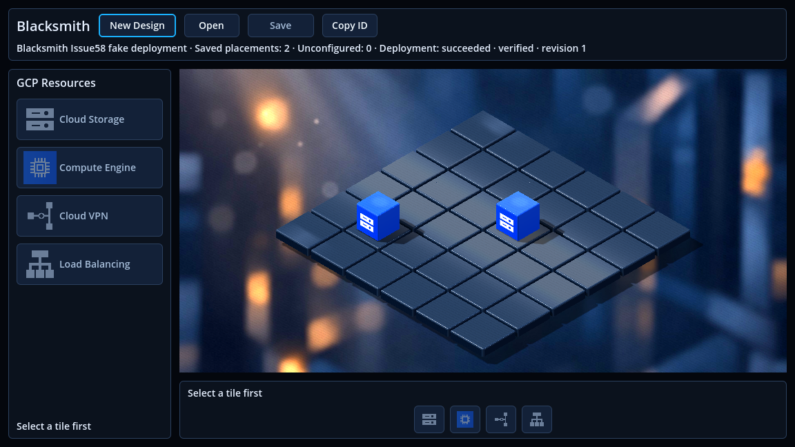
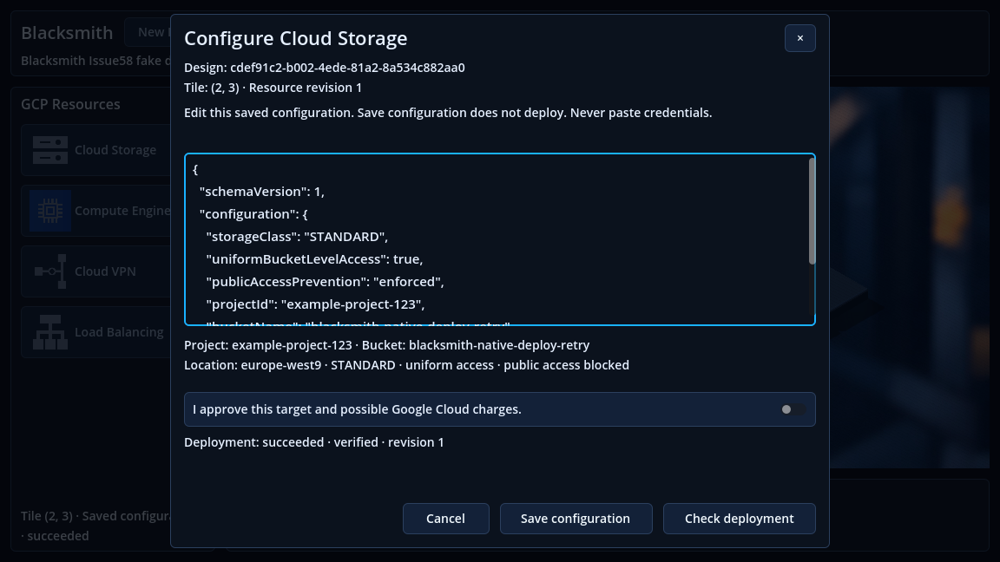

# Issue #60 — Repeatable local Save & Deploy validation

Issue: [Stabilize and Validate the Existing Local Save & Deploy Workflow](https://github.com/dexterBEN/blacksmith/issues/60).

## Result and scope

Completed validation on `issue_60`, based on `master` commit
`7cc9fa95ecad3a2d7848a9376a05a3406d62b21f` (`update dev env`). Five consecutive
native application restart/Open cycles passed after a full test-API process
restart. The existing launcher and production workflow did
not need a functional fix. Changes consolidate repeatable regressions, add full
test-API process restart support, and document the local operating procedure.
No application UI, BLoC/Cubit, provider, authorization policy, schema, migration,
Dev Container or development database configuration was changed.

The developer's earlier successful real Google Cloud bucket creation remains
historical evidence. This pass uses a fake provisioner and an isolated PostgreSQL
database, not another live deployment. No Google resource is inspected, created,
modified or deleted.

## Audit findings

- `run_local.sh` already resolves paths independently of the current directory,
  reads only the ignored backend token as a literal value, disables tracing before
  reading it, forwards arguments/exit codes, preserves the library path and opens
  editor mode. Its production content is unchanged.
- The three existing deployment environment settings in the running backend Dev
  Container matched `backend/.env`; the actual running development API process
  also inherited those same settings, compared only in memory. The ADC bind mount
  is read-only. No deployment token or service-account key was displayed or
  written into test fixture files. The initial tool read of the tracked Dev
  Container JSON did echo its pre-existing development connection string;
  subsequent environment checks were sanitized. No credential value is included
  in this report, its screenshots, new tests or documentation. Existing tracked
  development credentials were not changed as part of this task.
- Host port 5100 was already owned by VS Code's forwarding process. It was left
  running. The fake API uses container port 5146 instead; the procedure explains
  how to identify/reuse a listener and why a second API gets Address already in use.
- Source model states are `pending`, `succeeded`, `failed`, `unknown`. Saved-only
  means no deployment record. An expired pending lease is represented as
  `unknown` / `execution_interrupted` by DTO projection without a database write.
- Open/metadata GETs do not call the provisioner. Check Save is database-only.
  Explicit Check deployment is a provider inspection and records an attempt;
  it must not be included among ordinary read-only reopen actions.
- The existing UI summary/dialog expose the durable outcome. Per-cube status
  indicators remain a separate UI follow-up. Success belongs to a Resource
  revision and is not automatic live cloud health monitoring.
- `storage_deployment_attempts` is a durable request-deduplication ledger, not a
  full per-attempt outcome/audit history. The test verifies its identities/count
  remain unchanged on reads; it does not introduce a history UI or job system.

## Changes

| File | Purpose |
| --- | --- |
| `frontend/scripts/test_run_local.py` | Standard-library-only offline launcher regressions; dummy credentials and fake Godot, no real `.env` access. |
| `frontend/scripts/test-godot.py` | Opt-in real local-editor import and repeated native Open cycles, distinct process verification and per-cycle evidence. |
| `frontend/src/test_support/deployment_journey_checks.dart` | Compare both Resources' IDs, tiles, revisions, ETags, complete configuration and deployment identity/outcome; inspect/cancel configuration, repeat Open, verify only GETs and unchanged SQL/provider counters. |
| `frontend/scripts/start-design-test-backend.py` | Explicit restart of the deployment fixture process, retaining its uniquely named isolated DB. |
| `frontend/scripts/deployment-test-backend/Program.cs` | Resume only a validated fixture DB; expose process ID and Design count for restart/read-only assertions. |
| `frontend/src/test/storage_deployment_test.dart` | Four five-restart coordinator tests: pending, succeeded, failed, unknown, each alongside a saved-only Resource. |
| `backend/tests/Blacksmith.PostgreSql.Tests/StorageDeploymentTests.cs` | Five fresh API hosts restore all states plus saved-only; compare complete table fingerprints and verify no provider calls or extra rows. |
| `docs/local-smoke-test.md`, `README.md` | Host/container startup order, listener diagnostics, explicit safe generation commands and reproducible non-cloud protocol. |

No replacement persistence flow or production fake-provider switch was introduced.
The test API executes the real controllers, application services, repositories,
EF migrations and PostgreSQL driver. Only its external cloud adapter is replaced.

## Environment and commands

Ubuntu host: Godot `4.4.stable.official.4c311cbee`, Dart `3.12.2`, X11/OpenGL Compatibility,
VirtualBox `llvmpipe`, existing Linux native Godot/Dart libraries and standalone
`/usr/lib/dart/bin/dart`. Backend: existing .NET SDK `8.0.426` Dev Container,
PostgreSQL 16 Compose server; no containers or volumes created/deleted.

The full reusable commands and terminal contexts are in
[the local smoke-test procedure](docs/local-smoke-test.md). Run artifacts are
retained locally under `/tmp/blacksmith-issue60/`; fixture database
`blacksmith_front_smoke_57f1469633564b8c9ff112eb57f2f530`, API port 5146.
The database name is randomly generated and contains no credentials.

| Check | Actual result |
| --- | --- |
| `bash -n frontend/scripts/run_local.sh` | PASS. |
| `python3 frontend/scripts/test_run_local.py` | PASS: 13 tests, including malformed/empty/unreadable config, duplicates, BOM/CRLF, no eval/secret trace, missing Godot, arguments, CWD and library path, nonzero exit. |
| Fresh `dart run build_runner build --delete-conflicting-outputs` | PASS: 57 outputs; no lockfile/cache deletion. |
| `dart analyze` | PASS: no issues. |
| `dart test --reporter expanded` | PASS: 205 tests. |
| Backend Release build and unit/HTTP tests | PASS: 96 Application + 90 HTTP tests. |
| Isolated PostgreSQL suite | PASS: 43 tests, none skipped; includes the new all-status five-host test. |
| Existing host API health | PASS: `/cloud_services/ping` and `/db/ping` on 5100; existing listener reused. |
| Duplicate listener diagnosis | PASS: a second API deliberately rejected on occupied test port 5146 with Address already in use; original API unaffected. |
| Real graphical `run_local.sh` from `/tmp`, normal window close | PASS: token matched in process memory, existing library entry preserved, actual editor window confirmed, exit 0, no engine errors or ObjectDB warning. |
| Native fake-provider Save & Deploy preparation | PASS: rejection, consented retry, lost response, database-only Check Save and explicit fake reconciliation. |
| Five native reopen cycles after full API restart | PASS: five distinct native processes, identical persisted snapshots, only repository GETs and zero provider calls. |
| Legacy 2D regressions | PASS: standalone import/readiness, interactions and local diagnostic markers; zero repository/HTTP calls. Eight existing headless import errors are detailed below. |

The first PostgreSQL baseline invocation without a test connection correctly
skipped its 42 tests; a subsequent isolated run passed all 42, then all 43 after
adding coverage. Skipped tests are not counted as passed.

## Native restart evidence

Preparation created two configured Resources through the existing UI/API, one
saved-only and one eventually succeeded. Fake counters before backend restart:
two create invocations (first rejected), one inspection, one fake bucket;
PostgreSQL: two Resources, two configurations, one operation, three attempts.

The actual test API process restarted from container PID `44378` to `46536`, on
the same isolated database. Its fake adapter's in-memory counters/buckets reset
to zero; the database counts stayed `2 / 2 / 1 / 3`. Reopening must not recreate
the fake bucket to rediscover the already persisted success.

The final series completed without a failed or skipped cycle:

| Cycle | Native player PID | Repository GETs | Resources / configurations | Operations / attempts | Creates / inspections after restart | Result |
| --- | --- | --- | --- | --- | --- | --- |
| 1 | 219616 | 4 | 2 / 2 | 1 / 3 | 0 / 0 | PASS |
| 2 | 221426 | 4 | 2 / 2 | 1 / 3 | 0 / 0 | PASS |
| 3 | 223306 | 4 | 2 / 2 | 1 / 3 | 0 / 0 | PASS |
| 4 | 224705 | 4 | 2 / 2 | 1 / 3 | 0 / 0 | PASS |
| 5 | 226254 | 4 | 2 / 2 | 1 / 3 | 0 / 0 | PASS |

Every cycle starts empty in a new player process, Opens the same Design, verifies
both complete Resource snapshots, opens/reviews/cancels the deployed Resource's
configuration, and Opens the same Design again. The 20 repository requests are
all GETs; fixture-counter inspections are additional GETs, not included in that
column. Every traced player IP connection goes only to the dedicated API
`172.18.0.4:5146`. No runtime engine errors or ObjectDB leak warnings occurred.

Independent read-only SQL comparisons confirm that complete row fingerprints
and counts for Resources, configurations, operations and attempts are unchanged
from before API restart to after all five cycles. All five development tables
(including Designs) also have identical before/after fingerprints and counts.
No development data was overwritten, deleted or migrated.

Actual, unmodified Godot screenshots from cycle 1 after API restart, using only
the fake project and disposable Design (the reused fixture retains its Issue58
Design label):





## Failures, limits and follow-ups

- An initial graphical editor probe used `--quit-after 90`; Godot exited 0 but
  emitted a render-thread `finalize` error and an ObjectDB leak warning. A normal
  window-manager close was then verified with no errors/warnings. Do not present
  that forced-frame exit as a clean shutdown test. Window inspection was corrected
  to identify the probe's own X11 client window by PID before normal closure.
- Generation initially invalidated its cached asset graph after an SDK change;
  regeneration completed normally without deleting `.dart_tool` or the lockfile.
  The pinned generator/analyzer version remains an existing environment constraint.
- The first five-cycle attempt stopped during editor import because the new
  network assertion rejected the editor's own Dart debugger connection at
  `127.0.0.1:6222`. The test now allows only the exact loopback endpoint advertised
  by that editor, while player traffic remains restricted to the dedicated API.
  This was a test assertion failure before the first Open, not a cloud request.
- Full syscall interception made cold Dart startup particularly slow under
  VirtualBox. The tracer now uses its installed seccomp filter to monitor the
  same connect calls without intercepting unrelated syscalls. Redundant editor
  imports between player cycles were removed; five full player restarts are the
  acceptance cycles, following one real launcher/editor import. Preliminary
  tracing runs were stopped only within their exact isolated test projects;
  no existing API, user editor or persisted data was terminated/removed.
- The first legacy run reached its interaction markers but its headless import
  also reported a missing Dart VM service while another editor was active.
  The harness now rejects Dart/native exceptions even when a readiness marker
  exists. The standalone rerun passed all three stages with no Dart/native
  exceptions. Its headless editor import still emits eight known Godot 4.4
  `progress_dialog.cpp` errors despite exit 0. This is a noisy editor-import
  limitation, not a clean zero-error import; neither runtime stage emits engine
  errors. The local diagnostic intentionally logs its injected missing-DI stack
  before confirming the fallback scene. Run editor/import checks sequentially
  to avoid competing for the editor VM service port.
- Native input is driven through real Godot controls in an isolated copy using
  the production bootstrap plus test-only repository instrumentation. This proves
  native application restart/reopen behavior, not five manual F5 sessions or five
  VM reboots, nor real Google API reachability/IAM/billing behavior.
- The fake backend restart is orderly and replaces the OS process. Unknown/expired
  execution behavior is covered independently by isolated PostgreSQL tests; this
  pass does not terminate a real cloud operation or alter its recovery evidence.

## Preservation and review state

The existing launcher, `dev.sh`, `pubspec.lock` and ignored backend `.env` match
their original SHA-256 fingerprints. All three pre-existing stash identities and
the starting HEAD are unchanged. Tracked Godot editor cache files touched by the
real editor probe were restored to their original committed bytes.

The isolated API was stopped through its own fixture control; only its uniquely
named test database was removed. The existing development API, PostgreSQL/pgAdmin
and Dev Container were retained. No Docker container/volume or Google resource
was removed. Evidence/logs remain in `/tmp/blacksmith-issue60/`.

The changes are **uncommitted** on `issue_60`; the base commit above identifies
the unchanged production code. The tested source manifest below identifies the
new/retained launcher and regression code separately from that commit. Aggregate
SHA-256: `dcfd862e771e4222fb284706c3674ab7a2e069a9e089269606f8f6e26acd6358`.
It hashes sorted entries as `path + NUL + file_sha256 + newline`.

```text
bc22c5365e59ee101a9a3847742ea9ef9716921ee826707c0ac93b52206822cc  backend/tests/Blacksmith.PostgreSql.Tests/StorageDeploymentTests.cs
f2ca911f8a8ad5014a870d1531445c32d6e9d6c8652cdf5d12f6bd74849627ac  frontend/scripts/deployment-test-backend/Program.cs
425379133577929d44cfa54717499f4fc72ca9040d5d4dde6931466fdbfe96fe  frontend/scripts/run_local.sh
192bf7480375373c3f7985a47b0ae6237e92a67c0488cadb1b89e19d515b0ef7  frontend/scripts/start-design-test-backend.py
a878c52cd4c3e2b4eda2714cbbf30045cfc577d61889c6212b8d15aed9f5c1a4  frontend/scripts/test-godot.py
a9ca574cec01fa237c6b9c5902b0d48496df6644cd827c3f97a2adcdbd8fdc5b  frontend/scripts/test_run_local.py
c5946049744fc329d92f602d0927c12095d004e86d989552c6c24bfdd2243a99  frontend/src/test/storage_deployment_test.dart
05f7eaf8d568e6f39fb3ded7e792af3ed64e303d2d3a933e963975b968e8778a  frontend/src/test_support/deployment_journey_checks.dart
```

No commit, push or merge was performed. `git diff --check`, Bash syntax, Python
syntax, launcher regressions and CLI rejection checks passed. The branch is ready
for source review; real-cloud authorization remains a separate operator action.
