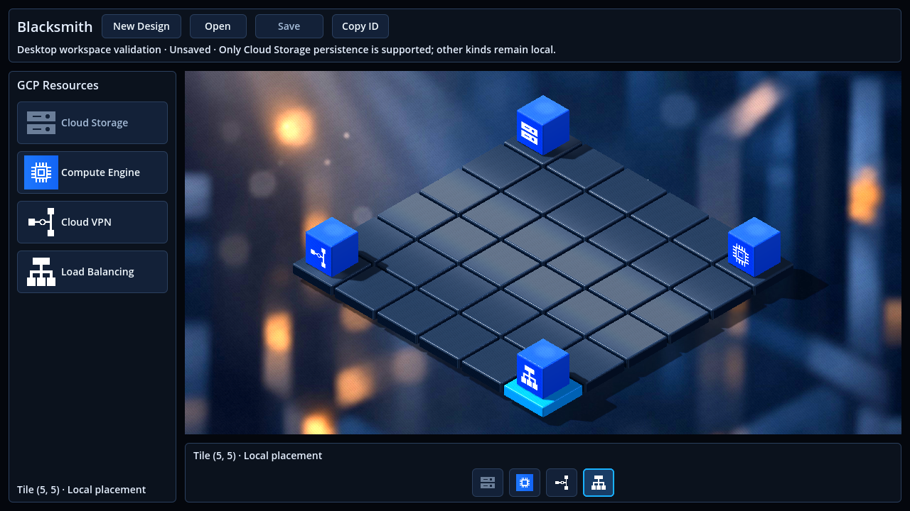
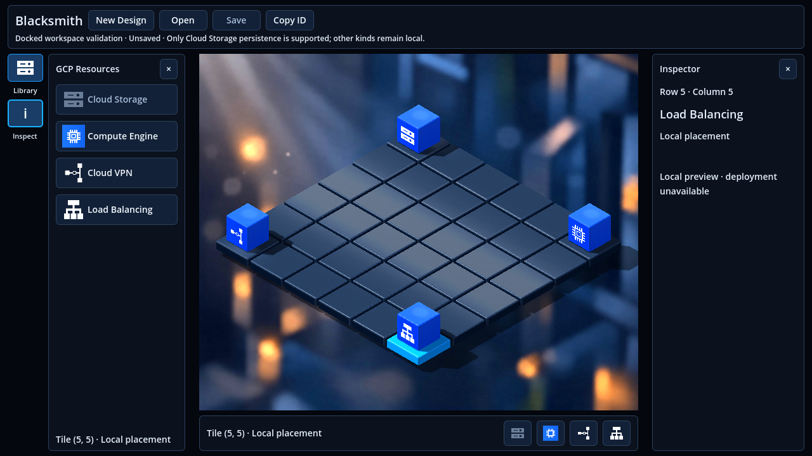
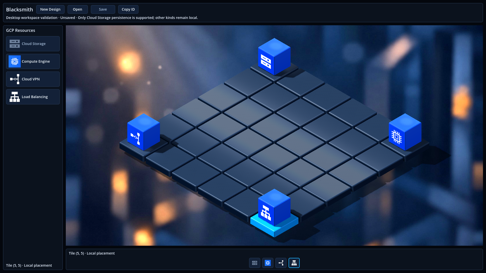
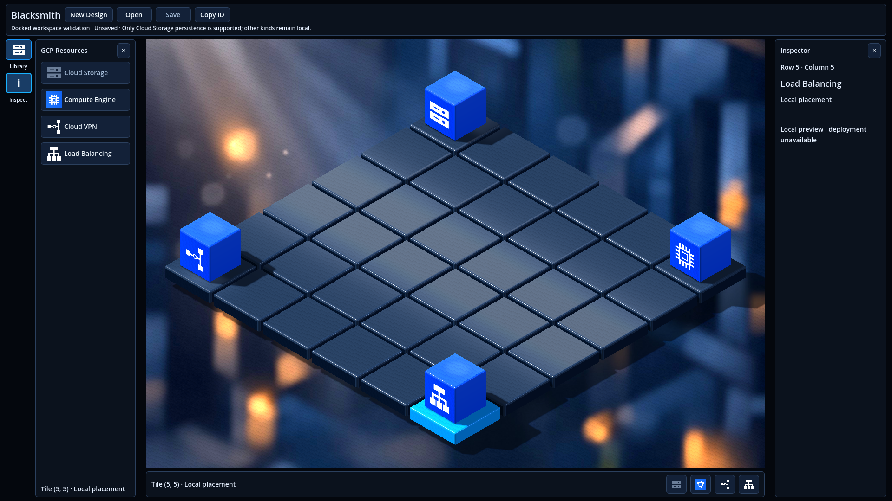

# Issue #62 — Canvas-first workspace and reserved docks

Issue: [Implement a Canvas-First 3D Workspace with Non-Overlapping Docked Panels](https://github.com/dexterBEN/blacksmith/issues/62).

## Scope and decisions

Completed on `issue_62`, created directly from the already synchronized `master`,
commit `463b4f4f6e3b315217504ddde5d412675cd8cd39`. The initial working tree was
clean. Existing stashes and unrelated work are preserved.

The workspace keeps the existing dark theme, grid, materials, four resource
visuals, real `SubViewportContainer` and fixed orthographic camera. This pass
changes the layout and its controls; it does not change cloud behavior or the
persistence/deployment state machine. The images guide the spatial hierarchy;
their material polish and incidental controls are not additional features here.

Two source-based clarifications:

- The runtime camera currently supports selection and automatic fitting, not
  pan/zoom/orbit navigation tools. Its pose/projection are preserved; fitting
  responds to the canvas dimensions rather than resetting camera orientation.
- The non-overlap contract applies to the docked Library/Inspector. The existing
  New Design and configuration/deployment dialogs remain intentional blocking
  modals, preserving their confirmation and error behavior.

## Layout

```text
+--------------------------------------------------------------------------+
| Blacksmith   New Design  Open  Save  Copy ID                              |
| Active Design / existing save and deployment summary                     |
+--------+------------------+---------------------------+-------------------+
| Library| optional Library | remaining canvas          | optional Inspector|
| Inspect|                  | SubViewportContainer      | tile / kind / ID  |
|        | four GCP choices |   WorldViewport/Camera3D  | saved/deploy state|
|        |                  +---------------------------+ Configure storage |
|        |                  | compact quick placement   |                   |
+--------+------------------+---------------------------+-------------------+
```

- Both docks start closed. The rail and quick-placement strip remain available.
- Library and Inspector open independently at desktop widths and have explicit
  close controls. Selection alone never opens a panel or changes the framing.
- Native `HBoxContainer`/`VBoxContainer` siblings reserve each visible dock and
  its resize grip. Closing docks returns their space to the canvas. There are no
  sliding overlays or panel animations.
- Library: 216 px default, 200–304 px range. Inspector: 240 px default,
  216–304 px range. The inner edges are real mouse-driven resize grips.
- Minimum window remains 960 × 640. Minimum map allocation is 480 × 320.
  When both requested docks cannot fit, the last opened/resized dock wins.
  Both preferences are retained and restored when the window widens. Closing
  the winning dock may reveal the other previously requested dock.
- Inspector reads existing BLoC values: logical row/column, resource kind,
  local/saved/configured state, Resource ID and available deployment outcome.
  **Configure storage** calls the original `DesignCubit` entry point. Save and
  Save & Deploy retain their existing meanings and consent requirements.
- Panel state is local presentation state; it is not written to a Design,
  repository, database or cloud provider. Closing Inspector never deselects.
- Existing blocking dialogs disable the underlying dock actions, including their
  keyboard activation, as well as the original palette/header actions.

## Implementation boundaries

| File/component | Change |
| --- | --- |
| `workspace_controls.tscn` | Compact header/quick strip, accessible two-action rail, optional Library and Inspector, sibling resize grips, native canvas minimum. Existing viewport/camera paths remain stable. |
| `workspace_layout.dart` | Small Godot-free policy for panel preferences, clamped widths and narrow-window priority. No grid dimensions or data access. |
| `workspace_3d.dart` | Owns presentation signals, inspector projection, panel visibility/widths and mouse resize lifecycle. |
| `isometric_3d_grid.dart` | Creates/updates the workspace helper and routes grip input while preserving the existing picking/rendering paths. |
| `workspace_layout_test.dart` | Minimum allocation, all dock states, independent closure, fallback/restore and width clamps. |
| `workspace_checks.dart` | Native dock/resize/selection/configuration/mode matrix and real screenshots. |
| `isometric_3d_framing_checks.dart` | Checks every visible dock/rail/grip against the actual canvas; hidden docks no longer count as occupied space. Existing perimeter mesh/cube and camera-pose checks remain. |
| `application_startup_checks.dart` | Explicit fail-closed Resource HTTP client in addition to the existing cloud and Design doubles. |
| Persistence/deployment journey fixtures | Open the Library before using its hidden catalog; verify restored deployment information and reach configuration from Inspector. |
| `README.md`, `frontend/src/README.md` | New panel behavior, dimensions and test commands. |

`IsomapGridBloc`, `DesignCubit`, repositories, configuration form, backend,
providers, schema/migrations, Dev Containers, launcher and legacy 2D scene are
unchanged. No deployment shortcut or unsupported cloud-provider entry was added.

## Validation commands and results

Host SDK: `/usr/lib/dart/bin/dart`, with existing Godot 4.4/godot_dart/native
libraries. Renderer: OpenGL Compatibility / VirtualBox llvmpipe. Backend tests
use the existing .NET 8 Dev Container and random PostgreSQL test databases.

```bash
cd frontend/src
/usr/lib/dart/bin/dart run build_runner build --delete-conflicting-outputs
/usr/lib/dart/bin/dart analyze
/usr/lib/dart/bin/dart test --reporter expanded
cd ../..
python3 frontend/scripts/test-godot.py --application --trace-network \
  --timeout 600 --output /tmp/blacksmith-issue62/verified
python3 frontend/scripts/test-godot.py --design --trace-network \
  --timeout 600 --output /tmp/blacksmith-issue62/design
python3 frontend/scripts/test-godot.py --timeout 600 \
  --output /tmp/blacksmith-issue62/legacy
```

The existing fake-provider host provides actual HTTP/API/PostgreSQL Save & Deploy
and reopen. Host terminal A starts it and remains open:

```bash
python3 frontend/scripts/start-design-test-backend.py CONTAINER_ID --deployment --port 5148
```

Host terminal B uses the container's reachable numeric IP (this run used
`172.18.0.4`), then stops only the fixture using its printed RUN_PATH:

```bash
python3 frontend/scripts/test-godot.py --deployment http://CONTAINER_IP:5148 \
  --trace-network --timeout 600 --output /tmp/blacksmith-issue62/deployment
python3 frontend/scripts/start-design-test-backend.py CONTAINER_ID --stop RUN_PATH
```

Backend tests ran with `dotnet test BlacksmithBackend.sln --configuration Release
--no-restore` inside the existing Dev Container, with `BLACKSMITH_TEST_POSTGRES`
targeting the administrative connection used solely to create random test
databases. No connection string or password is reproduced here. No development
listener was stopped. All provisioner calls in the fixture are simulated.

| Check | Result |
| --- | --- |
| Fresh bindings | PASS; existing dependencies/lockfile retained. |
| Dart analysis | PASS; no issues. |
| Dart unit tests | PASS; 225 tests, including 20 layout-policy tests. |
| Backend regressions | PASS; 96 Application + 90 HTTP + 43 isolated PostgreSQL tests. |
| Baseline native captures | PASS; frozen pre-change source, captures at 1280×720 and 1920×1080 render sizes. |
| Native layout/interaction matrix | PASS; 16 requested dock/size combinations, real grips/clamps, maximize/restore, native window minimum, all perimeter cubes visible, selection and native resource nodes retained. |
| Production bootstrap and clean 3D/2D launches | PASS; one shared BLoC, scene reload, shutdown and no IP connections in the presentation scenarios. Workspace/parent scenes were saved/reloaded twice before testing. |
| New Design regression | PASS; cancel, validation, duplicate guard, active Design, discard only after success, scene reload, zero cloud calls. |
| Legacy 2D interaction regression | PASS; both placement choices, replacement, normal and local diagnostic paths, zero repository/HTTP calls. Known headless import messages are noted below. |
| Save & Deploy and full frontend restart on isolated DB | PASS; real HTTP/API/PostgreSQL with fake provisioner, both palette entry points, failure/unknown/retry/reconciliation, stable restoration and Inspector configuration entry point. |
| Final preservation/fingerprint checks | PASS; five development table fingerprints/counts unchanged; baseline files and three stashes unchanged. |

### Native acceptance matrix

Each row covers both closed, Library only, Inspector only, and both requested.
The minimum-size both-requested case correctly shows only the Inspector when it
was requested last; the rail switches to Library without modifying selection.
Widening restores both requested docks. Native minimum clamping below 960×640,
grip limits and maximize/restore were also exercised.

| Native client size | Mode | States | Canvas width range | Canvas height | Overlap / controls / perimeter visibility / selection |
| --- | --- | --- | --- | --- | --- |
| 960×640 | Windowed | 4, with narrow fallback | 610–872 px | 483 px | PASS |
| 1280×720 | Windowed | 4 | 692–1192 px | 563 px | PASS |
| 1600×900 | Windowed | 4 | 1012–1512 px | 743 px | PASS |
| 1920×1080 | Native fullscreen | 4 | 1332–1832 px | 923 px | PASS |

The JSON matrix records actual native Window/viewport dimensions and visible
dock states. Geometry assertions inspect real Control rectangles, rendered
viewport size, mesh projections, camera pose and instance IDs. They do not just
reassert the pure layout formula. Input uses named controls' current bounds and
world projection rather than fixed desktop coordinates.

### Persistence/deployment evidence

Test DB: `blacksmith_front_smoke_5acee0867a6a469eac973e03a2220685`, API port 5148.
Save player PID `61593` and reopened player PID `62788` were distinct processes.
The fixture created two configured Resources, one saved-only and one eventually
verified as succeeded. The journey tested rejected creation, fresh consent for
retry, injected lost response, database-only Check Save and explicit fake
provider reconciliation.

Before and after restart/Open: two Resources, two configurations, one operation,
three attempt records; fake calls remained two creates and one inspection,
with one in-memory fake bucket. Reopen/review/cancel/repeated Open issued four
repository GETs, no repository writes and no additional provisioner calls.
The fixture-statistics checks are additional read-only GETs. Network traces
allowed only the dedicated API in this scenario.

Inspector showed the restored Resource ID and succeeded outcome, opened the
original canonical JSON form with consent reset, and blocked underlying dock
controls while the form was modal. Both complete Resource snapshots, positions,
revisions, configurations and deployment identity/outcome matched the saved
snapshot. No Google SDK provisioning or Google resource inspection occurred.

## Native display observations

The Ubuntu desktop is 1920 × 1080. GNOME constrains an ordinary decorated
1920 × 1080 client to 1854 × 1011 on this desktop. A diagnostic confirmed that
960 × 640, 1280 × 720 and 1600 × 900 native client sizes are retained.

The final matrix therefore uses real windowed clients for those sizes and real
native fullscreen for 1920 × 1080. It verifies physical Window size and viewport
size together, then also exercises maximize/restore. No desktop-resolution or
production window-mode setting is changed. The first matrix attempt stopped at
the size mismatch rather than counting a scaled/clamped viewport as a pass.

Mouse release after a resize is allowed through Godot's GUI path to clear its
native pointer capture. Mouse motion is consumed during the drag; world picking
ignores release events. This preserves panel dragging without a trailing tile
selection or a stuck GUI capture.

An early grip test moved the synthetic pointer outside the native client and
failed its minimum-width assertion. The corrected test drags past the minimum
while remaining inside the client; both width clamps then passed. No panel-width
contract was relaxed to make that test pass.

The existing Godot 4.4 headless legacy-editor import still emits eight
`progress_dialog.cpp` errors despite exit 0. Its readiness and both subsequent
runtime stages passed, with no Dart/native exceptions. The local diagnostic
stage intentionally logs its injected missing-DI stack. The graphical 3D,
configuration/deployment and New Design runs completed without runtime engine
errors. This does not claim a clean zero-error headless editor import.

## Evidence

Six actual, unmodified Godot captures are included. The before images use a
frozen pre-change source copy at the requested render sizes; the after images
use the physical native client sizes/modes described above. The four perimeter
cubes are explicit offline rendering fixtures, with Cloud Storage configuration
persistence tested separately through the real API journey.

| Render size | Before | After, docks closed | After, both docks open |
| --- | --- | --- | --- |
| 1280×720 |  |  |  |
| 1920×1080 |  |  |  |

Logs, the native matrix, HTTP method records, saved/reopened snapshots and
source manifest remain in `/tmp/blacksmith-issue62/`. The aggregate source
SHA-256 is `4941c77bb71234ffa0dffca320687c996ddaacac1790e20bf44253f7fb2f7231`.
It hashes sorted `path + NUL + file_sha256 + newline` entries for the workspace
scene, prototype Dart libraries (excluding generated bindings), layout unit test
and native test-support Dart files. Production services/models outside this UI
scope remain identified by the base commit above.

The ignored `.env`, launcher, `dev.sh` and lockfile match their initial SHA-256
fingerprints. All three stash identities and HEAD are unchanged. Development
data counts/full-row fingerprints match for Designs, Resources, configurations,
deployments and attempts. Only the fixture API and its own uniquely named
temporary DB were stopped/removed; containers, volumes and existing cloud data
were retained. No credentials are included in the new files or screenshots.

## Limits and follow-up

The renderer/materials are retained, so this validates a more spacious,
non-overlapping workspace rather than a new lighting/reflection implementation.
Runtime navigation remains the existing fixed isometric view. Preferences reset
on scene/application restart; selection/data persistence keep their existing
ownership and behavior. Real GCP provisioning is not part of this validation.

No commit, push or merge is performed by this task.
