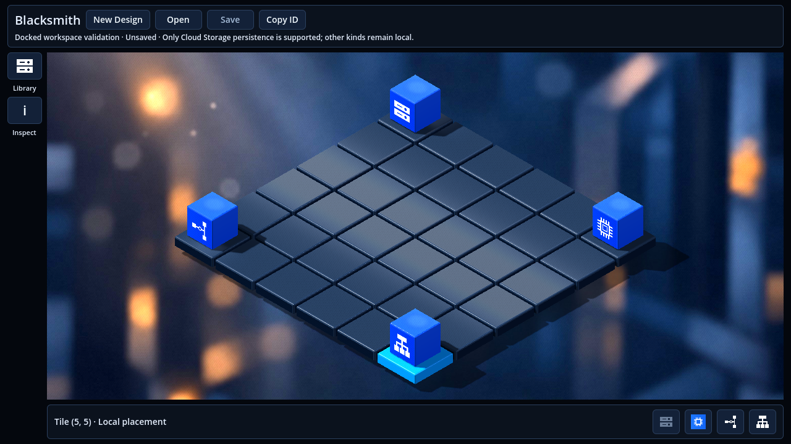
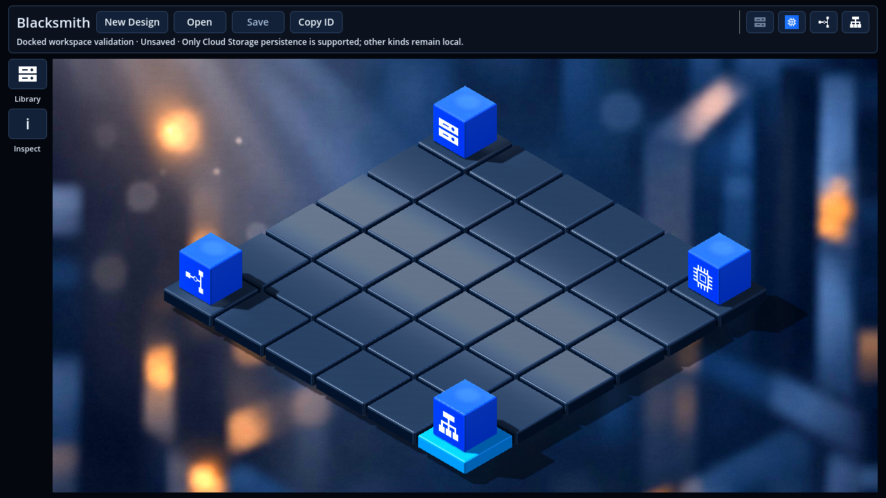
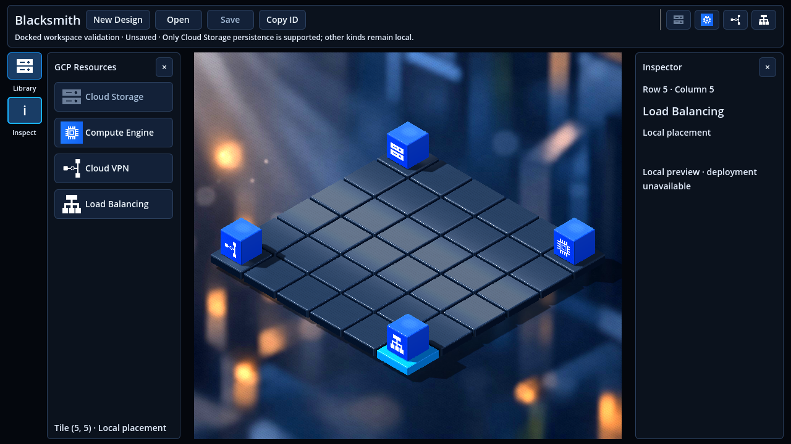
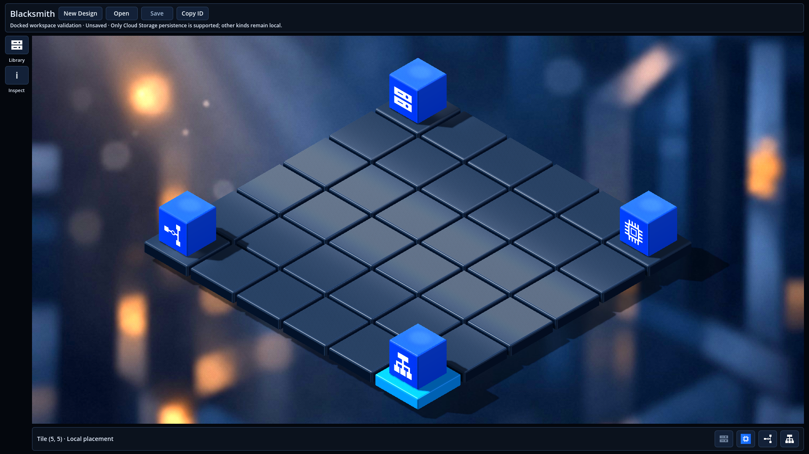
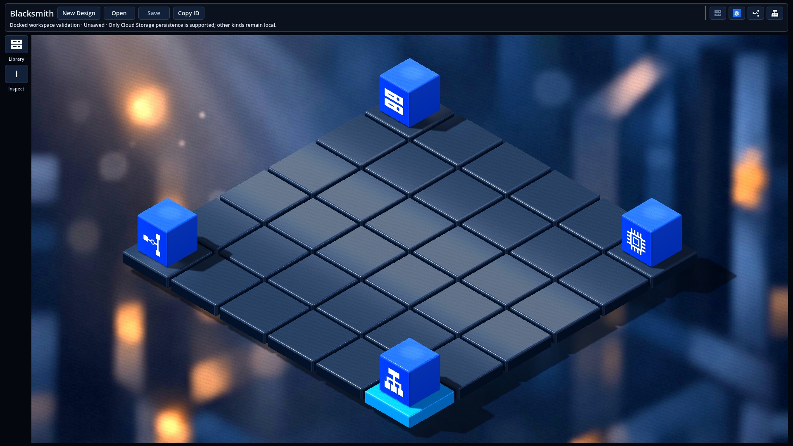
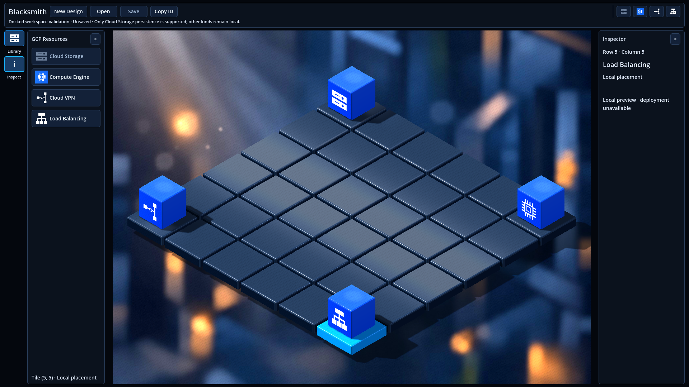

# Issue #64 — Remove the persistent bottom toolbar

## Purpose and scope

[Issue #64](https://github.com/dexterBEN/blacksmith/issues/64) removes the permanent bottom strip so the existing 3D canvas can use its height. The four existing placement shortcuts move into the existing header; tile/resource context remains in the existing Inspector. No new toolbar, camera tool, notification system or resource workflow is introduced.

Branch: `issue_64`, created from the already current `master`, base commit `1870ca7cd6b24f9d9400593a54d96b6cc4a45be3` (PR #63). Implementation and validation changes are uncommitted for review. No commit, push or merge was requested.

## Source inventory and destinations

The inventory was taken from `workspace_controls.tscn`, `ResourcePalette3D`, `Workspace3D`, `Isometric3DGrid` and `DesignEditor3D`, rather than inferred from the reference image.

| Previous bottom-strip element | Handler / source of truth | Destination and preserved behavior |
| --- | --- | --- |
| Cloud Storage button | `ResourcePalette3D` → existing `DesignCubit.openResourceConfiguration()` callback | Header `Rows/Actions/PlacementChoices/CloudStorage`; opens the existing form, subject to active Design, tile, persisted-resource and modal guards. Opening it does not save or deploy. |
| Compute Engine button | Palette callback → `IsomapGridBloc.add(PlaceResource(...))` | Header `PlacementChoices/ComputeEngine`; same local placement/replacement. |
| Cloud VPN button | Same callback and event with `cloudVpn` | Header `PlacementChoices/CloudVpn`; same local placement/replacement. |
| Load Balancing button | Same callback and event with `cloudLoadBalancing` | Header `PlacementChoices/CloudLoadBalancing`; same local placement/replacement. |
| Instruction label: no selection / tile coordinates / local, unconfigured or saved configuration | Palette projection of `IsomapGridState.selected` and selected `PlacedResource` | Existing Inspector `Coordinates`, `Kind`, `Placement` and `Identity`; the equivalent Library guidance remains. The duplicate bottom label is removed. |
| Selected resource deployment tooltip | `resource.deployment.describe(resource.revision)` | Existing Inspector `Deployment` and Library tooltip. Global persistence/deployment feedback remains in the existing header label/tooltip and configuration dialog, independently of Inspector visibility. |
| Bottom `QuickPlacement`, `Content`, `Choices` containers | Native Godot layout only | Removed entirely; their buttons are reparented into the existing header. No placeholder or hidden allocation remains. |

There were **no camera, navigation, mode, Save or Deploy buttons in the bottom strip**, and no custom keyboard shortcuts attached to its four buttons. Native pointer, focus and keyboard activation remain. Existing header New Design / Open / Save / Copy ID controls are unchanged.

The Inspector uses the current BLoC state even while hidden. Selection neither opens it automatically nor depends on its visibility. Reset clears its context; reopening after a different selection must not display stale information.

## Implementation

- `frontend/scenes/isometric_3d/workspace_controls.tscn`: removes the footer hierarchy, moves the four existing buttons into header `PlacementChoices`, using 40 × 32 minimum buttons and 20-pixel icons to fit the existing header row. The Library retains full resource names. `Center` keeps its existing canvas and viewport hierarchy.
- `frontend/src/lib/prototypes/isometric_3d/workspace_3d.dart`: centralizes the new shortcut path; removes the obsolete footer path and updates empty-tile guidance.
- `frontend/src/lib/prototypes/isometric_3d/resource_palette_3d.dart`: drops the obsolete label reference; retains the same two groups of four button bindings and existing enablement rules. Unselected shortcuts explain “Select a tile first” in their tooltips.
- Existing native test helpers: verify no footer allocation, header button containment, exactly-once placement, keyboard activation, Inspector reopening and header deployment feedback with Inspector closed. Existing geometry, real picking and workflow checks remain in use.
- Root and frontend READMEs: describe the new control locations.

`IsomapGridBloc`, `DesignCubit`, repositories, HTTP/JSON contracts, backend, migrations, Godot rendering/materials, minimum window/canvas sizes and legacy 2D scene are unchanged. The real `SubViewportContainer`, camera path, canvas input mapping and scene ownership remain intact. No second command binding is added when moving the buttons.

## Validation results

**All planned checks completed successfully.** The non-failing engine/tooling messages are recorded under Observations and limits.

- Fresh `dart run build_runner build --delete-conflicting-outputs`: passed (1,052 outputs / 2,104 actions); generated tracked resolver unchanged.
- `dart analyze`: passed, no issues.
- `dart test --reporter expanded`: **225 passed**.
- Native application import, scene save/reload (twice), clean 3D and legacy 2D launches: **passed**, with network tracing.
- Legacy 2D import, scene and local diagnostic suite: **passed**, with network tracing.
- Native New Design regression suite: **passed** (cancel, validation, duplicate guard, active Design, discard after success, reload; no cloud calls).
- Native workspace interactions: **passed**, including exactly-once placement, Enter activation, current Inspector context after reopening, 16 layout cases, minimum window, shared BLoC lifecycle, scene reload and **zero HTTP/provisioning calls** (one explicit in-memory fixture Design creation).
- Native Save & Deploy / full-process restart against the isolated API and temporary PostgreSQL database: **passed**, including the new header-feedback assertion with Inspector closed.
- Backend Release build and `dotnet test BlacksmithBackend.sln --configuration Release --no-restore --nologo`: **229 passed** (96 application, 90 HTTP integration, 43 PostgreSQL).

Environment: Godot 4.4 stable, Dart 3.12.2, native `godot_dart` libraries with package 0.11.0; X11 / OpenGL Compatibility with Mesa llvmpipe in the Ubuntu VM. Backend validation uses .NET 8.0.426 inside the existing Dev Container.

### Reclaimed canvas space

The existing native harness was run first on a frozen, clean copy of base commit `1870ca7`, then on the implementation. **All 16 paired layout cases gained exactly 64 pixels of real render height**, with identical canvas widths and dock visibility. The previous footer occupied 56 pixels plus an 8-pixel sibling gap. Header height stays 69 pixels; the canvas now ends at the existing 8-pixel bottom margin.

| Native client size | Canvas height before → after | Canvas widths: closed / Library / Inspector / both requested |
| --- | --- | --- |
| 960 × 640 | 483 → **547** | 872 / 634 / 610 / 610 (Inspector wins) |
| 1280 × 720 | 563 → **627** | 1192 / 954 / 930 / 692 |
| 1600 × 900 | 743 → **807** | 1512 / 1274 / 1250 / 1012 |
| 1920 × 1080 | 923 → **987** | 1832 / 1594 / 1570 / 1332 |

The matrix covers closed, Library-only, Inspector-only and both requested at every size. The native tests check container/render-size equality, no UI/canvas intersections, all 36 tile bounds and hypothetical cube envelopes, actual corner cubes, projected corner-tile picking after resize, grip clamps, narrow fallback and maximize/restore. The minimum viewport remains above 480 × 320 in every case.

### Native evidence

These unmodified PNGs were captured from native Godot with identical corner-resource fixtures before and after, then visually inspected. They are rendered screenshots, not mockups or AI images.

| Size | Before, docks closed | After, docks closed | After, both docks open |
| --- | --- | --- | --- |
| 1280 × 720 |  |  |  |
| 1920 × 1080 |  |  |  |

The four perimeter cubes and selected cyan tile remain fully visible. The actual viewport extends through the former footer area; the docks continue to reserve space beside it.

### Workflow and safety

The offline placement/layout suite deliberately uses a legacy local Cloud Storage fixture **after cancelling its configuration form**, solely to render all four cube types. It does not claim to persist that fixture. The separate native API journey validates configured Cloud Storage through the actual form, HTTP API and temporary PostgreSQL database. Compute Engine, Cloud VPN and Load Balancing remain local placements.

The Save & Deploy smoke test uses the real ASP.NET Core/EF/PostgreSQL execution path with the existing recording fake cloud provider. Only a uniquely named disposable test database is migrated; the development database is not modified. No real GCP provisioning is authorized or performed.

The native API journey passed these checks:

- Save-only creates a separate configured resource without requesting deployment.
- A simulated provider rejection retains its saved resource/configuration and requires new consent to retry.
- A deliberately lost HTTP response causes uncertainty without automatic retry. Check Save only rereads the database; explicit Check Deployment reconciles the outcome.
- Final fake-provider totals: **2 create calls, 1 inspection, 1 simulated bucket**. SQL contains **2 resources, 2 configurations, 1 deployment operation and 3 attempts**.
- A full Godot restart used distinct OS processes (`123838` → `124992`), restored both complete resource/configuration snapshots and the successful deployment identity/outcome, and issued only GET requests. Provider counters remained unchanged.
- Restored deployment feedback is available in the header tooltip while Inspector is closed. Inspector reopening shows the saved resource identity/outcome; the configuration form retains canonical JSON and starts without deployment consent.
- Offline native suites made **zero IP connections** in the recorded traces. The API journey's traced connections were restricted to the dedicated fixture at `172.18.0.4:5150`; there was no live Google Cloud endpoint or legacy bucket-creation request.

Cleanup completed: the fixture API exited normally and dropped only its own `blacksmith_front_smoke_36cdfa6f4add4ccfa023ef9cab84b1be` database; `pg_database` confirms it is absent. Development-table counts and complete-row fingerprints for designs, resources, configurations, deployments and attempts are identical before/after. All three original containers remain running with the same IDs. All **three stashes**, protected local launcher/configuration files, dependency lockfile and tested frontend source fingerprints are unchanged.

### Reproduction and source identity

Run Dart commands in `frontend/src` with `/usr/lib/dart/bin/dart`. Native commands below run from the repository root and use the existing harness:

```bash
python3 frontend/scripts/test-godot.py --application --trace-network --timeout 900 --output /tmp/blacksmith-issue64/after
python3 frontend/scripts/test-godot.py --design --trace-network --timeout 900 --output /tmp/blacksmith-issue64/design
python3 frontend/scripts/test-godot.py --trace-network --timeout 900 --output /tmp/blacksmith-issue64/legacy

# Separate fixture API; this creates/migrates only its random test database.
python3 frontend/scripts/start-design-test-backend.py 2a491f48dabc --deployment --port 5150
# Run in another terminal while that fixture is up:
python3 frontend/scripts/test-godot.py --deployment http://172.18.0.4:5150 --trace-network --timeout 900 --output /tmp/blacksmith-issue64/deployment
# Stop using the exact RUN_PATH printed by the fixture startup script.
```

The container ID/IP are local to this VM and should be replaced if necessary. The deployment harness verifies `fakeProvider=true` before running. Use a fresh output directory for a new API journey; do not reuse saved IDs from the already deleted test database.

Raw logs, source fingerprints and JSON matrices for this run remain in `/tmp/blacksmith-issue64/`; permanent before/after evidence is linked above. All four native suites returned exit code 0. The executed frontend production/test patch against the base commit has SHA-256 `b70ecb1acd1c676f7720bcd2be5f067addceff43a7f250b5cd9d146e529968a1`, calculated with:

```bash
git diff -- frontend/scenes frontend/src/lib frontend/src/test_support | sha256sum
```

The tested source was rechecked after all native suites and is unchanged. This identifies the working-tree patch, not a new commit.

## Observations and limits

- This task consolidates existing controls. It intentionally does not implement the richer camera controls or resource indicators in the reference artwork.
- At 960 × 640 the existing narrow-width rule still gives priority to the last requested dock; both requested docks return when space becomes available. The minimum canvas remains 480 × 320.
- On this 1920 × 1080 VM desktop, GNOME cannot provide a decorated window with a 1920 × 1080 client area. The existing harness uses real native fullscreen for that matrix row and ordinary windowed mode for the other requested sizes.
- The existing generator warns that its pinned analyzer predates Dart 3.12. Generation and analysis succeed; no dependency upgrade is included in this presentation change.
- The legacy **headless editor import** emits eight existing Godot 4.4 `progress_dialog.cpp` errors. It exits successfully with its expected readiness marker, and both subsequent 2D runtime checks pass. The existing harness explicitly handles this engine limitation while still rejecting Dart/native exceptions. Graphical application and New Design checks report no native errors.
- Temporary copied fixtures can emit resource-UID fallback warnings; Godot resolves the existing text paths. No production asset paths or UIDs were changed.
