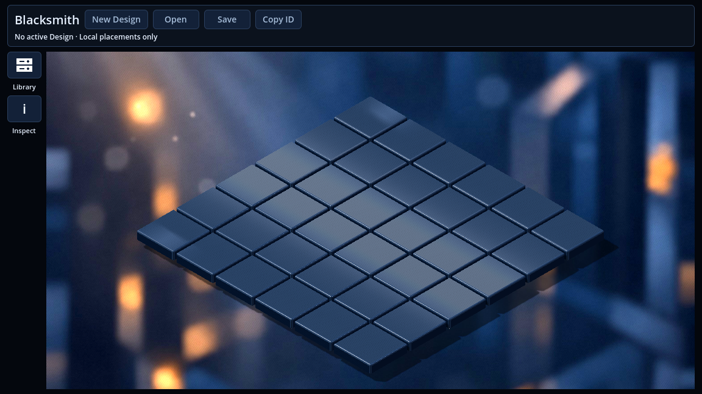
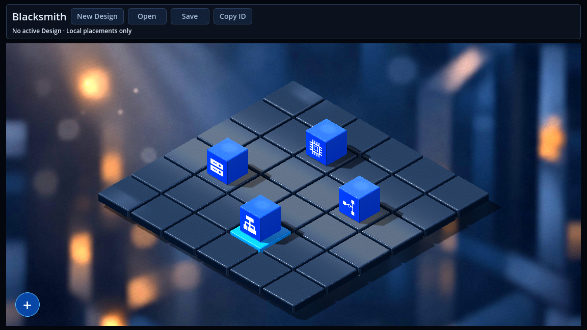
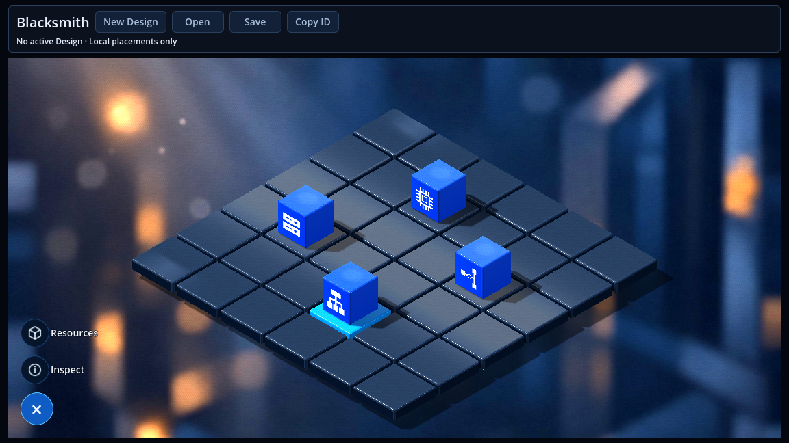
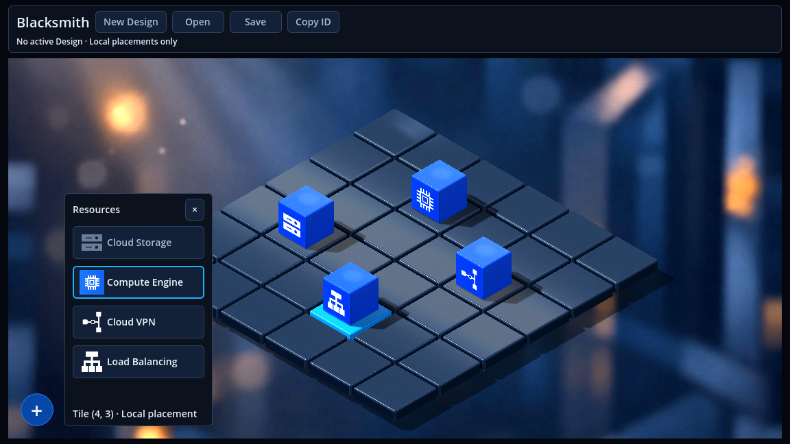
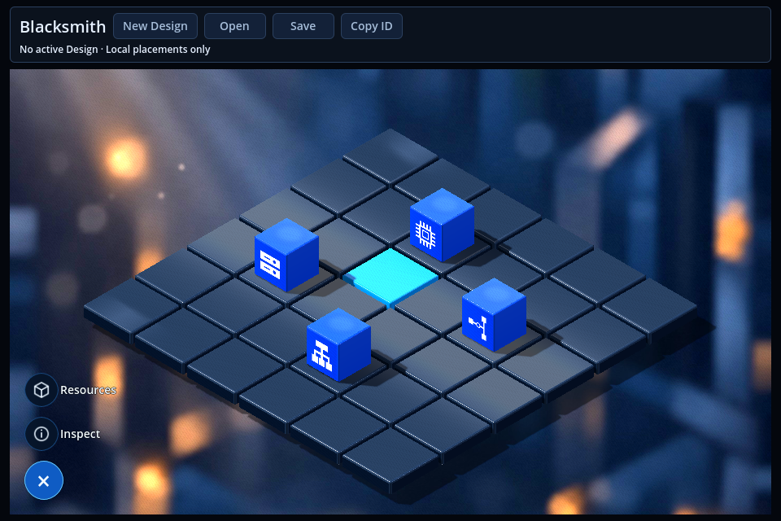
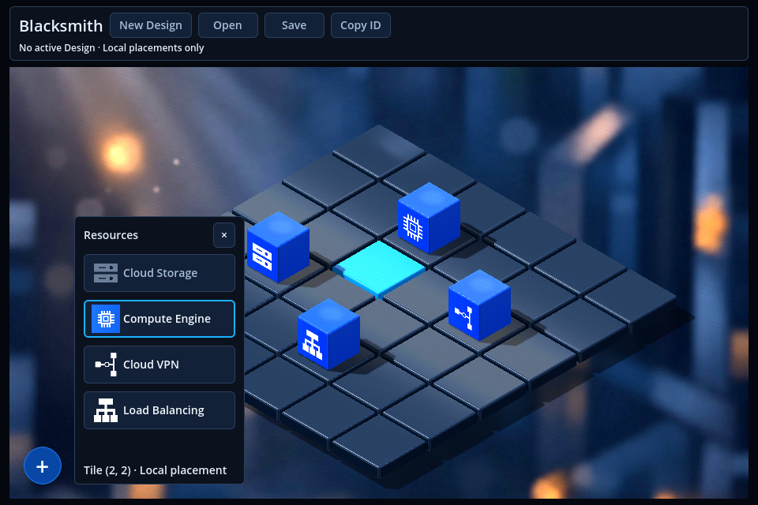

# Issue #73 — Floating vertical Speed Dial

## Result

Replace the permanent left navigation rail with a compact Speed Dial floating at the bottom-left of the existing 3D workspace. The viewport now fills the complete available width below the unchanged Design toolbar.

At 1152 × 648, the canvas expands from **1064 to 1128 pixels**: the recovered 64 pixels were the old 56-pixel rail and its 8-pixel separation. The existing 12-pixel outer margins remain. Opening the menu or a floating panel does not resize the viewport or change camera framing.

## UI and interaction changes

- Default state: one **48-pixel round blue `+` button**, inset 18 pixels from the canvas bottom-left.
- Expanded state: **Resources** and **Inspect** sit in a single upward column above **`×`**. Secondary buttons have 42-pixel dark-blue circles, small SVG icons, and text labels to their right.
- A native `AnimationPlayer` provides a restrained **160 ms** fade/upward entrance. Collapse hides actions immediately so invisible controls cannot intercept input.
- The user-facing Library action is renamed **Resources**. Existing internal names, resource kinds, callbacks, and persistence fields are retained.
- Resources and Inspect reuse their existing controls and contents in floating panels beside the main button. Only one panel is open at a time; the old dock resize grips are removed.
- Choosing an action closes the dial and focuses the existing popup controls. Escape or a popup close button dismisses the UI and returns focus to the main button.
- Outside clicks dismiss floating controls and continue through the ordinary grid input route. Transparent overlay regions, including the gaps between action rows, remain clickable.
- Main/action buttons and popup bodies consume their own input. Grid picking additionally checks the visible actionable rectangles to prevent click-through during GUI state changes.
- Opening a modal or resetting selection for a Design change dismisses floating controls. A newly loaded scene starts collapsed.

The existing **select tile → open Resources → choose resource** workflow remains authoritative. Resource choices remain disabled without a selected tile. Existing Cloud Storage configuration requirements and occupied/persisted-resource constraints continue to come from the existing palette and BLoC/Cubit code. The menu itself never provisions resources or issues backend calls.

## Implementation boundaries

The production change is localized to:

| File | Change |
| --- | --- |
| `frontend/scenes/isometric_3d/workspace_controls.tscn` | Remove the rail/grip allocation; retain the viewport/camera path; move existing panels under the full-width canvas host. |
| `frontend/scenes/isometric_3d/speed_dial.tscn` | Anchored native controls, circular styles, labels, and entrance animation. |
| `frontend/scenes/isometric_3d/icons/` | Two small native SVG icons for Resources and Inspect. |
| `frontend/src/lib/prototypes/isometric_3d/workspace_3d.dart` | Scene-local menu/popup presentation, focus, dismissal, input bounds, and popup positioning. |
| `frontend/src/lib/prototypes/isometric_3d/workspace_layout.dart` | Exclusive floating-panel preferences; panels consume no canvas width. |
| `frontend/src/lib/prototypes/isometric_3d/isometric_3d_grid.dart` | Guard grid picking against visible floating controls. |

`README.md` and `frontend/src/README.md` describe the new entry points and layout. Existing integration fixtures now open the dial before choosing Resources/Inspect. Obsolete dock-allocation/grip assertions are replaced by overlay/full-width assertions.

A focused **`--speed-dial`** option was added to the existing isolated preview runner. It runs the changed UI and placement checks without repeating the longer grid matrix; normal interactive, full-check, headless, and material-variant modes retain their existing behavior. No build command or dependency version changed.

**Preserved:** toolbar actions and paths, BLoC/Cubit ownership, resource palette rules, logical coordinates, resource mapping, camera transform/fitting algorithm, 3D tile/cube geometry, materials, lighting, renderer, backend, API contracts, database, and persistence format. The scene still owns its actual `SubViewport` and camera; no static map image or fake editor viewport was introduced.

## Actual Godot screenshots

The images below are unmodified viewport captures from **Godot 4.4, Compatibility/OpenGL**, rendered on Mesa llvmpipe. The before image shows the empty editor; the final UI captures include four local sample resources seeded exclusively inside the isolated preview fixture. The 3D assets are unchanged.

| Before — permanent rail | After — collapsed, full-width workspace |
| --- | --- |
|  |  |

| Expanded vertically | Existing resource picker after tile selection |
| --- | --- |
|  |  |

The 960 × 640 window was also resized and captured natively:

| Small window — expanded | Small window — resource picker |
| --- | --- |
|  |  |

Cloud Storage is disabled in this isolated preview because it has no active persistent Design. This is the existing configuration constraint. The resource hint retains the selected coordinates, and the focused test additionally chooses Compute Engine through the real picker and verifies that Inspect reads that same selected resource.

## Validation

Fresh checks after resuming the interrupted task:

- **212 Dart unit tests passed.** Dock-specific layout expectations were replaced with full-width/exclusive-overlay cases, including multiple window widths and preserved width preferences.
- **21 script/dispatcher tests passed.**
- **Targeted Dart static analysis: no issues found.**
- **Resource dependency validation: 20 files passed.**
- **Focused graphical Dart/Godot preview passed with exit 0**, using the final source assets and the real native controls. Both success markers were present: `BLACKSMITH_ISSUE73_SPEED_DIAL_PASSED` and `BLACKSMITH_ISSUE73_FLOW_PASSED`. The runtime log contains no native/script/shader errors or shutdown leak warnings.
- Verified at **1152 × 648 and 960 × 640**: full-width viewport; bottom-left anchoring; upward-only expansion; label/glyph changes; popup focus; selection preservation; Escape/outside dismissal; toggle/action/popup input consumption; transparent row gaps; and unchanged viewport size while overlays are open.
- The click-through checks temporarily place the actual controls and popup padding above a valid tile, rather than relying on their normal location outside the board.
- The focused flow verifies disabled choices without a selection, placement on the previously selected tile, Inspector content, and **zero HTTP/provisioning calls**.
- Before interruption, the full headless selection/placement/framing/lifecycle suite also passed: all 36 centers, gaps, four resource kinds, replacement/replay/removal, scene reload, and six framing sizes / 216 tile-center clicks.
- Git comparison confirms no changes to the protected 3D assets, domain state, backend, renderer configuration, or dependency lockfile.

The graphical test initially exposed an unreliable fixed-delay assumption: on software rendering, a 160 ms native animation can remain active after a wall-clock delay. The shared test input helper now waits for `AnimationPlayer.isPlaying()` to finish before geometry-dependent clicks. The transparent-gap regression then passed at both sizes.

The interrupted attempts to rerun the entire graphical grid matrix are **not** reported as complete passes. The focused graphical command was added to make validation of this UI change reproducible within the environment's execution limits. Full API-backed Save/Open and Save & Deploy journeys were not rerun; their UI entry-point fixtures were adapted, while production persistence/deployment code remains unchanged.

Reproduce from the repository root:

```bash
frontend/scripts/dev.sh preview --speed-dial --check --timeout 500 --output /tmp/blacksmith-speed-dial
frontend/scripts/dev.sh preview --speed-dial --headless --timeout 500 --output /tmp/blacksmith-speed-dial-headless
# Existing complete editor regressions:
frontend/scripts/dev.sh preview --headless --timeout 600 --output /tmp/blacksmith-grid-regression
```

## Intentional differences from the mockup

The existing toolbar, background, tiles, cubes, shadows, and reflections are preserved. The mockup is used for the full-width layout and compact vertical navigation only. The expanded main button shows **×**, as required by the issue text, although the concept image displays a plus. Popups are mutually exclusive floating panels rather than resizable docks. They can cover part of the map while open; closing them restores visibility without reframing it.

No commit or merge was performed.
