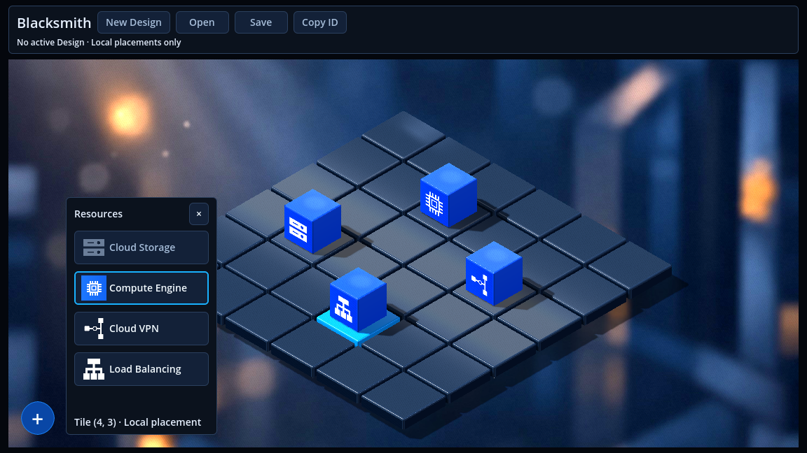
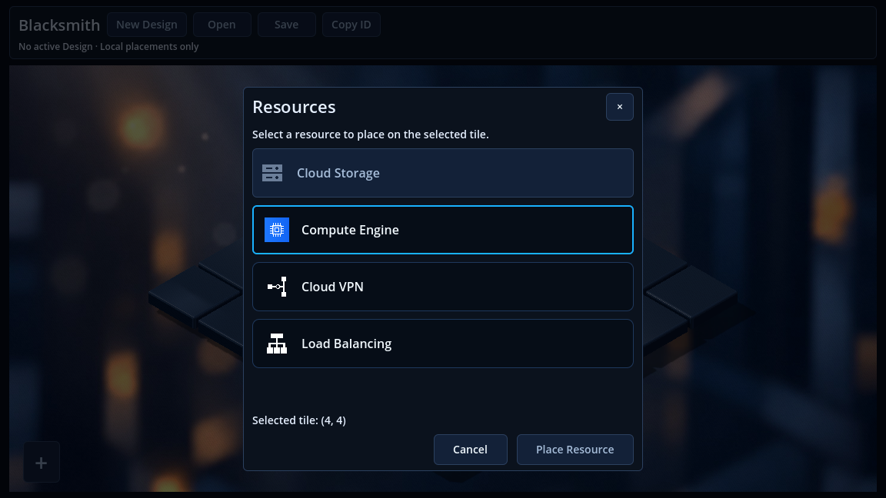
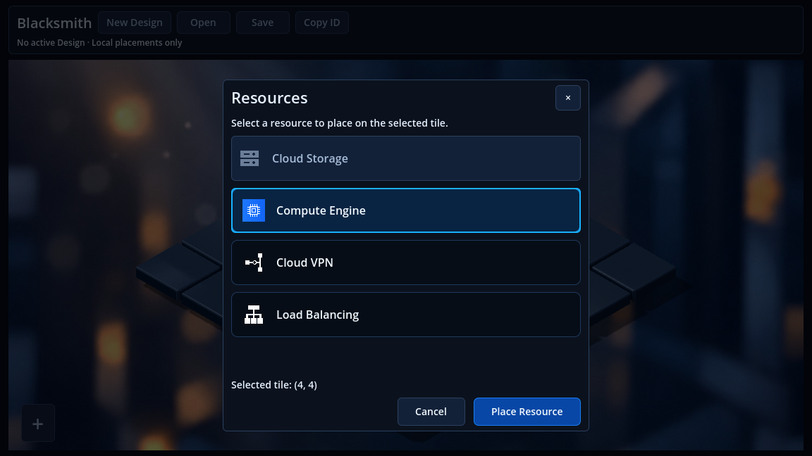
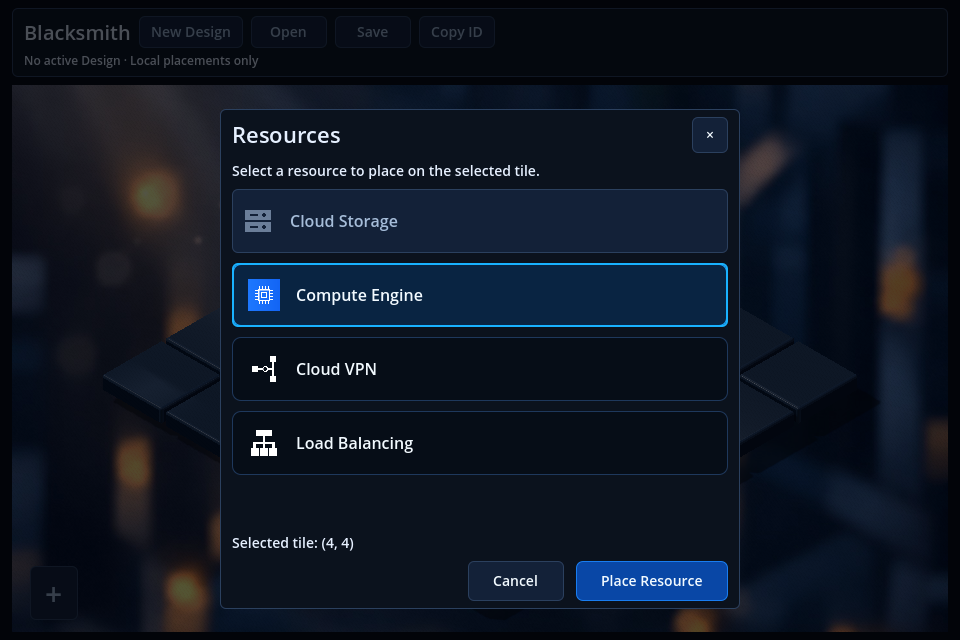
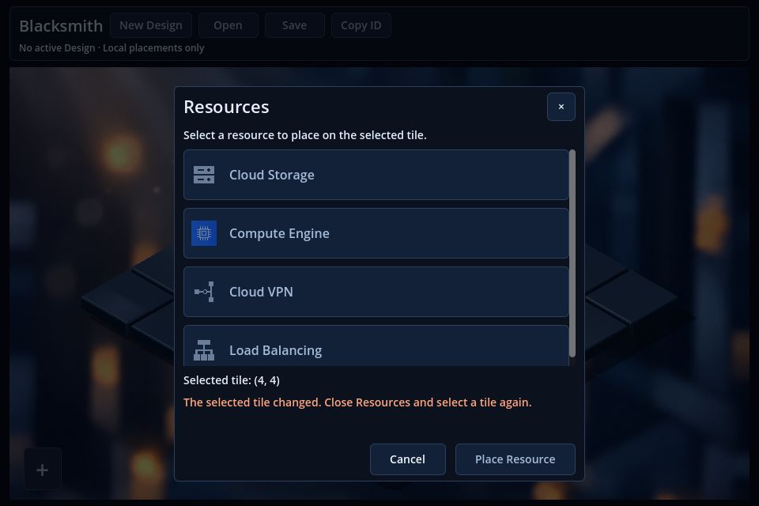

# Issue #75 — Centered Resources modal with explicit confirmation

## Result

Resources now opens a **centered in-app modal** rather than the narrow panel beside the Speed Dial. Clicking a resource row only selects a draft; **Place Resource** explicitly invokes the existing placement/configuration path on the tile selected before opening.

The supplied target image was downloaded from the issue's stable attachment and visually inspected **before implementation**. Its centered composition, dimmed workspace, resource list, tile context, and explicit confirmation guide this change. The Speed Dial is collapsed while the modal is open, as required by the issue text.

## UI behavior

- The dialog is centered in the usable workspace with a preferred size of **520 × 500**, constrained by the available canvas and 16-pixel margins.
- A translucent scrim covers the entire editor, including the toolbar. The viewport stays full-width; opening the modal changes neither its dimensions nor the existing camera framing.
- The existing four catalog rows, icons, labels, availability rules, and tooltips are reused. A native, scene-local ButtonGroup provides single selection with a cyan highlight.
- The list scrolls when necessary and follows keyboard focus. The footer retains readable selected-tile coordinates, Cancel, and a blue Place Resource button.
- No row is selected initially. Place Resource stays disabled until both the target and the chosen resource are eligible.
- Cancel, × and Escape discard the draft without placing or changing the selected tile, then restore focus to the main Speed Dial button.
- **Backdrop policy: keep the modal open.** Backdrop clicks are consumed; they never select a tile or activate toolbar/Speed Dial controls underneath.
- Tab/Shift+Tab remain within enabled modal controls. Keyboard input cannot activate background controls while the modal is active.
- Confirmation disables repeated submission and close controls while pending. Successful placement closes the modal; rejected/failed placement keeps it open with feedback and a retry opportunity.
- Validation feedback reserves readable space, is bounded to three lines, and exposes the full message in a tooltip. The list yields space rather than clipping the footer.

## Placement, eligibility and state ownership

`ResourcePickerDraft` contains only view state: the captured target, highlighted resource kind, pending/error state, and a generation guard for late asynchronous completion. The existing grid BLoC remains the authority for selected tiles and placed resources.

Resource rows no longer call placement directly. Confirmation uses the existing callback, which still dispatches **PlaceResource** for local resource types. The callback checks that the authoritative selection still matches the captured target and waits for the BLoC result before reporting success. An already-present identical resource retains the existing no-op behavior.

For **Cloud Storage**, Place Resource continues into the existing configuration dialog. It does not skip configuration, save metadata automatically, or provision a bucket. Existing Design requirements, persisted-resource restrictions, configuration validation, save/deployment behavior, and repository contracts remain unchanged. If configuration cannot open, the existing validation/persistence feedback is surfaced in Resources.

If selection changes or is reset while Resources is open, the draft becomes invalid and confirmation stays disabled with a message. Returning later to the same coordinates does not silently revive that draft; close and reopen Resources to capture a fresh target. Closing/reopening or scene teardown invalidates late completion callbacks so they cannot alter a new dialog.

## Main files

| File | Change |
| --- | --- |
| `frontend/scenes/isometric_3d/workspace_controls.tscn` | Replace the resource popover with the full-editor scrim and centered dialog; reuse catalog controls and add confirmation/footer/feedback. |
| `frontend/src/lib/prototypes/isometric_3d/resource_palette_3d.dart` | Row selection, existing eligibility rendering, explicit confirmation, pending state and feedback binding. |
| `frontend/src/lib/prototypes/isometric_3d/resource_picker_draft.dart` | View-state draft with frozen target, invalidation, duplicate-submit prevention and error/retry lifecycle. |
| `frontend/src/lib/prototypes/isometric_3d/workspace_3d.dart` | Centering, modal input/focus handling, dismissal and existing Inspect coordination. |
| `frontend/src/lib/prototypes/isometric_3d/isometric_3d_grid.dart` | Await the existing command path, acknowledge success, preserve Cloud Storage handoff, prioritize modal input and invalidate pending UI on exit. |
| `frontend/src/test/resource_picker_draft_test.dart` | Focused asynchronous draft/error/invalidation tests. |
| `frontend/src/test_support/resource_modal_checks.dart` | Native GUI scenarios and screenshots at two real window sizes. |
| `frontend/scripts/preview/run-isometric-3d.py` | Add focused `--resources-modal` validation alongside the existing preview modes. |

Existing placement, startup, configuration, persistence and deployment fixture helpers now select a row **and confirm** before expecting a placement or configuration dialog. The keyboard fixture similarly checks that Enter on a resource row selects only, followed by explicit confirmation. Project documentation describes the new interaction.

## Screenshots

The before image is the current-panel capture supplied in the GitHub issue. The after images are unmodified captures from the real Dart/Godot editor scene in the isolated fixture, with four local sample resources. The reference's speculative 3D art was not reproduced.

| Before — floating panel from the issue | After — centered modal, no row chosen |
| --- | --- |
|  |  |



At **960 × 640**, the dialog remains centered and the footer stays accessible:

| Eligible selection | Invalidated target with visible feedback and scrolling |
| --- | --- |
|  |  |

The isolated preview has no active persistent Design, so Cloud Storage remains disabled according to its existing rule. Selecting Compute Engine in these screenshots has not yet changed the grid; the native regression subsequently confirms it and verifies the selected tile's resource in Inspect.

## Validation

- **219 Dart tests passed**, including seven new draft tests: eligibility, missing target/choice, duplicate confirmation, selection invalidation, failure/retry, late completion after reopening, and cancellation.
- **21 script/dispatcher tests passed**.
- **Dart static analysis: no issues found** in the changed 3D presentation and integration fixtures.
- **Resource dependency validation: 20 files passed**.
- **Native graphical Resources modal regression passed, exit 0**, on Godot 4.4 Compatibility/OpenGL with Mesa llvmpipe. Both `BLACKSMITH_ISSUE75_MODAL_PASSED` and `BLACKSMITH_ISSUE75_IO_PASSED` were present; the runtime had no native/script/shader errors or shutdown leak warnings.
- Native checks cover **1152 × 648 and 960 × 640**: centering/bounds, stable canvas/camera, collapsed inactive dial, frozen coordinates, disabled confirmation before selection, single choice, no command on row click, blocked backdrop/grid/toolbar input, trapped Tab focus, Cancel/×/Escape, focus restoration, cleared draft on reopening, exactly-once confirmation on the original tile, Inspect after placement, and invalidation with readable feedback.
- The native fixture asserts **zero HTTP and provisioning calls**. Failure/retry and duplicate in-flight submission are tested through the asynchronous view draft; invalid-state feedback is additionally rendered and inspected natively.
- Git comparison confirms no changes to backend, domain BLoC/Cubit implementations, resource assets, 3D scene/materials/lighting, project renderer configuration or dependency lockfile.

The final graphical pass reused the already-imported isolated project after a visual check identified a zero-height error label. An explicit bounded feedback height and native visibility/size assertion now prevent that regression. Captures wait for rendered frames so deferred container layout is visible in the recorded result.

Reproduce from the repository root:

```bash
frontend/scripts/dev.sh preview --resources-modal --check --timeout 500 --output /tmp/blacksmith-resources-modal
frontend/scripts/dev.sh preview --resources-modal --headless --timeout 500 --output /tmp/blacksmith-resources-modal-headless
```

Existing normal preview and Speed Dial modes remain available. Full API-backed Save/Open, Save & Deploy and live cloud journeys were not rerun for this frontend-only change; their picker entry-point fixtures were updated. No backend/database/cloud operation was performed.

## Reference differences and scope

The current application theme, service iconography, two-row Design toolbar, background and 3D assets are retained. No service descriptions or metadata were invented to imitate the mockup. Inspect keeps its existing floating behavior. The modal's background policy is intentionally stricter than the old popover: outside clicks remain blocked until the user cancels or confirms.

The snapshots demonstrate actual Compatibility rendering on software llvmpipe, not a hardware-GPU performance measurement. No new dependency, OS dialog, state-management architecture, backend contract, resource type, drag-and-drop flow, automatic replacement rule or provisioning path was introduced.

No commit or merge was performed.
