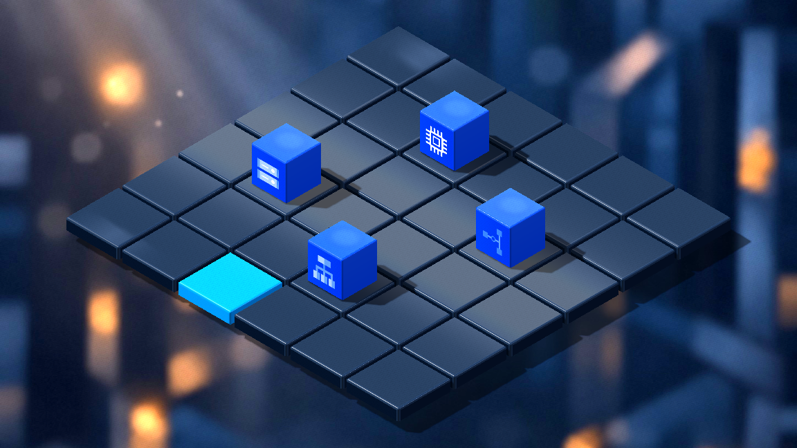
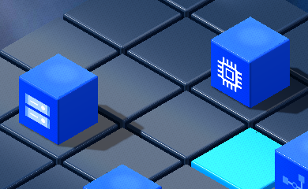

# Issue #28 / PR #29 — Complete asset publication and validation

[Issue #28](https://github.com/dexterBEN/blacksmith/issues/28) ·
[PR #29](https://github.com/dexterBEN/blacksmith/pull/29) · branch `issue_28`.

The published commit `5d26367` omitted two required PNGs: the Cloud Storage and
Cloud VPN source textures. They were missing from both its Git tree and the local
working directory; neither path was ignored by `.gitignore`. A clean export of
that exact commit reproduces Godot's missing-resource import errors. The fix
restores the original bytes from `Blacksmith_Godot_3D_Models.zip` and publishes the
supporting documentation and reproducible dependency checks.

## Focused changes

- Restore `source/cloud_storage/cloud_storage_texture.png` and
  `source/cloud_vpn/cloud_vpn_texture.png`. Both original OBJ comparisons and the
  corrected native materials need these PNGs.
- Add `check_resource_cubes.py`. It walks all 28 runtime/source dependencies,
  including OBJ `mtllib`, MTL `map_Kd`, original SVGs and rendered icon PNGs.
  `--require-tracked` also rejects dependencies absent from the Git index. The
  original published tree fails this check; the corrected candidate passes.
- Keep the shared 44-triangle beveled mesh, dimensions, materials, four service
  variants and current board appearance. No new geometry pipeline is introduced.
- Following the user's explicit choice during review, remove the three white
  adaptations. Use the original Google SVG artwork without recoloring. Godot
  rasterizes those unchanged sources at 256 pixels for sharp texture sampling;
  the original 24-pixel import was visibly blurred at the cube's screen size.
- Add an opt-in `--resource-cubes` demonstration to the existing 3D launcher.
  It attaches only static visual children in a temporary copy of the real Dart
  grid scene. The existing grid script, picking, BLoC, highlighting, scene reload
  and lifecycle tests remain active. Placement is not connected to application
  resource state, and the helper has no input handlers.

## Asset inventory and conventions

The required native assets are four `.tscn` wrappers, one shared mesh `.tres`,
one shared spatial shader, four material `.tres` files, three original Google
SVGs and their reproducible rendered PNGs, and four original OBJ/MTL/PNG triples.
Source/usage READMEs, icon provenance, the checker, launchers and native test helpers
are included. Screenshots and sanitized JSON are review evidence, not import caches.
No native Dart libraries, package caches, Python bytecode or new `.godot` caches
are added. The repository has some pre-existing tracked `.godot` files; the
isolated asset launcher does not copy or use them.

Cubes remain **1 × 1 × 1**, Y-up, with the base at Y=0 and a **0.045** bevel.
The demo uses **0.68** uniform scale and positions the base at **Y=0.12**, exactly
on the existing tile top. Their footprint fits inside its 0.93-unit flat top.
The four demo cells, `(row, column)`, are Storage `(3,1)`, Compute `(1,2)`, VPN
`(2,4)`, and Load Balancing `(4,3)`.

## Icon mapping and usage

| Service | Source icon | Classification |
| --- | --- | --- |
| Cloud Storage | `icons/official/cloud_storage.svg` | Official legacy console artwork, unchanged |
| Compute Engine | `source/compute_engine/compute_engine_texture.png` | Supplied-pack CPU symbol; not claimed as official Google artwork |
| Cloud VPN | `icons/official/cloud_vpn.svg` | Official legacy console artwork, unchanged |
| Cloud Load Balancing | `icons/official/cloud_load_balancing.svg` | Official legacy console artwork, unchanged |

Google's [icon library](https://cloud.google.com/icons) supplies these resources
for diagrams and technical documentation. The
[brand guidance](https://about.google/brand-resource-center/guidance/) and
[trademark rules](https://about.google/brand-resource-center/rules/) require
appropriate original artwork and no suggestion of affiliation or endorsement.
The download is not treated as permission to recolor or relicense the art. The
three official source hashes and rendered-image hashes are documented in
[`icons/provenance.json`](frontend/assets/models/resource_cubes/icons/provenance.json).
See the [usage notes](frontend/assets/models/resource_cubes/icons/README.md) for
ownership, the absence of a standalone ZIP license and applicable Google terms.
The previous white derivatives are removed from the current tree; history is not rewritten.

## Validation

The asset-only test uses a clean Git-exported source tree and an empty temporary
Godot project. It copies only committed resource sources, not the working tree's
untracked files, native Dart libraries or imported resources. It regenerates
icon PNGs from the original SVGs and verifies matching hashes, then imports and
renders all four corrected scenes and the original comparison assets.

The separate Dart-grid demonstration uses the established local Godot/Dart SDK
prerequisites. Its fake repository/client are fail-closed; the regression marker
asserts **repository calls=0, HTTP requests=0**, no placed resources and no pending
operations. The tests cover all 36 tile centers, gaps/outside clicks, GUI input
interception, resizing, external selection updates, reloads, subscription counts
and local fallback disposal. All four visual children survive reloads.

Recorded results and dependency hashes are in
[publication_validation.json](docs/frontend/resource_cubes_preview/publication_validation.json).
The original exact published commit is tested as a negative control, and the
fixed source tree is tested with fresh imports before publication. The final
committed tree is checked again before pushing its exact commit to the PR branch.

| Check | Result |
| --- | --- |
| Published `5d26367` negative control | Reproduced the two missing texture errors |
| Dependency graph and Git-index check | 28 dependencies pass; old-index negative control rejects unpublished files |
| Fresh asset-only import/render and icon regeneration | Both variants pass; regenerated PNG hashes match |
| Dart unit tests / analysis | 49 tests pass; no analysis issues |
| Native Godot 2D scene and local diagnostic | Pass |
| Native 3D selection/lifecycle with four cubes | Pass; 36 centers tested, no HTTP or provisioning calls |

The unchanged 2D harness's headless editor import still emits Godot 4.4
progress-dialog diagnostics on this VM, despite exit code 0 and its positive
initialization marker. Its runtime scene/diagnostic checks have no engine,
script or shader errors. The windowed fresh asset import and final 3D import/run
have no such errors or ObjectDB leak warnings. Existing UID fallback warnings
resolve through the checked-in text paths. These environment diagnostics are
recorded rather than hidden or addressed through unrelated configuration changes.

## Actual Godot captures

Four official-color service visuals with the existing selection active:



Unscaled native crop containing Storage and Compute Engine:



[Asset-only full-board capture](docs/frontend/resource_cubes_preview/corrected.png) ·
[Asset-only runtime record](docs/frontend/resource_cubes_preview/corrected.json) ·
[Selection runtime record](docs/frontend/resource_cubes_preview/active_selection/runtime.json).

## Reproduce

From the repository root:

```bash
python3 frontend/scripts/check_resource_cubes.py --require-tracked
python3 frontend/scripts/preview-resource-cubes.py --generate-icons --check --compare --output /tmp/blacksmith-assets
cd frontend/src
/usr/lib/dart/bin/dart test
/usr/lib/dart/bin/dart analyze
cd ../..
python3 frontend/scripts/test-godot.py --timeout 600
python3 frontend/scripts/run-isometric-3d.py --resource-cubes --check --timeout 600 --output /tmp/blacksmith-selection
```

The asset-only check needs Python, Godot 4.4 and the VM's X11 display. The native
Dart regressions additionally need the existing ignored Linux libraries, generated
bindings and package configuration; these development prerequisites are not asset
dependencies and are not committed. The 2D/3D tests do not start the backend.

## Scope and remaining limits

No backend, database, GCP provisioning, production BLoC, resource-placement logic,
production main scene or development-container configuration is modified. All
existing stashes, including the issue #27 internal-illumination experiment, are
preserved. No force push, history rewrite, merge, container or volume deletion is
part of this fix.

This remains a visual asset demonstration. Cube picking, placement/removal driven
by resource state, persistence and provisioning are separate work. The existing
reflection probe captures lighting cards rather than cube reflections. Runtime
observations use VirtualBox/Mesa llvmpipe software rendering; the recorded sample
was approximately 7.8 FPS over 6.53 seconds. It is not a hardware-performance
claim or a new benchmark suite. CI was not run.
